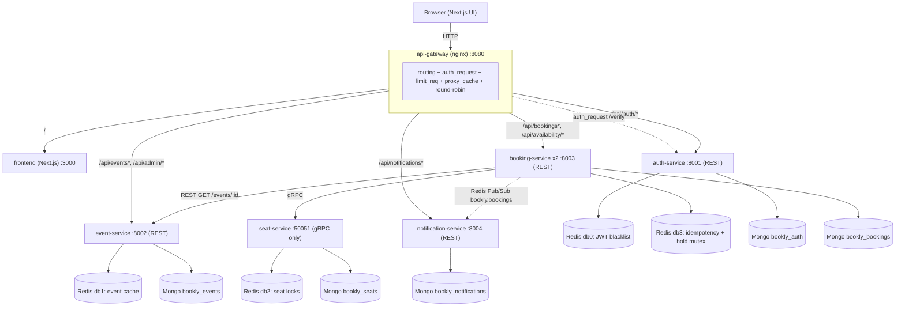
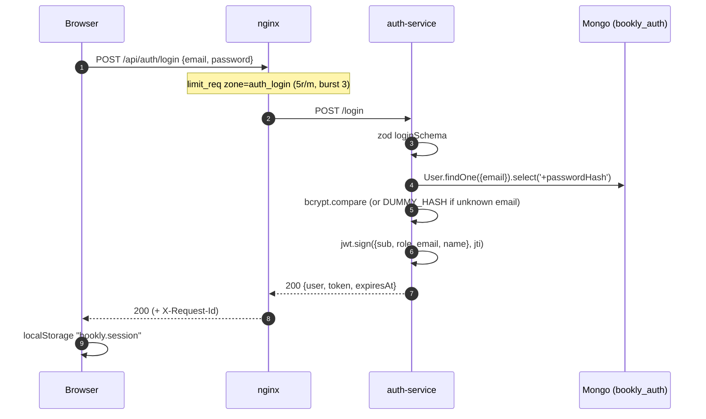
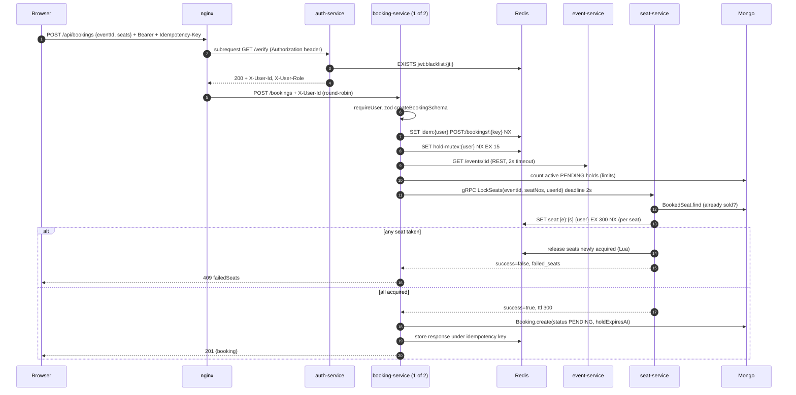
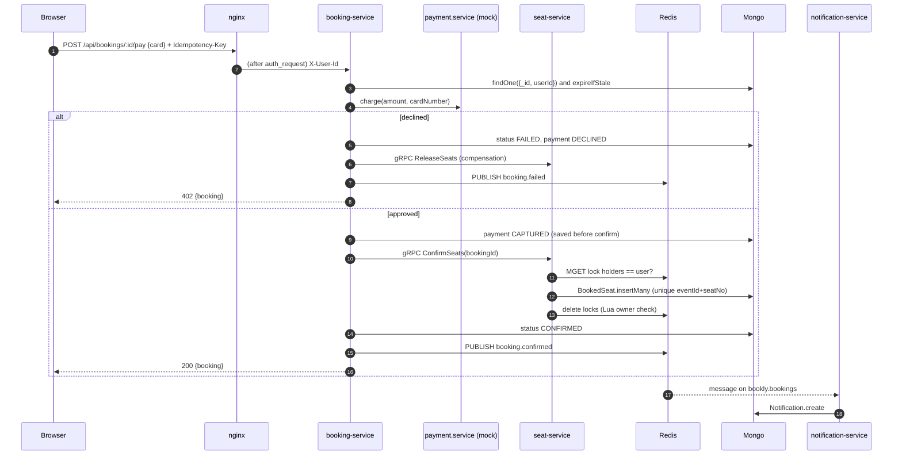
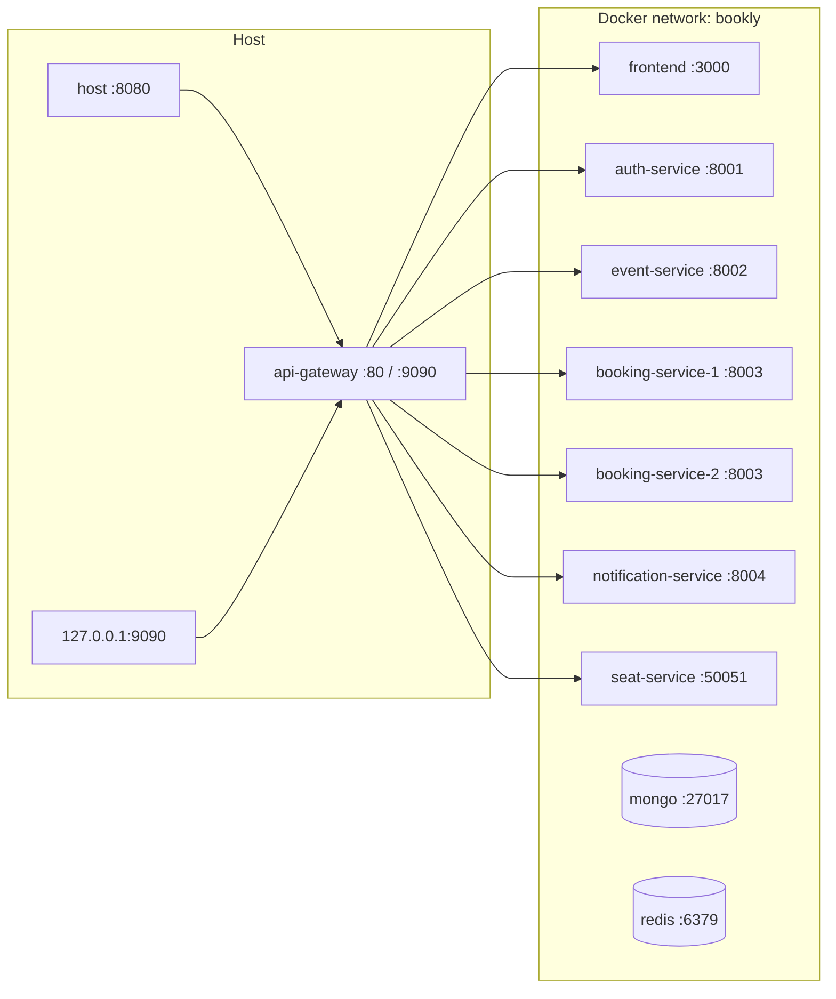
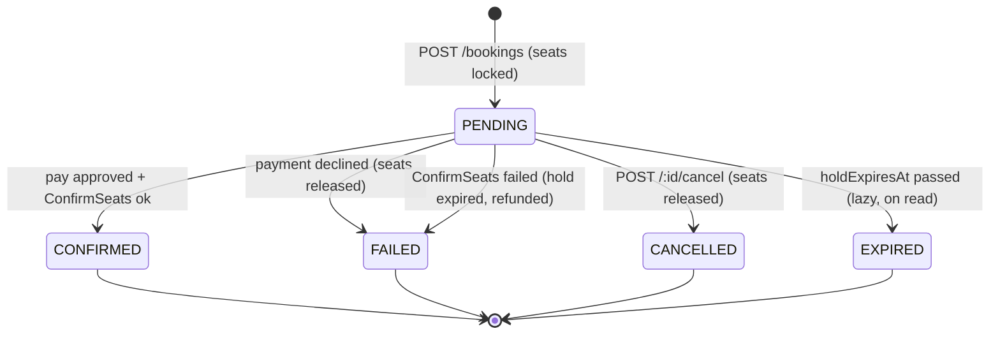
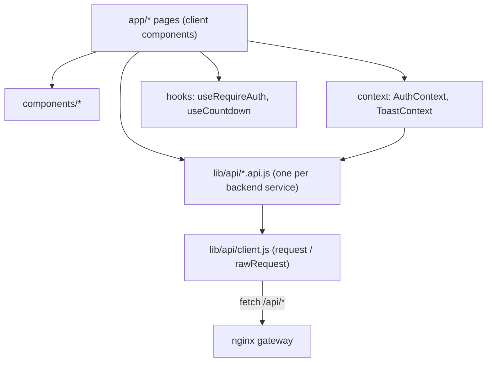

# Bookly — Interview Prep Kit

> Everything here is grounded in the code in this repository. Where something does not exist in the code, it says **NOT FOUND IN CODE**. Snippets are copied from the real files (trimmed, never invented). Speak in first person: this is your project.

---

# 0. Table of Contents

1. [Project Overview](#1-project-overview)
2. [Complete System Architecture](#2-complete-system-architecture)
3. [Backend Services](#3-backend-services)
   - [3.1 api-gateway (nginx)](#31-api-gateway-nginx)
   - [3.2 auth-service](#32-auth-service)
   - [3.3 event-service](#33-event-service)
   - [3.4 seat-service (gRPC)](#34-seat-service-grpc)
   - [3.5 booking-service](#35-booking-service)
   - [3.6 notification-service](#36-notification-service)
4. [Frontend (Next.js)](#4-frontend-nextjs)
5. [Cross-Cutting Concerns](#5-cross-cutting-concerns)
6. [End-to-End Walkthrough](#6-end-to-end-walkthrough)
7. [How to Run, Demo, and Debug](#7-how-to-run-demo-and-debug)
8. [Interview Question Bank](#8-interview-question-bank)
9. [Honest Weak-Spots Review](#9-honest-weak-spots-review)
10. [Improvement Roadmap](#10-improvement-roadmap)
11. [Cheat Sheet](#11-cheat-sheet)
12. [Glossary](#12-glossary)

**Assumptions made in this document**

- The project runs with `docker compose` on a single host. There are no Kubernetes manifests (**NOT FOUND IN CODE**).
- There is no CI pipeline (no `.github/`, no other CI config — **NOT FOUND IN CODE**).
- There are no unit or integration test files. Testing is done by two scripts: `scripts/smoke-test.js` (end-to-end, 24 checks) and `scripts/seat-race/race.js` (concurrency).
- The original design brief named PostgreSQL; the implementation uses **MongoDB**. Where the brief and the code differ, this document follows the code.

---

# 1. Project Overview

## 30-second pitch

> "Bookly is an event-ticketing system where you choose the exact seat you want on a live seat map. I built it as six small services behind an nginx gateway. The interesting part is double-booking prevention: seats are held with a Redis distributed lock that expires after five minutes, the booking service talks to the seat service over gRPC, and every write is idempotent so retries never double-charge. It runs with one `docker compose up`, two load-balanced booking replicas, and a Next.js frontend."

## 2-minute version

> "The problem is the classic ticketing race: two people click the same seat at the same moment. I wanted to solve it properly and, along the way, learn the pieces that real backends use: an API gateway, REST and gRPC side by side, Redis for more than caching, and failure handling.
>
> The browser only ever talks to **nginx**. nginx routes `/api/auth` to the **auth-service**, `/api/events` to the **event-service**, `/api/bookings` to two replicas of the **booking-service**, and `/api/notifications` to the **notification-service**. For protected routes nginx uses `auth_request` to ask the auth-service whether the JWT is valid, then forwards the user id as a header — so no other service ever parses a JWT.
>
> Booking is a two-step flow. First you **hold** seats: the booking-service calls the internal **seat-service** over gRPC, which does `SET seat:{event}:{seat} {user} NX EX 300` in Redis for each seat, all-or-nothing. Then you **pay**: a mock payment runs, and on success `ConfirmSeats` writes the sale to MongoDB, protected by a unique index. If payment fails I run a compensating `ReleaseSeats`. If the user walks away, the lock just expires.
>
> Redis does four jobs: cache-aside for events, the seat locks, a JWT blacklist for logout, and idempotency keys so a retried POST replays the original response. Booking events go out on Redis Pub/Sub, and the notification-service turns them into in-app notifications.
>
> I verified it with an end-to-end smoke test of 24 checks and a race script where 50 concurrent users fight for one seat — exactly one wins every time."

## Problem, users, features

| | |
| --- | --- |
| **Problem** | Selling reserved seats without double-booking, without losing seats to abandoned checkouts, and without double-charging on retries. |
| **Target users** | Event-goers (browse, pick seats, pay, see tickets), admins (manage the event catalog), and — as a learning artifact — developers (API explorer). |
| **Key features** | Event catalog with search/filter; live seat map; 5-minute seat holds; mock payment with decline path; confirmed tickets; "My tickets"; in-app notifications; admin CRUD for events; interactive API explorer; rate limiting; caching; load balancing. |

## Tech stack

| Layer | Technology | Why I chose it |
| --- | --- | --- |
| Gateway | nginx 1.27 (`api-gateway/`) | Battle-tested reverse proxy; has `auth_request`, `limit_req`, `proxy_cache`, upstream load balancing and `grpc_pass` built in, so cross-cutting concerns live in one place. |
| Services | Node.js 22, Express 5 | Fast to build; Express 5 forwards rejected promises from async handlers to the error middleware, so no `try/catch` wrappers are needed. |
| Service-to-service RPC | gRPC (`@grpc/grpc-js`, `@grpc/proto-loader`) | Typed contract (`proto/seat.proto`), deadlines and status codes are first-class; lets me compare it with REST in the same project. |
| Database | MongoDB 7 + Mongoose 8 | One logical database per service keeps data ownership clear; flexible schema for snapshots (booking stores a copy of event details). |
| Cache / locks / blacklist / idempotency / pub-sub | Redis 7 + ioredis | Atomic `SET NX EX` is the simplest correct distributed lock; TTLs make cleanup automatic; Pub/Sub for fire-and-forget events. |
| Validation | zod | Declarative schemas that also normalize input (trim, lower-case, coerce). |
| Auth | JWT (`jsonwebtoken`) + bcryptjs | Stateless tokens the gateway can verify via one call; bcrypt for password hashing. |
| Frontend | Next.js 15 (App Router), React 19, Tailwind CSS 4 | File-based routing, standalone Docker output, fast UI work with design tokens. |
| Packaging | Docker, Docker Compose | One command to run 10 containers with health checks and dependency ordering. |

---

# 2. Complete System Architecture

## 2.1 High-level architecture



**External APIs:** none. Payment is a mock inside booking-service (`services/booking-service/src/services/payment.service.js`).

## 2.2 Request lifecycles

### Flow A — Login



### Flow B — Hold seats (the core flow)



### Flow C — Pay and confirm (with compensation)



## 2.3 Service communication map

| Caller → Callee | Protocol | Sync/async | Why |
| --- | --- | --- | --- |
| Browser → nginx | HTTP/1.1 REST | sync | Only public entry point. |
| nginx → auth-service `/verify` | HTTP subrequest | sync | Centralized token validation (auth offloading). |
| nginx → every service | HTTP reverse proxy | sync | Routing. |
| booking → event-service `GET /events/:id` | REST (`fetch`, 2s `AbortSignal.timeout`) | sync | Needs price, layout, start time at hold time. |
| booking → seat-service | gRPC unary | sync | Seat operations are correctness-critical; typed contract and deadlines. |
| booking → notification-service | Redis Pub/Sub channel `bookly.bookings` | **async** | Booking must not wait for or depend on notifications. |
| nginx (port 9090) → seat-service | gRPC via `grpc_pass` | sync | Dev tooling only (race test), loopback-bound. |

Nobody calls booking-service except nginx; event-service is called by nginx and booking-service; seat-service is called only by booking-service (and the dev gRPC proxy).

## 2.4 Data ownership

| Data | Owner | Store | Others access it how? |
| --- | --- | --- | --- |
| Users, password hashes, roles | auth-service | Mongo `bookly_auth.users` | Only via JWT claims / `X-User-*` headers. |
| Revoked tokens | auth-service | Redis db0 `jwt:blacklist:{jti}` | Never. |
| Events (catalog, price, seat layout) | event-service | Mongo `bookly_events.events` + Redis db1 `event:{id}` | REST `GET /events/:id`. |
| Seat holds (temporary) | seat-service | Redis db2 `seat:{eventId}:{seatNo}` | gRPC only. |
| Sold seats (permanent) | seat-service | Mongo `bookly_seats.bookedseats` | gRPC `GetSeatMap`. |
| Bookings, payment outcome | booking-service | Mongo `bookly_bookings.bookings` | REST via gateway. Stores an **event snapshot** so reads never need event-service. |
| Idempotency records, hold mutex | booking-service | Redis db3 | Never. |
| Notifications | notification-service | Mongo `bookly_notifications.notifications` | REST via gateway. |

## 2.5 Deployment / runtime view



- Defined in `docker-compose.yml`. Only `api-gateway` publishes ports. Every container uses `env_file: .env`.
- Health checks: Node services `wget /health`; seat-service runs `src/healthcheck.js` (a real `GetSeatMap` gRPC round-trip); Mongo `mongosh ping`; Redis `redis-cli ping`.
- `depends_on: condition: service_healthy` orders startup: infra → services → gateway.
- `booking-service` has `deploy.replicas: ${BOOKING_REPLICAS}` (2).
- Volumes: `mongo-data`, `redis-data` (Redis runs with `--appendonly yes`).

## 2.6 Architecture decisions

| Decision | Alternatives | Why I chose this | Trade-offs |
| --- | --- | --- | --- |
| nginx as gateway with `auth_request` | Kong, Express gateway, each service verifies JWT | Auth logic in one place; services stay tiny; logout (blacklist) is enforced everywhere instantly. | Every protected request costs one extra internal HTTP call; services must never be exposed directly. |
| Redis `SET NX EX` seat locks | DB row locks (`SELECT … FOR UPDATE`), optimistic versioning, Redlock | Atomic, O(1), TTL gives automatic expiry of abandoned holds. | Single Redis is a SPOF; on Redis failover locks can be lost (mitigated by Mongo unique index at confirm time). |
| gRPC for booking → seat | REST | Typed contract, deadlines, status codes; learning comparison. | Browsers can't call it → needed a REST facade (`/availability`). |
| Two-step hold → pay | Single "book now" call | Makes the 5-min TTL meaningful; mirrors real ticketing UX. | More states to manage (`PENDING`, `EXPIRED`). |
| Saga-style compensation | 2PC / distributed transactions | No distributed transaction manager needed; each step has an explicit undo (`ReleaseSeats`). | Eventual consistency; must reason about every failure point. |
| Redis Pub/Sub for notifications | RabbitMQ, Kafka, Redis Streams | Zero extra infrastructure; decouples booking from notifications. | At-most-once delivery: messages are lost if the subscriber is down. |
| One Mongo DB + Redis index per service | Shared database | Clear ownership, independent evolution. | Cross-service queries are impossible by design; needed snapshots. |
| No shared library (copied `ApiError`, `logger`) | Shared npm package | Services deploy independently, no lockstep upgrades. | Small duplication across services. |
| Event snapshot inside booking | Join to event-service on read | Booking reads never depend on event-service availability. | Snapshot can go stale if an event is edited. |
| Idempotency keys in Redis | DB unique constraint on client key | Works across both replicas; replays exact original response. | Extra Redis round trips; small race window (see weak spots). |

---

# 3. Backend Services

Every Node service follows the same MVC layout, so once you can explain one you can explain all of them:

| Folder | Role | Teaching note |
| --- | --- | --- |
| `src/server.js` | Bootstrap: connect DB/Redis, start listening, graceful shutdown on `SIGTERM`/`SIGINT`. | Separating bootstrap from `app.js` means the Express app could be imported in tests without opening ports. |
| `src/app.js` | Express app: `helmet`, JSON body parser (100 kb limit), `morgan` logging, routes, 404 + error handler. | Middleware order matters: parsers before routes, error handler last. |
| `src/config/` | `index.js` reads env (from the root `.env` via dotenv), `database.js`, `redis.js`. | Fail-fast: `required(name)` throws at startup if a variable is missing. |
| `src/models/` | Mongoose schemas — the **M**. | |
| `src/routes/` | URL → middleware chain → controller. | Routing is declarative and readable in one file. |
| `src/controllers/` | Thin HTTP adapters — the **C**. They call services and shape responses. | Controllers never contain business rules. |
| `src/services/` | Business logic. | The part you'd unit test. |
| `src/middlewares/` | Validation, identity, idempotency, errors. | |
| `src/validators/` | zod schemas. | |
| `src/utils/` | `ApiError`, `logger`. | |

The **V** of MVC is the JSON response; the visual layer lives entirely in `frontend/`.

---

## 3.1 api-gateway (nginx)

### Purpose
The single public entry point. It owns **routing, authentication offloading, rate limiting, response caching, load balancing, JSON error pages and the dev gRPC proxy**. No business logic.

### Folder structure

```text
api-gateway/
├── Dockerfile                       # nginx:1.27-alpine; copies templates + snippets
├── templates/default.conf.template  # the whole config, rendered with envsubst at start
└── snippets/
    ├── proxy-common.conf            # headers/timeouts included by every proxied location
    └── auth-required.conf           # auth_request + auth_request_set
```

### Tech
nginx 1.27. The official image renders every file in `/etc/nginx/templates/*.template` with `envsubst` into `/etc/nginx/conf.d/`, substituting **only variables that exist in the environment**. That's why `${AUTH_SERVICE_PORT}` is replaced from `.env` while nginx's own `$request_id` is left alone.

### Database
None. It has an on-disk cache: `proxy_cache_path /var/cache/nginx/events … keys_zone=events_cache:10m`.

### Routing table (from `templates/default.conf.template`)

| Location | Upstream | Auth | Extras |
| --- | --- | --- | --- |
| `= /_auth_verify` (internal) | `auth_service/verify` | — | body stripped |
| `~* ^/api/auth/+(login\|register)/*$` | `auth_service/$1` | public | `limit_req zone=auth_login` |
| `/api/auth/` | `auth_service/` | public (service checks itself) | |
| `/api/events` | `event_service/events` | public | `limit_except GET HEAD { deny all; }`, `proxy_cache` |
| `/api/admin/` | `event_service/admin/` | JWT | role checked by event-service |
| `/api/bookings` | `booking_service/bookings` | JWT | `limit_req zone=api_general`, `X-Upstream-Addr` |
| `/api/availability/` | `booking_service/availability/` | public | `limit_req`, never cached |
| `/api/notifications` | `notification_service/notifications` | JWT | |
| `= /api/health` | — | public | returns JSON directly |
| `/api/` | — | — | JSON 404 for unknown API paths |
| `/_next/static/` | `frontend` | public | `Cache-Control: immutable` |
| `/` | `frontend` | public | |
| `server :9090` `/` | `grpc_pass seat_service_grpc` | none | HTTP/2, loopback only |

### Core logic walkthrough

**1. Auth offloading.** `snippets/auth-required.conf`:

```nginx
auth_request /_auth_verify;                                   # subrequest before proxying
auth_request_set $bookly_user_id $upstream_http_x_user_id;    # copy header from /verify response
auth_request_set $bookly_user_role $upstream_http_x_user_role;
```

- `auth_request` sends a subrequest; a 2xx lets the request through, 401/403 is returned to the client, anything else becomes 500.
- `$upstream_http_x_user_id` is how nginx reads a response header named `X-User-Id` from the subrequest.

**2. Identity header anti-spoofing.** In the `server` block:

```nginx
set $bookly_user_id "";
set $bookly_user_role "";
```

and in `snippets/proxy-common.conf`:

```nginx
proxy_set_header X-User-Id $bookly_user_id;
proxy_set_header X-User-Role $bookly_user_role;
```

On public routes the variables stay empty, so a client that sends its own `X-User-Id: someone-else` has it **overwritten with an empty value**. Only `auth_request` can fill it. This is why downstream services may trust the header.

> Teaching point: nginx does **not** merge `proxy_set_header` from the server block into a location that defines its own. That's why the headers live in a snippet `include`d by every location instead of being set once at server level.

**3. Rate limiting.**

```nginx
limit_req_zone $binary_remote_addr zone=auth_login:10m rate=${LOGIN_RATE_LIMIT};   # 5r/m
location ~* ^/api/auth/+(login|register)/*$ {
    limit_req zone=auth_login burst=${LOGIN_RATE_BURST} nodelay;                     # burst 3
    proxy_pass http://auth_service/$1;
}
```

Token-bucket per client IP. The regex is case-insensitive and tolerates extra slashes, because Express would otherwise also match `/LOGIN/` and an exact-match location could be bypassed (this was a real bug found by a security review and fixed).

**4. Response caching.**

```nginx
location /api/events {
    limit_except GET HEAD { deny all; }
    proxy_cache events_cache;
    proxy_cache_key $request_method$request_uri;
    proxy_cache_valid 200 ${GATEWAY_EVENTS_CACHE_SECONDS}s;   # 15s
    proxy_cache_lock on;                                       # one upstream fetch per key at a time
    proxy_cache_use_stale error timeout updating http_500 http_502 http_503 http_504;
    proxy_cache_background_update on;
    add_header X-Gateway-Cache $upstream_cache_status always;
    ...
}
```

- `proxy_cache_lock` prevents a **cache stampede** (many simultaneous misses all hitting the backend).
- `use_stale … updating` + `background_update` = stale-while-revalidate: users get the old copy while one request refreshes it.

**5. Load balancing.**

```nginx
upstream booking_service {
    zone booking_service 64k;     # round-robin state shared by ALL nginx worker processes
    server booking-service:${BOOKING_SERVICE_PORT} max_fails=3 fail_timeout=10s;
    keepalive 16;
}
```

Docker's DNS returns one A-record per replica for `booking-service`; nginx adds each as an upstream server and round-robins. `max_fails/fail_timeout` is passive health checking. `keepalive 16` reuses TCP connections (requires `proxy_http_version 1.1` and `Connection ""`, both in the snippet).

> Why `zone`? nginx runs one worker process per CPU. Without a shared-memory zone, **each worker keeps its own round-robin counter**, and every worker's first pick is the same server. Ten requests on fresh connections landed on ten different workers and all went to replica 1. My smoke test didn't catch it because Node's `fetch` reuses one keep-alive connection (one worker), which alternated correctly. With the zone: an even 5/5 split, and 3/3/3 after scaling to three replicas.

**6. Uniform JSON errors.**

```nginx
error_page 401 = @unauthorized;
error_page 429 = @rate_limited;
error_page 500 502 503 504 = @upstream_unavailable;
```

These only apply to responses **generated by nginx** (auth failure, rate limit, dead upstream). Upstream error bodies pass through untouched because `proxy_intercept_errors` is off.

### Auth / validation
Validation: none (by design). Auth: delegated to auth-service via `auth_request`.

### Inter-service communication & failure handling
- `proxy_connect_timeout 3s`, `proxy_read_timeout 15s` (in `proxy-common.conf`).
- Dead upstream → JSON 503 via `@upstream_unavailable`.
- `proxy_next_upstream` is the default (`error timeout`), which **does not retry non-idempotent requests** like POST — correct for bookings.

### Error handling, logging, config
- Logging: nginx default access/error logs (stdout in the container). `X-Request-Id` (`$request_id`) is generated and returned on every response, and forwarded upstream — but services don't log it yet (see weak spots).
- Config: everything comes from `.env` via templating.

### Testing
Exercised end-to-end by `scripts/smoke-test.js` (401 without token, revoked token rejected, load balancing across 2 replicas) and manually (429 on login). No nginx config tests (`nginx -t` runs implicitly at startup).

### How I built it (narration)
1. Started with one upstream (auth) and the `auth_request` subrequest, verified `X-User-Id` reached the service.
2. Added the login rate limit and JSON error pages.
3. Added event-service with `proxy_cache` and the `X-Gateway-Cache` header so I could see HITs.
4. Added the booking upstream with replicas, then the notifications route and the frontend at `/`.
5. Added the separate HTTP/2 server for `grpc_pass` to run the race test from my laptop.
6. Fixed the rate-limit bypass after a security review (regex location + strict routing in auth-service).

### Challenges (suggested talking points)
- **`proxy_set_header` inheritance** — headers silently disappeared in locations that set their own; solved with an include snippet.
- **Variables referenced before being defined** — `$bookly_user_id` only exists if some location uses `auth_request_set`; solved by `set` defaults at server level plus `uninitialized_variable_warn off`.
- **Rate-limit bypass via path variants** — solved with a case-insensitive regex.
- **Load balancing that only looked like it worked** — new connections all hit one replica because each worker process had its own round-robin counter; found with `curl` in a loop, fixed with `zone booking_service 64k`.

### Limitations / improvements
- Upstream DNS is resolved **once at startup**: after `docker compose up --scale booking-service=3` you must restart the gateway (or use a `resolver` + variable-based `proxy_pass`, or nginx Plus/`zone … resolve`).
- No TLS. No purge for `proxy_cache` (OSS nginx).
- Rate limiting by IP is unfair behind NAT; per-user limits would need the user id (available after `auth_request`).
- No access-log format with upstream timings and request id.

### 10 Q&A — api-gateway

**Q1: Why validate JWTs in the gateway instead of each service?**
**Short answer:** One place for auth logic, one place to enforce logout, and services stay small and language-agnostic.
**Deep answer:** `auth-required.conf` calls auth-service `/verify`, which checks signature, expiry and the Redis blacklist (`token.service.js#verify`). Services just read `X-User-Id` (`requireUser.js`). If I changed the token format, only auth-service changes.
**Follow-up traps:** "Isn't that an extra network hop per request?" — Yes, ~1 ms on the Docker network; at scale I'd cache `/verify` results for a few seconds keyed by the token, accepting that logout takes that long to propagate.

**Q2: How do you stop a client spoofing `X-User-Id`?**
**Short answer:** Public routes overwrite it with an empty value; only `auth_request` can set it; services aren't publicly reachable.
**Deep answer:** `set $bookly_user_id ""` at server level and `proxy_set_header X-User-Id $bookly_user_id` in every location. Only `api-gateway` publishes ports in `docker-compose.yml`.
**Follow-up traps:** "What if someone gets onto the Docker network?" — Then they can impersonate anyone; production fix is mTLS between gateway and services or re-verifying a signed internal token.

**Q3: What does `proxy_cache_lock` do?**
**Short answer:** On a cache miss, only one request goes to the backend; the others wait for it.
**Deep answer:** Prevents thundering herd when a popular `/api/events` entry expires. Combined with `proxy_cache_use_stale updating`, users get the stale copy while it refreshes.
**Follow-up traps:** "What's the cost?" — Waiting requests see added latency up to `proxy_cache_lock_timeout` (default 5s).

**Q4: How does load balancing work with Docker replicas?**
**Short answer:** The service name resolves to all replica IPs; nginx round-robins them.
**Deep answer:** `upstream booking_service { zone booking_service 64k; server booking-service:8003 max_fails=3 fail_timeout=10s; }`. The `zone` shares the round-robin counter across nginx worker processes. The smoke test fires 8 requests and asserts `X-Served-By` shows 2 distinct replicas; a `curl` loop shows an even split.
**Follow-up traps:** "What happens if you scale to 3?" — nginx resolved DNS at startup, so it won't see the third until restarted (`docker compose restart api-gateway`, verified 3/3/3). The fix without restarts is a `resolver` + dynamic resolution. "Why did you need `zone`?" — see the worker-process explanation above; it's a real bug I found.

**Q5: Why is login rate-limited with a regex location?**
**Short answer:** So `/api/auth/LOGIN/` can't bypass an exact-match limiter.
**Deep answer:** Express matched case-insensitively and with trailing slashes by default; I also set `case sensitive routing` and `strict routing` in `auth-service/src/app.js`. Defense in depth.
**Follow-up traps:** "Is 5/min per IP enough against credential stuffing?" — No; add per-account lockout/backoff and CAPTCHA.

**Q6: Would nginx retry a failed `POST /api/bookings` on the other replica?**
**Short answer:** No — `proxy_next_upstream` doesn't retry non-idempotent methods unless `non_idempotent` is set.
**Deep answer:** That's desirable; the client retries with the same `Idempotency-Key` instead, which is safe.
**Follow-up traps:** "And GET?" — GETs are retried on `error`/`timeout`.

**Q7: Why `limit_except GET HEAD { deny all; }` on `/api/events`?**
**Short answer:** Writes must go through `/api/admin/`, which is authenticated.
**Deep answer:** Without it, a `POST /api/events` would reach event-service unauthenticated (it would 404, but closing the door at the edge is cleaner).
**Follow-up traps:** "Then how do admins write?" — `/api/admin/events` with `auth-required.conf`; event-service's `requireAdmin` checks `X-User-Role`.

**Q8: Why is the gRPC proxy bound to 127.0.0.1?**
**Short answer:** seat-service must stay internal; the proxy is only for local tooling.
**Deep answer:** `"127.0.0.1:${GRPC_GATEWAY_PORT}:9090"` in compose; it has no auth because seat-service trusts its callers.
**Follow-up traps:** "How would you expose gRPC publicly?" — TLS, auth via metadata, or grpc-web for browsers.

**Q9: How is the config parameterized?**
**Short answer:** It's a template rendered with `envsubst` from the root `.env` at container start.
**Deep answer:** Only defined env vars are substituted, so nginx's own `$variables` survive.
**Follow-up traps:** "Danger?" — If an env var happened to be named like an nginx variable (e.g. `host`), it would be substituted. Naming convention avoids it.

**Q10: What would you change for production?**
**Short answer:** TLS, dynamic DNS resolution, per-user rate limits, structured access logs, health-checked upstreams.
**Deep answer:** Or replace with a managed gateway / Kubernetes Ingress + service mesh for mTLS.
**Follow-up traps:** "Why not just use Kong/Envoy from the start?" — Learning goal: understand each mechanism directly.

---

## 3.2 auth-service

### Purpose
Owns identity: registration, login, issuing JWTs, verifying tokens for the gateway, logout via a blacklist, and bootstrapping the admin account.

### Folder structure

```text
services/auth-service/src/
├── server.js                    # connect Mongo, ensureAdminUser(), listen, graceful shutdown
├── app.js                       # helmet, json, morgan; case-sensitive + strict routing
├── config/index.js              # AUTH_SERVICE_PORT, AUTH_DB_NAME, AUTH_REDIS_URL, JWT_*, ADMIN_*
├── config/database.js           # mongoose.connect(uri, { dbName })
├── config/redis.js              # ioredis client
├── models/user.model.js         # User schema, comparePassword, hashPassword
├── validators/auth.validators.js# registerSchema, loginSchema (zod)
├── middlewares/authenticate.js  # Bearer → tokenService.verify → req.auth
├── middlewares/validate.js
├── middlewares/errorHandler.js  # notFound + errorHandler
├── services/token.service.js    # issue / verify / revoke
├── services/auth.service.js     # register / login / getProfile / ensureAdminUser
├── controllers/auth.controller.js
├── routes/auth.routes.js
├── routes/index.js              # /health + auth routes
└── utils/ApiError.js, logger.js
```

### Tech / libraries
Express 5, Mongoose 8, ioredis, jsonwebtoken, bcryptjs, zod, helmet, morgan.

### Database
`users` collection in `bookly_auth` (`models/user.model.js`):

| Field | Type | Notes |
| --- | --- | --- |
| `name` | String | required, trimmed |
| `email` | String | required, **unique index**, lowercased |
| `passwordHash` | String | `select: false` — never returned unless explicitly selected |
| `role` | `'user' \| 'admin'` | default `user` |
| `createdAt/updatedAt` | Date | `timestamps: true` |

`toJSON` transform maps `_id` → `id` and deletes `passwordHash`. Migrations: **NOT FOUND IN CODE** (Mongoose creates indexes on startup).

Redis db0: `jwt:blacklist:{jti}` → `"1"` with TTL.

### API reference (as seen by the browser through `/api/auth`)

| Method | Endpoint | Auth | Request | Response | Status codes |
| --- | --- | --- | --- | --- | --- |
| POST | `/api/auth/register` | public, rate-limited | `{ name, email, password }` | `{ user, token, expiresAt }` | 201, 400, 409, 429 |
| POST | `/api/auth/login` | public, rate-limited | `{ email, password }` | `{ user, token, expiresAt }` | 200, 400, 401, 429 |
| GET | `/api/auth/me` | Bearer (checked by the service) | — | `{ user }` | 200, 401, 404 |
| GET | `/api/auth/verify` | Bearer | — | `{ valid, userId, role, expiresAt }` + headers `X-User-Id`, `X-User-Role`, `X-User-Email` | 200, 401 |
| POST | `/api/auth/logout` | Bearer | — | `{ message, revokedForSeconds }` | 200, 401 |
| GET | `/health` (internal) | — | — | `{ service, status }` | 200, 503 |

### Core logic

**Issuing a token** (`services/token.service.js`):

```js
function issue(user) {
  const jti = crypto.randomUUID();                       // unique token id → lets us revoke ONE token
  const token = jwt.sign(
    { sub: user.id, role: user.role, email: user.email, name: user.name },
    config.jwt.secret,
    { expiresIn: config.jwt.expiresIn, jwtid: jti },     // HS256, default 1h
  );
  const { exp } = jwt.decode(token);
  return { token, expiresAt: new Date(exp * 1000).toISOString() };
}
```

**Verifying** — signature + expiry, then the blacklist:

```js
async function verify(token) {
  let claims;
  try {
    claims = jwt.verify(token, config.jwt.secret);
  } catch (err) {
    throw ApiError.unauthorized(err.name === 'TokenExpiredError' ? 'Token expired' : 'Invalid token');
  }
  if (await redis.exists(blacklistKey(claims.jti))) {
    throw ApiError.unauthorized('Token has been revoked');
  }
  return claims;
}
```

**Revoking (logout)** — blacklist only as long as the token would otherwise be valid, so Redis never fills up with dead entries:

```js
async function revoke(claims) {
  const ttl = claims.exp - Math.floor(Date.now() / 1000);
  if (ttl > 0) await redis.set(blacklistKey(claims.jti), '1', 'EX', ttl);
  return Math.max(ttl, 0);
}
```

**Login with timing equalization** (`services/auth.service.js`):

```js
// Compared against when the email is unknown, so response time does not reveal which accounts exist.
const DUMMY_HASH = bcrypt.hashSync('timing-equalizer', config.bcryptRounds);

async function login({ email, password }) {
  const user = await User.findOne({ email }).select('+passwordHash');
  const valid = user
    ? await user.comparePassword(password)
    : await bcrypt.compare(password, DUMMY_HASH).then(() => false);
  if (!valid) throw ApiError.unauthorized('Invalid email or password');
  return { user: user.toJSON(), ...tokenService.issue(user) };
}
```

Without the dummy compare, unknown emails return in ~1 ms and known emails in ~70 ms (bcrypt), leaking which accounts exist.

**The gateway contract** (`controllers/auth.controller.js#verify`):

```js
res.set({ 'X-User-Id': req.auth.sub, 'X-User-Role': req.auth.role, 'X-User-Email': req.auth.email });
```

**Admin bootstrap** (`auth.service.js#ensureAdminUser`): on startup, if `ADMIN_EMAIL`/`ADMIN_PASSWORD` are set and no such user exists, create it with `role: 'admin'`.

### Auth & validation
- `middlewares/authenticate.js` extracts `Bearer <token>`; Express 5 forwards the async rejection to the error handler.
- zod: `registerSchema` (name 2–60, valid email lowercased, password 8–72 — 72 because bcrypt ignores bytes beyond 72) and `loginSchema`.
- `app.set('case sensitive routing', true); app.set('strict routing', true);` — routes match exactly what the gateway rate-limits.

### Inter-service communication
- Called by nginx (`/_auth_verify` subrequest) on every protected request, and directly via `/api/auth/*`.
- Calls nothing else. If auth-service is down, every protected route fails (nginx turns the failed subrequest into 500 → JSON 503 page). It's a critical dependency.

### Errors, logging, config
- `ApiError` with static helpers (`badRequest`, `unauthorized`, `conflict`, …). `errorHandler` returns `{ error: { status, message, details? } }` and hides messages for 5xx.
- `logger.js`: timestamp + `[auth-service]` + level to stdout. `morgan` logs requests (skips `/health`).
- `config/index.js` throws on missing `MONGO_URI`, `AUTH_REDIS_URL`, `JWT_SECRET`.

### Testing
Unit tests: **NOT FOUND IN CODE**. Covered by `scripts/smoke-test.js`: register (201 + token), `/auth/me`, 401 without token, logout, revoked token rejected at the gateway.

### How I built it
1. Model + bcrypt hashing with `select: false` on the hash.
2. `token.service` with `jti` so individual tokens can be revoked.
3. `/verify` returning identity as response headers for nginx.
4. Blacklist with TTL = remaining lifetime.
5. Admin bootstrap from env.
6. After the security review: timing-equalized login and strict routing.

### Challenges (suggested talking points)
- Making logout real with stateless JWTs → `jti` + Redis blacklist.
- User enumeration through response timing → dummy bcrypt compare.
- Rate-limit bypass via path variants → strict routing + gateway regex.

### Limitations / improvements
- Registration still reveals "email already exists" (409) — inherent to a signup form; mitigated by rate limiting. Could send a verification email instead.
- No refresh tokens; 1-hour access token. No password reset, email verification, MFA, or account lockout (**NOT FOUND IN CODE**).
- HS256 shared secret: anyone with `JWT_SECRET` can mint tokens. RS256 with a JWKS endpoint would let services verify without the secret.
- Admin password has a default in `.env.example`.

### 10 Q&A — auth-service

**Q1: JWTs are stateless — how does your logout work?**
**Short answer:** Every token has a `jti`; logout stores `jwt:blacklist:{jti}` in Redis with TTL equal to the token's remaining life; `/verify` rejects blacklisted ids.
**Deep answer:** `token.service.js#revoke`. Because the gateway calls `/verify` on every protected request, revocation is effective immediately everywhere.
**Follow-up traps:** "So it's not stateless anymore?" — Correct; it's a deliberate hybrid. The state is tiny and self-expiring.

**Q2: Why `select: false` on `passwordHash`?**
**Short answer:** So no query returns the hash by accident.
**Deep answer:** Only `login` opts in with `.select('+passwordHash')`. `toJSON` also deletes it as a second guard.
**Follow-up traps:** "Is bcrypt still OK?" — Yes with a cost of 10+; argon2id is the modern recommendation.

**Q3: What's in your JWT and why?**
**Short answer:** `sub` (user id), `role`, `email`, `name`, `jti`, `exp`, `iat`.
**Deep answer:** `role` lets the gateway forward `X-User-Role` without a DB lookup; `name` lets the UI greet the user.
**Follow-up traps:** "What if a user's role changes?" — The old token keeps the old role until it expires (≤1h). Fix: short-lived tokens + refresh, or revoke on role change.

**Q4: How do you prevent user enumeration?**
**Short answer:** Same error message for unknown email and wrong password, plus a dummy bcrypt compare to equalize timing.
**Deep answer:** `DUMMY_HASH` in `auth.service.js`.
**Follow-up traps:** "Registration leaks it though." — Yes, 409 on duplicate email; mitigated by rate limiting; the alternative is "check your email" flows.

**Q5: Why does `/verify` return headers rather than a body?**
**Short answer:** nginx's `auth_request_set` can only read response headers/variables from the subrequest.
**Deep answer:** `$upstream_http_x_user_id` maps to the `X-User-Id` response header.
**Follow-up traps:** "Does the body matter?" — Not to nginx; it's useful for humans in the API explorer.

**Q6: Why limit passwords to 72 characters?**
**Short answer:** bcrypt only uses the first 72 bytes.
**Deep answer:** Longer passwords would silently be truncated, so I reject them explicitly in `registerSchema`.
**Follow-up traps:** "Multi-byte characters?" — The limit is bytes, so a 72-character emoji password could still exceed it; a byte-length check would be stricter.

**Q7: What happens if Redis is down?**
**Short answer:** `/verify` throws → every protected route fails closed.
**Deep answer:** `redis.exists` rejects; Express 5 forwards to `errorHandler` → 500; nginx turns the failed `auth_request` into an error.
**Follow-up traps:** "Fail open instead?" — No; failing open would let revoked tokens through. A short in-memory cache of the blacklist could add resilience.

**Q8: How is the admin created?**
**Short answer:** `ensureAdminUser()` on startup from `ADMIN_*` env vars, only if it doesn't exist.
**Deep answer:** Idempotent; changing `ADMIN_PASSWORD` later does **not** update an existing admin.
**Follow-up traps:** "Is a default admin password a risk?" — Yes; README warns; production would require it with no default.

**Q9: Why strict and case-sensitive routing?**
**Short answer:** So the service only answers to the exact paths the gateway protects.
**Deep answer:** Fixes a rate-limit bypass where `/LOGIN/` reached `/login`.
**Follow-up traps:** "Is the gateway fix alone enough?" — It is, but defense in depth costs nothing here.

**Q10: How would you scale auth?**
**Short answer:** It's stateless apart from Mongo/Redis, so add replicas; cache `/verify` at the gateway briefly; move to asymmetric keys so services can verify locally.
**Deep answer:** RS256 + JWKS removes the per-request hop entirely; keep a revocation list pushed via pub/sub.
**Follow-up traps:** "Then how is logout immediate?" — Short token TTL + revocation list distribution.

---

## 3.3 event-service

### Purpose
Owns the event catalog: listing, search, filtering, event detail with Redis cache-aside, categories, and admin create/update/delete. Seeds sample data on first start.

### Folder structure

```text
services/event-service/src/
├── server.js                       # connect Mongo, seedEvents() if SEED_EVENTS=true, listen
├── app.js
├── config/index.js                 # EVENT_SERVICE_PORT, EVENT_DB_NAME, EVENT_REDIS_URL, EVENT_CACHE_TTL_SECONDS, SEED_EVENTS
├── models/event.model.js           # Event schema, CATEGORIES, capacity virtual, indexes
├── validators/event.validators.js  # createEventSchema, updateEventSchema, listEventsQuery
├── middlewares/requireAdmin.js     # trusts X-User-Id / X-User-Role from the gateway
├── middlewares/validate.js         # body or query (query → req.validatedQuery)
├── services/cache.service.js       # getJSON / setJSON / del — never throws
├── services/event.service.js       # list, getById (cache-aside), create, update, remove
├── controllers/event.controller.js # public
├── controllers/admin.controller.js # admin
├── routes/event.routes.js          # GET /events, /events/categories, /events/:id
├── routes/admin.routes.js          # POST/PATCH/DELETE /admin/events
├── routes/index.js
└── seed/events.seed.js             # 8 sample events dated relative to "now"
```

### Database
`events` in `bookly_events`:

| Field | Type | Notes |
| --- | --- | --- |
| `title`, `description`, `venue`, `city` | String | trimmed |
| `category` | enum `Concert, Comedy, Theatre, Sports, Conference, Festival` | |
| `startsAt` | Date | **index** `{ startsAt: 1 }` (sort + "upcoming" filter) |
| `price` | Number ≥ 0 | |
| `currency` | String | default `INR` |
| `imageUrl` | String | optional |
| `layout.rows` (1–26), `layout.seatsPerRow` (1–40) | Number | seat ids are `A1`…`Z40` |
| `createdBy` | String | admin user id or `seed` |
| virtual `capacity` | `rows × seatsPerRow` | included via `toJSON: { virtuals: true }` |

There's also a **text index** on title/venue/city/description, but the search actually uses a case-insensitive regex (see weak spots). Redis db1: `event:{id}` → JSON with TTL `EVENT_CACHE_TTL_SECONDS` (60).

### API reference

| Method | Endpoint (browser) | Auth | Request | Response | Status |
| --- | --- | --- | --- | --- | --- |
| GET | `/api/events` | public (nginx-cached 15s) | query `q, category, city, upcoming=true, page=1, limit=12 (≤50)` | `{ data: Event[], pagination: { page, limit, total, pages } }` | 200, 400 |
| GET | `/api/events/categories` | public | — | `{ categories }` | 200 |
| GET | `/api/events/:id` | public | — | `{ event }` + `X-Cache: HIT\|MISS` | 200, 404 |
| POST | `/api/admin/events` | admin | full event body | `{ event }` | 201, 400, 401, 403 |
| PATCH | `/api/admin/events/:id` | admin | partial body (≥1 field) | `{ event }` | 200, 400, 401, 403, 404 |
| DELETE | `/api/admin/events/:id` | admin | — | empty | 204, 401, 403, 404 |

### Core logic

**Cache-aside** (`services/event.service.js#getById`):

```js
async function getById(id) {
  if (!isValidObjectId(id)) throw ApiError.notFound('Event not found');   // bad ids never hit Mongo

  const cached = await cache.getJSON(cacheKey(id));                      // 1. try Redis
  if (cached) return { event: cached, cache: 'HIT' };

  const event = await Event.findById(id);                                // 2. miss → Mongo
  if (!event) throw ApiError.notFound('Event not found');

  const json = event.toJSON();
  await cache.setJSON(cacheKey(id), json, config.cacheTtlSeconds);       // 3. populate with TTL
  return { event: json, cache: 'MISS' };
}
```

The controller turns `cache` into the `X-Cache` response header — so in the API explorer you can watch three layers: `X-Gateway-Cache` (nginx) → `X-Cache` (Redis) → Mongo.

**Cache failures never break reads** (`services/cache.service.js`):

```js
async function getJSON(key) {
  try {
    const raw = await redis.get(key);
    return raw ? JSON.parse(raw) : null;
  } catch (err) {
    logger.warn(`cache get failed for ${key}: ${err.message}`);
    return null;                       // degrade to the database
  }
}
```

**Invalidation on write**:

```js
async function update(id, data) {
  ...
  const event = await Event.findByIdAndUpdate(id, data, { new: true, runValidators: true });
  if (!event) throw ApiError.notFound('Event not found');
  await cache.del(cacheKey(id));       // delete, don't update: next read repopulates
  return event.toJSON();
}
```

**Search** — user input is regex-escaped before building a pattern (prevents ReDoS / regex injection):

```js
function escapeRegex(text) {
  return text.replace(/[.*+?^${}()|[\]\\]/g, '\\$&');
}
...
if (q) {
  const pattern = new RegExp(escapeRegex(q), 'i');
  filter.$or = [{ title: pattern }, { venue: pattern }, { city: pattern }, { description: pattern }];
}
```

### Auth & validation
- `requireAdmin.js`: 401 if no `X-User-Id`, 403 if `X-User-Role !== 'admin'`. Trust comes from the gateway.
- zod validators coerce strings to numbers/dates (`z.coerce`), enforce `startsAt` in the future, `layout.rows` 1–26 (letters A–Z), `currency` 3 letters upper-cased.
- `validate(schema, 'query')` writes to `req.validatedQuery` because `req.query` is a read-only getter in Express 5.

### Inter-service communication
- Called by nginx (public + admin) and by booking-service (`GET /events/:id`, internal URL `EVENT_SERVICE_URL`).
- Calls nothing. Booking-service stores a snapshot, so event-service outages don't affect reading bookings — only creating new holds.

### Errors, logging, config
Same `ApiError` / `errorHandler` / `logger` pattern as auth. Cache errors are logged at `warn` and swallowed.

### Testing
Unit tests: **NOT FOUND IN CODE**. Smoke test checks list + detail and prints cache headers; I manually verified MISS→HIT for both layers and that an admin PATCH invalidates Redis.

### How I built it
1. Model with seat layout (rows × seats) so the frontend and booking-service can compute seat ids.
2. Public list with filters + pagination; regex escaping.
3. Cache-aside on detail with the `X-Cache` header.
4. Admin routes behind `requireAdmin`, invalidation on write.
5. Seed data dated relative to "now" so events are always upcoming.
6. Gateway `proxy_cache` on top.

### Challenges (suggested talking points)
- Express 5's read-only `req.query` → `req.validatedQuery`.
- Two cache layers with different invalidation abilities: Redis can be deleted on write, nginx OSS can't be purged → keep nginx TTL short (15s). The admin UI calls the list with a cache-busting param (`fresh=Date.now()` in `frontend/src/app/admin/page.js`).

### Limitations / improvements
- Text index unused; regex `$or` search does collection scans → use `$text` or Atlas Search.
- `updateEventSchema = createEventSchema.partial()` keeps the "must start in the future" rule, so editing an already-started event fails.
- Changing `layout` after seats are sold isn't guarded; deleting an event doesn't cancel bookings or release seats.
- List results aren't cached in Redis (only by nginx).
- No admin listing of bookings per event.

### 10 Q&A — event-service

**Q1: Explain cache-aside.**
**Short answer:** The app checks the cache, on a miss reads the DB and writes the result to the cache with a TTL; writes invalidate.
**Deep answer:** `getById` + `update/remove` calling `cache.del`. The cache is a side store; the DB is the source of truth.
**Follow-up traps:** "Race between invalidation and repopulation?" — A read could fetch the old value just before an update and write it after the delete; TTL bounds staleness to 60s. Fix: versioned keys or delete-after-delay.

**Q2: Why delete the key instead of updating it on write?**
**Short answer:** Simpler and avoids writing a value that might be outdated by a concurrent write.
**Deep answer:** Next read repopulates from Mongo.
**Follow-up traps:** "Thundering herd after delete?" — nginx `proxy_cache_lock` absorbs most of it for public traffic.

**Q3: How do you know which layer served a request?**
**Short answer:** `X-Gateway-Cache` from nginx and `X-Cache` from the service.
**Deep answer:** Note a gateway HIT replays the stored upstream headers, so you can see `X-Gateway-Cache: HIT` together with the original `X-Cache: MISS`.
**Follow-up traps:** "Would you expose these in production?" — Usually only internally or behind a debug flag.

**Q4: What if Redis is down?**
**Short answer:** Reads fall back to Mongo; the cache helpers never throw.
**Deep answer:** `cache.service.js` catches and logs.
**Follow-up traps:** "Then the DB takes all the load." — Yes; nginx cache still absorbs repeated GETs.

**Q5: How do you prevent regex injection in search?**
**Short answer:** `escapeRegex` before `new RegExp`.
**Deep answer:** Without it, `q=(a+)+$` could cause catastrophic backtracking on the DB.
**Follow-up traps:** "Why not `$text`?" — Should, for performance; regex gave substring matching quickly.

**Q6: How do admins authenticate here?**
**Short answer:** They don't — the gateway does; this service checks `X-User-Role === 'admin'`.
**Deep answer:** `/api/admin/` includes `auth-required.conf`; `requireAdmin.js` enforces the role.
**Follow-up traps:** "What if someone calls event-service directly?" — It isn't published; only reachable inside the Docker network.

**Q7: Why `isValidObjectId` before querying?**
**Short answer:** Turn bad ids into a clean 404 instead of a Mongoose `CastError` 500.
**Deep answer:** Also avoids a pointless Redis + DB round-trip.
**Follow-up traps:** "Case of hex ids?" — Mongo ObjectIds are case-insensitive, which caused a real bug in booking-service (see 3.5).

**Q8: Why store seat layout as rows × seatsPerRow?**
**Short answer:** Compact and enough to generate every seat id deterministically.
**Deep answer:** booking-service validates seats against it (`assertSeatsExist`); the frontend draws the map from it (`lib/seats.js#buildSeatGrid`).
**Follow-up traps:** "Real venues have irregular layouts and price tiers." — Next step would be a seat-map document with sections and price zones.

**Q9: How is pagination done and what's wrong with it at scale?**
**Short answer:** `skip/limit` + `countDocuments`.
**Deep answer:** `skip` gets slower for deep pages; cursor-based pagination on `(startsAt, _id)` scales better.
**Follow-up traps:** "Is `countDocuments` expensive?" — On large collections yes; could return `hasMore` instead.

**Q10: What happens to bookings when an event is deleted?**
**Short answer:** Nothing — bookings keep their snapshot.
**Deep answer:** That's a gap; I'd publish `event.cancelled` and let booking-service refund and notify.
**Follow-up traps:** "Soft delete?" — Yes, a `status: 'cancelled'` field would be safer than hard delete.

---

## 3.4 seat-service (gRPC)

### Purpose
The only component allowed to decide who holds or owns a seat. Internal, gRPC only. Implements **lock / confirm / release / seat map**.

### Folder structure

```text
proto/seat.proto                       # shared contract (repo root)
services/seat-service/
├── Dockerfile                         # COPY --from=proto . ./proto (compose additional_contexts)
└── src/
    ├── server.js                      # grpc.Server, bindAsync 0.0.0.0:50051, tryShutdown
    ├── healthcheck.js                 # real GetSeatMap call used by the Docker healthcheck
    ├── config/index.js                # SEAT_* env, resolveProtoPath()
    ├── config/grpc.js                 # proto-loader → SeatService definition
    ├── config/database.js, redis.js
    ├── models/bookedSeat.model.js     # sold seats, unique (eventId, seatNo)
    ├── validators/seat.validators.js  # seatRequest, confirmRequest, seatMapRequest
    ├── services/seatLock.service.js   # all the locking logic
    ├── controllers/seat.controller.js # unary() adapter: validate → service → callback
    ├── routes/seat.routes.js          # server.addService(SeatService.service, {...})
    └── utils/GrpcError.js, logger.js
```

"Routes" for gRPC = binding each RPC name from the proto to a controller function.

### The contract (`proto/seat.proto`)

```proto
service SeatService {
  rpc LockSeats(LockRequest) returns (LockResponse);
  rpc ConfirmSeats(ConfirmRequest) returns (ConfirmResponse);
  rpc ReleaseSeats(ReleaseRequest) returns (ReleaseResponse);
  rpc GetSeatMap(SeatMapRequest) returns (SeatMapResponse);
}
message LockRequest  { string event_id = 1; repeated string seat_nos = 2; string user_id = 3; }
message LockResponse { bool success = 1; repeated string failed_seats = 2; int32 ttl_seconds = 3; }
```

`proto-loader` with `keepCase: false` turns `event_id` into `eventId` in JavaScript.

### Database
- **Redis db2**: `seat:{eventId}:{seatNo}` → `userId`, TTL `SEAT_LOCK_TTL_SECONDS` (300).
- **Mongo `bookly_seats.bookedseats`** (`models/bookedSeat.model.js`): `eventId, seatNo, userId, bookingId, timestamps`; indexes `{ eventId: 1, seatNo: 1 }` **unique** and `{ bookingId: 1 }`.

### API reference (gRPC)

| RPC | Request | Response | Errors |
| --- | --- | --- | --- |
| `LockSeats` | `event_id, seat_nos[], user_id` | `success, failed_seats[], ttl_seconds` | `INVALID_ARGUMENT`, `INTERNAL` |
| `ConfirmSeats` | `event_id, seat_nos[], user_id, booking_id` | `success, failed_seats[]` | same |
| `ReleaseSeats` | `event_id, seat_nos[], user_id` | `released_count` | same |
| `GetSeatMap` | `event_id` | `locked_seats[], booked_seats[], lock_ttl_seconds` | same |

Auth: none (internal). Business failures (seat taken) are **successful RPCs with `success=false`**, not gRPC errors — errors are reserved for bad input and crashes.

### Core logic (`services/seatLock.service.js`)

**Acquire one seat** — the distributed lock:

```js
async function acquire(eventId, seatNo, userId) {
  const key = lockKey(eventId, seatNo);
  const ok = await redis.set(key, userId, 'EX', config.lockTtlSeconds, 'NX');  // atomic: only if absent
  if (ok) return 'acquired';
  if ((await redis.get(key)) === userId) {        // already mine → refresh (makes LockSeats idempotent)
    await redis.expire(key, config.lockTtlSeconds);
    return 'refreshed';
  }
  return 'taken';
}
```

**Lock many seats, all-or-nothing**:

```js
async function lockSeats({ eventId, seatNos, userId }) {
  const booked = await findBooked(eventId, seatNos);                      // sold seats can't be held
  if (booked.length) return { success: false, failedSeats: booked, ttlSeconds: 0 };

  const outcomes = await Promise.all(seatNos.map((seatNo) => acquire(eventId, seatNo, userId)));
  const failedSeats = seatNos.filter((_, i) => outcomes[i] === 'taken');

  if (failedSeats.length) {
    // All-or-nothing: roll back only the locks this call created.
    const newlyAcquired = seatNos.filter((_, i) => outcomes[i] === 'acquired');
    if (newlyAcquired.length) await releaseSeats({ eventId, seatNos: newlyAcquired, userId });
    return { success: false, failedSeats, ttlSeconds: 0 };
  }
  return { success: true, failedSeats: [], ttlSeconds: config.lockTtlSeconds };
}
```

Note the subtlety: only seats the call **newly** acquired are rolled back — seats the user already held from a previous request (`refreshed`) are kept.

**Owner-checked release** with a Lua script (atomic compare-and-delete):

```js
redis.defineCommand('releaseIfOwner', {
  numberOfKeys: 1,
  lua: "if redis.call('GET', KEYS[1]) == ARGV[1] then return redis.call('DEL', KEYS[1]) else return 0 end",
});
```

Why Lua? A plain `GET` then `DEL` has a window where my lock expires, another user takes the seat, and my `DEL` deletes **their** lock. Lua runs atomically inside Redis.

**Confirm — idempotent per booking**:

```js
async function confirmSeats({ eventId, seatNos, userId, bookingId }) {
  const alreadyConfirmed = new Set(
    await BookedSeat.find({ eventId, bookingId, seatNo: { $in: seatNos } }).distinct('seatNo'),
  );
  const pending = seatNos.filter((s) => !alreadyConfirmed.has(s));
  if (pending.length === 0) return { success: true, failedSeats: [] };          // retry after success

  const holders = await redis.mget(pending.map((s) => lockKey(eventId, s)));
  const failedSeats = pending.filter((_, i) => holders[i] !== userId);         // lock expired / stolen
  if (failedSeats.length) return { success: false, failedSeats };

  try {
    await BookedSeat.insertMany(pending.map((seatNo) => ({ eventId, seatNo, userId, bookingId })));
  } catch (err) {
    if (err.code !== 11000) throw err;                                          // 11000 = duplicate key
    await BookedSeat.deleteMany({ eventId, bookingId, seatNo: { $in: pending } });
    return { success: false, failedSeats: pending };
  }
  await releaseSeats({ eventId, seatNos: pending, userId });                    // lock no longer needed
  return { success: true, failedSeats: [] };
}
```

**Seat map** — `SCAN` (non-blocking, unlike `KEYS`) for locks + `distinct` for sold seats.

**Controller adapter** (`controllers/seat.controller.js`): wraps each service function into a gRPC unary handler, maps thrown `GrpcError` codes to gRPC statuses, logs timing, and hides internal error messages.

### Auth & validation
No auth (internal-only). `validators/seat.validators.js` requires non-empty ids, 1–20 seats, de-duplicates and upper-cases, and checks `/^[A-Z][1-9][0-9]?$/` → `INVALID_ARGUMENT`.

### Inter-service communication
- Called by booking-service (`clients/seat.client.js`) and the dev `grpc_pass` proxy. Calls nothing.
- If Redis is down: RPCs fail with `INTERNAL`, booking-service maps that to 503 for the user.

### Errors, logging, config
`unary()` logs `LockSeats OK 3ms` / `rejected` / `failed`. `resolveProtoPath()` finds the proto in `/app/proto` (Docker) or the repo root (local). Health check is a real `GetSeatMap` call (`src/healthcheck.js`), so "healthy" means gRPC + Redis + Mongo all work.

### Testing
- `scripts/seat-race/race.js`: 50 concurrent `LockSeats` for one seat via `127.0.0.1:9090` → asserts exactly **1 winner, 49 rejected**, then releases. Passed in ~350 ms.
- Smoke test covers lock, conflict, release-on-decline, confirm, sold-seat rejection.
- Unit tests: **NOT FOUND IN CODE**.

### How I built it
1. Wrote `seat.proto` first (contract-first design).
2. `acquire` with `SET NX EX`, then multi-seat all-or-nothing with rollback.
3. Lua compare-and-delete for release.
4. Confirm with Mongo unique index as the final guard, then made it idempotent by `bookingId`.
5. Exposed through nginx `grpc_pass` and wrote the race script to prove it.
6. Deep health check.

### Challenges (suggested talking points)
- Making every RPC idempotent so the client can retry safely (refresh-own-lock, confirm-by-bookingId, owner-checked release).
- Rolling back only newly-acquired seats.
- Sharing the proto without a shared code package → Docker `additional_contexts`.

### Limitations / improvements
- Single Redis instance = single point of failure; with replication, a failover can lose a just-written lock (async replication). The Mongo unique index still prevents double **sales**, but two users could both believe they hold a seat for a moment.
- `GetSeatMap` uses `SCAN` per call, and every open seat-map page polls every 5s → O(keys) per poll. Better: maintain a Redis set/hash per event, or push updates via WebSocket/SSE.
- Insecure gRPC credentials (no TLS); no auth between services.
- No way to un-sell a seat (refund/cancel after confirm).

### 10 Q&A — seat-service

**Q1: Walk me through how double-booking is prevented.**
**Short answer:** `SET key user NX EX 300` per seat — Redis guarantees only one client creates the key; at sale time a unique Mongo index is the backstop.
**Deep answer:** `acquire()` + `lockSeats()` all-or-nothing; `confirmSeats()` checks the holder with `MGET` then `insertMany` against `{eventId, seatNo}` unique. Race script: 50 users → 1 winner.
**Follow-up traps:** "What about Redlock?" — Redlock spreads the lock across N independent Redis nodes; it's debated (Kleppmann's critique about clock/GC pauses). My design doesn't depend on the lock alone — the DB constraint is the source of truth for sales, like a fencing guard.

**Q2: Why a TTL on the lock?**
**Short answer:** Abandoned checkouts and crashed clients release seats automatically.
**Deep answer:** 300s (`SEAT_LOCK_TTL_SECONDS`); booking-service sets `holdExpiresAt` from the returned `ttl_seconds`.
**Follow-up traps:** "What if payment takes longer than 5 minutes?" — Confirm fails, booking is marked FAILED with payment REFUNDED (`booking.service.js#pay`).

**Q3: Why Lua for release?**
**Short answer:** Compare-and-delete must be atomic so you never delete someone else's lock.
**Deep answer:** GET→DEL in two round-trips has a race with expiry + re-acquisition.
**Follow-up traps:** "Alternative?" — Redis 7 has no built-in CAS delete; Lua or `WATCH/MULTI` are the options.

**Q4: Why is a taken seat `success=false` and not a gRPC error?**
**Short answer:** It's an expected business outcome, not a failure of the call.
**Deep answer:** gRPC errors trigger retries in the client (`UNAVAILABLE`) or 400s (`INVALID_ARGUMENT`); conflict needs to carry `failed_seats` data.
**Follow-up traps:** "Could you use `ALREADY_EXISTS`/`ABORTED`?" — Yes, with error details; I chose explicit fields for clarity.

**Q5: Why gRPC here and REST elsewhere?**
**Short answer:** Internal, correctness-critical calls benefit from a typed contract and deadlines; public APIs need browser compatibility and caching.
**Deep answer:** booking-service sets a 2s deadline per call and retries on `UNAVAILABLE`/`DEADLINE_EXCEEDED`.
**Follow-up traps:** "Did you get the binary performance benefit?" — Payloads are tiny; the real wins are the contract and semantics, not speed.

**Q6: How do you make the lock idempotent?**
**Short answer:** If the key already holds my user id, I extend the TTL and report success.
**Deep answer:** Needed because the client retries after a deadline — the first call may have succeeded.
**Follow-up traps:** "Doesn't that let a user hold forever?" — They can refresh by re-requesting, but booking-service caps holds per user; a max-hold timestamp would close it fully.

**Q7: What happens if Mongo insert fails halfway in confirm?**
**Short answer:** On a duplicate key I delete what this booking inserted and return failure.
**Deep answer:** `insertMany` is ordered by default, so it stops at the first error; the cleanup keeps state consistent without a transaction.
**Follow-up traps:** "Why not a Mongo transaction?" — Requires a replica set; single-node Mongo here.

**Q8: Why `SCAN` and not `KEYS`?**
**Short answer:** `KEYS` blocks Redis for the whole keyspace; `SCAN` iterates incrementally.
**Deep answer:** `redis.scanStream({ match, count: 200 })`.
**Follow-up traps:** "Still O(N)?" — Yes overall; a per-event set would make it O(seats held).

**Q9: How is the proto shared without coupling?**
**Short answer:** The `.proto` is the only shared artifact, copied into each image via compose `additional_contexts`.
**Deep answer:** No shared code; each side loads it with `proto-loader`.
**Follow-up traps:** "Versioning?" — Package is `bookly.seat.v1`; additive changes with new field numbers are backward compatible; breaking changes → `v2`.

**Q10: How would this scale to a stadium on-sale with 100k users?**
**Short answer:** Shard locks by event (Redis Cluster), queue users (virtual waiting room), push seat updates instead of polling.
**Deep answer:** Hot-key problem: one event = one hot slot range; per-section keys spread load.
**Follow-up traps:** "Fairness?" — A waiting room with tokens issued in order.

---

## 3.5 booking-service

### Purpose
The orchestrator. It owns bookings and runs the flow **hold → pay → confirm**, calling event-service (REST) and seat-service (gRPC), running a mock payment, compensating on failure, enforcing idempotency and abuse limits, and publishing domain events. Runs as **2 replicas**.

### Folder structure

```text
services/booking-service/src/
├── server.js                          # connect Mongo, listen, close gRPC client on shutdown
├── app.js                             # helmet, servedBy, json, morgan, routes
├── config/index.js                    # BOOKING_*, SEAT_SERVICE_ADDR, EVENT_SERVICE_URL, GRPC_*, IDEMPOTENCY_*, MAX_*, PAYMENT_*
├── config/redis.js                    # ioredis + releaseIfOwner Lua command
├── clients/seat.client.js             # gRPC client: deadline + retry with backoff
├── clients/event.client.js            # REST client: fetch + timeout
├── models/booking.model.js            # Booking schema, STATUSES, payment subdocument
├── validators/booking.validators.js   # createBookingSchema, payBookingSchema (Luhn, expiry)
├── middlewares/requireUser.js         # X-User-Id → req.user
├── middlewares/idempotency.js         # Idempotency-Key handling
├── middlewares/servedBy.js            # X-Served-By: booking-service@<hostname>
├── middlewares/validate.js, errorHandler.js
├── services/booking.service.js        # createHold, pay, cancel, getById, listForUser, getAvailability
├── services/payment.service.js        # mock charge
├── services/eventPublisher.service.js # Redis PUBLISH
├── controllers/booking.controller.js, availability.controller.js
├── routes/booking.routes.js, availability.routes.js, index.js
└── utils/ApiError.js, logger.js
```

### Database
`bookings` in `bookly_bookings` (`models/booking.model.js`):

| Field | Notes |
| --- | --- |
| `userId` | indexed |
| `eventId` | canonical (lower-case) event id |
| `event { title, venue, city, category, startsAt }` | **snapshot** taken at hold time |
| `seats[]`, `unitPrice`, `amount`, `currency` | |
| `status` | `PENDING`, `CONFIRMED`, `FAILED`, `CANCELLED`, `EXPIRED` |
| `holdExpiresAt` | from the lock TTL |
| `payment { status: CAPTURED\|DECLINED\|REFUNDED, reference, cardLast4, failureReason, processedAt }` | never the full card |
| `failureReason`, `confirmedAt`, timestamps | |

Indexes: `{ userId: 1 }`, `{ status: 1, holdExpiresAt: 1 }`.
Redis db3: `idem:{userId}:{METHOD}:{path}:{key}` and `hold-mutex:{userId}`.

State machine:



### API reference

| Method | Endpoint (browser) | Auth | Request | Response | Status |
| --- | --- | --- | --- | --- | --- |
| GET | `/api/availability/:eventId` | public | — | `{ eventId, lockedSeats, bookedSeats, lockTtlSeconds }` (`Cache-Control: no-store`) | 200, 503 |
| GET | `/api/bookings` | user | — | `{ data: Booking[] }` (max 100) | 200, 401 |
| POST | `/api/bookings` | user; `Idempotency-Key` optional | `{ eventId, seats[] }` | `{ booking }` (PENDING) | 201, 400, 404, 409, 422, 429, 503 |
| GET | `/api/bookings/:id` | user (owner only) | — | `{ booking }` | 200, 404 |
| POST | `/api/bookings/:id/pay` | user; `Idempotency-Key` | `{ cardHolder, cardNumber, expiry: "MM/YY", cvc }` | `{ booking }` (CONFIRMED) | 200, 400, 402, 404, 409, 503 |
| POST | `/api/bookings/:id/cancel` | user; `Idempotency-Key` | — | `{ booking }` (CANCELLED) | 200, 404, 409 |

Every response carries `X-Served-By: booking-service@<container-id>`.

### Core logic

**1. Route wiring shows the middleware pipeline** (`routes/booking.routes.js`):

```js
router.use(requireUser);                                                   // identity from gateway
router.post('/', validate(createBookingSchema), idempotency, controller.create);
router.post('/:id/pay', validate(payBookingSchema), idempotency, controller.pay);
router.post('/:id/cancel', idempotency, controller.cancel);
```

Validation runs **before** idempotency, so the fingerprint is computed on the normalized body and invalid requests never claim a key.

**2. Hold** (`services/booking.service.js`):

```js
function createHold(userId, body) {
  return withUserMutex(userId, () => holdSeats(userId, body));       // one hold per user at a time
}

async function holdSeats(userId, { eventId: requestedId, seats }) {
  const event = await eventClient.getEvent(requestedId);             // REST to event-service
  if (!event) throw ApiError.notFound('Event not found');
  const eventId = event.id;                                          // canonical id, never raw input
  await assertWithinHoldLimits(userId, eventId, seats);              // ≤3 holds, ≤8 seats/event
  if (new Date(event.startsAt) <= new Date()) throw ApiError.badRequest('This event has already started');
  assertSeatsExist(seats, event.layout);

  const lock = await seatClient.lockSeats({ eventId, seatNos: seats, userId });   // gRPC
  if (!lock.success) {
    throw ApiError.conflict('Some seats were just taken by someone else', { failedSeats: lock.failedSeats });
  }
  try {
    const booking = await Booking.create({ /* …snapshot, PENDING, holdExpiresAt… */ });
    return booking.toJSON();
  } catch (err) {
    await releaseQuietly({ id: 'unsaved', eventId, seats, userId });   // compensation
    throw err;
  }
}
```

Why `event.id` instead of the request's `eventId`? ObjectIds are case-insensitive in Mongo, so `ABC…` and `abc…` find the same event — but they would be **different Redis lock keys**. A security review found this double-booking path; the validator now lower-cases and the code uses the catalog's canonical id.

**3. Per-user mutex** (closes a check-then-act race on the hold limits):

```js
async function withUserMutex(userId, fn) {
  const key = `hold-mutex:${userId}`;
  const token = crypto.randomUUID();
  if (!(await redis.set(key, token, 'EX', 15, 'NX'))) {
    throw ApiError.conflict('Another seat hold for your account is in progress, please retry in a moment');
  }
  try {
    return await fn();
  } finally {
    await redis.releaseIfOwner(key, token).catch(() => {});
  }
}
```

**4. Pay → confirm with compensation**:

```js
if (booking.payment?.status !== 'CAPTURED') {             // a retry must not charge twice
  const payment = await paymentService.charge({ amount: booking.amount, currency: booking.currency, cardNumber });
  if (!payment.approved) {
    booking.status = 'FAILED';
    ...
    await booking.save();
    await releaseQuietly(booking);                         // compensation
    await publisher.publish('booking.failed', booking.toJSON());
    throw new ApiError(402, 'Payment declined — your seats have been released', { booking: booking.toJSON() });
  }
  booking.payment = { status: 'CAPTURED', ... };
  await booking.save();                                    // persist BEFORE confirming
}

const confirm = await seatClient.confirmSeats({ eventId: booking.eventId, seatNos: booking.seats, userId, bookingId: booking.id });
if (!confirm.success) {                                    // hold expired while paying
  booking.status = 'FAILED';
  booking.failureReason = 'Seat hold expired before payment completed — payment refunded';
  booking.payment.status = 'REFUNDED';
  ...
}
booking.status = 'CONFIRMED';
```

This is a small **saga**: each step has an undo (release seats / refund), executed in the reverse direction when a later step fails.

**5. gRPC client with deadline + retries** (`clients/seat.client.js`):

```js
const RETRYABLE = new Set([grpc.status.UNAVAILABLE, grpc.status.DEADLINE_EXCEEDED, grpc.status.RESOURCE_EXHAUSTED]);

async function call(method, request) {
  for (let attempt = 0; ; attempt += 1) {
    try {
      return await callOnce(method, request);              // deadline = now + GRPC_DEADLINE_MS (2000)
    } catch (err) {
      const retryable = RETRYABLE.has(err.code);
      if (!retryable || attempt >= maxRetries) {
        if (err.code === grpc.status.INVALID_ARGUMENT) throw ApiError.badRequest(err.details);
        throw ApiError.serviceUnavailable('Seat service is unavailable, please try again');
      }
      const backoff = 100 * 2 ** attempt + Math.floor(Math.random() * 50);   // exponential + jitter
      await sleep(backoff);
    }
  }
}
```

Measured: with seat-service stopped, `/api/availability` returns a JSON 503 after ~6.4s (3 attempts × 2s deadline + backoff), and recovers as soon as it restarts.

**6. Idempotency middleware** (`middlewares/idempotency.js`) — the key ideas:

```js
const redisKey = `idem:${req.user.id}:${req.method}:${req.baseUrl}${req.path}:${key}`;   // scoped per user+route
const fingerprint = crypto.createHash('sha256')
  .update(JSON.stringify(redactForFingerprint(req.body))).digest('hex');               // no card data hashed

const claimed = await redis.set(redisKey, JSON.stringify({ state: 'processing', fingerprint }), 'EX', ttl, 'NX');
if (!claimed) {
  // different body → 422; still processing → 409; done → replay stored status+body with Idempotent-Replayed: true
}
res.json = (body) => {
  const definitive = res.statusCode < 400 || res.statusCode === 402;   // only replay final outcomes
  const write = definitive ? redis.set(redisKey, /* done + status + body */) : redis.del(redisKey);
  ...
};
```

Why only 2xx and 402? A 409 "someone else holds the seat" or a 503 is **transient** — if I cached it, a retry with the same key would replay the failure forever.

**7. Mock payment** (`services/payment.service.js`): waits `PAYMENT_LATENCY_MS` (700), declines exactly `PAYMENT_DECLINE_CARD` (`4000000000000002`), approves everything else, returns a random `pay_…` reference and last 4 digits.

**8. Lazy expiry**: there's no background job. `expireIfStale()` (single read) and an `updateMany` in `listForUser()` flip overdue `PENDING` holds to `EXPIRED` when they're read. The Redis lock has already expired on its own.

### Auth & validation
- `requireUser.js` trusts `X-User-Id`; every query filters by `userId` (`findOne({ _id, userId })`), so users can't read others' bookings (smoke test asserts 404).
- `createBookingSchema`: 24-hex event id **lower-cased**, 1–`MAX_SEATS_PER_BOOKING` seats, regex, de-dupe + sort.
- `payBookingSchema`: strips spaces/dashes, 12–19 digits, **Luhn check**, `MM/YY` not expired, 3–4 digit CVC.
- Abuse limits: `MAX_ACTIVE_HOLDS_PER_USER` (3) and seats per event ≤ `MAX_SEATS_PER_BOOKING` (8), serialized by the mutex.

### Inter-service communication

| Direction | How | Failure handling |
| --- | --- | --- |
| → event-service | `fetch(EVENT_SERVICE_URL/events/:id)`, `AbortSignal.timeout(2000)` | 404 → `null` → 404 to user; network/other → 503 |
| → seat-service | gRPC, 2s deadline, 2 retries with backoff | `INVALID_ARGUMENT` → 400; else → 503 |
| → notification-service | `PUBLISH bookly.bookings` | Failure logged and ignored (fire-and-forget) |
| ← nginx | `/bookings*`, `/availability/*` | — |

### Errors, logging, config
Error handler exposes messages of `ApiError` 5xx (e.g. "Seat service is unavailable") but hides unexpected errors. `X-Served-By` for load-balancing visibility.

### Testing
Unit tests **NOT FOUND IN CODE**. Smoke test covers: hold, idempotent replay, conflict 409 with `failedSeats`, seat map locked, decline 402 + release, confirm, pay twice same key → same payment reference, sold seat 409, cancel, cross-user 404, 2 replicas. A scratch abuse script verified the uppercase-id fix (409) and that 10 parallel holds yield ≤3 successes.

### How I built it
1. Model + state machine.
2. Hold: REST to event-service, gRPC LockSeats, compensation if the DB write fails.
3. Pay: mock charge, ConfirmSeats, compensation; then made it retry-safe (`CAPTURED` check).
4. gRPC client with deadlines, retries, backoff; tested by stopping seat-service.
5. Idempotency middleware; refined after review to redact card data and replay only definitive outcomes.
6. Abuse limits + per-user mutex + canonical event id after security reviews.
7. Pub/Sub events; `X-Served-By`; scaled to 2 replicas.

### Challenges (suggested talking points)
- Designing failure handling at every step (what if the DB write fails after the lock? what if confirm fails after charge?).
- Idempotency semantics: what to cache, how to detect key reuse, how not to leak card data.
- Three real security findings fixed: inventory-denial via stacked holds, check-then-act race on limits, case-variant ids.

### Limitations / improvements
- Mock payment isn't idempotent with a real provider; a crash after `charge()` but before `save()` would charge twice on retry → pass the idempotency key to the provider.
- A small window: `res.json` writes the "done" record asynchronously, so a retry landing in that gap sees "processing" → 409.
- No background sweeper: expired bookings stay `PENDING` in the DB until read.
- Publish happens after the DB write without an outbox → if the process dies in between, the notification is lost (no **transactional outbox**).
- `listForUser` is capped at 100, no pagination.
- No confirmed-booking cancellation/refund.

### 10 Q&A — booking-service

**Q1: What is idempotency and how did you implement it?**
**Short answer:** Repeating a request has the same effect as doing it once. Clients send `Idempotency-Key`; I store the outcome in Redis and replay it on retries.
**Deep answer:** `idempotency.js`: `SET NX` claims the key; different body → 422; in-flight → 409; done → replay with `Idempotent-Replayed: true`. Shared across replicas via Redis. Smoke test: same key twice → same booking id; pay twice → same payment reference.
**Follow-up traps:** "Why not a unique DB index on the key?" — Works for creation, but replaying the exact response and handling in-flight duplicates is easier in Redis; a DB record would be more durable.

**Q2: Explain the saga in your pay flow.**
**Short answer:** Lock → charge → confirm; if charge fails I release seats; if confirm fails I refund and release.
**Deep answer:** `booking.service.js#pay`. Each compensation is best-effort (`releaseQuietly`), backed by the TTL.
**Follow-up traps:** "Orchestration or choreography?" — Orchestration: booking-service drives every step. Choreography would be services reacting to events.

**Q3: What if the booking-service crashes right after charging?**
**Short answer:** If `CAPTURED` was saved, a retry skips charging and goes straight to confirm.
**Deep answer:** The gap is between `charge()` returning and `save()`; with a real provider I'd pass an idempotency key so the provider dedupes.
**Follow-up traps:** "And if the lock expired meanwhile?" — Confirm fails → FAILED + REFUNDED.

**Q4: Why gRPC deadlines and retries?**
**Short answer:** Deadlines bound how long a user waits; retries smooth transient failures.
**Deep answer:** 2s deadline, 2 retries, exponential backoff with jitter, only on retryable codes. Safe because all seat RPCs are idempotent.
**Follow-up traps:** "Retry storms?" — Jitter + low max; a circuit breaker would be next.

**Q5: How do two replicas stay consistent?**
**Short answer:** They're stateless; all state is in Mongo and Redis.
**Deep answer:** Idempotency keys and the hold mutex live in Redis, so either replica can serve a retry.
**Follow-up traps:** "Sticky sessions needed?" — No.

**Q6: Why snapshot the event into the booking?**
**Short answer:** So booking reads never depend on event-service and show what the user bought.
**Deep answer:** `event: { title, venue, city, category, startsAt }`.
**Follow-up traps:** "If the event time changes?" — Snapshot is stale; an `event.updated` message could refresh it.

**Q7: How do you stop one user locking a whole venue?**
**Short answer:** ≤3 unpaid holds per user and ≤8 seats per event, enforced under a per-user Redis mutex.
**Deep answer:** `assertWithinHoldLimits` + `withUserMutex`. Without the mutex, 10 parallel requests all passed the count check.
**Follow-up traps:** "Multiple accounts?" — Needs per-IP/device limits or CAPTCHA.

**Q8: How does a hold expire?**
**Short answer:** The Redis key expires on its own; the booking row is marked `EXPIRED` lazily on read.
**Deep answer:** `expireIfStale` / `listForUser`.
**Follow-up traps:** "Reporting would show stale PENDING rows." — A periodic sweeper or Mongo TTL-based job would fix it.

**Q9: What's the bug you found with uppercase ids?**
**Short answer:** Mongo matched both cases to one event but Redis treated them as different lock keys → two users could hold the same seat.
**Deep answer:** Fixed by lower-casing in the validator and using `event.id` from event-service as the canonical key.
**Follow-up traps:** "General lesson?" — Normalize identifiers at the boundary; derive keys from canonical data.

**Q10: How would you add real payments?**
**Short answer:** Payment intent created at hold time, confirmed via provider webhook, idempotency key passed to the provider.
**Deep answer:** Webhook → verify signature → confirm seats; handle late webhooks after hold expiry by refunding.
**Follow-up traps:** "PCI?" — Never touch raw card numbers; use the provider's hosted fields/tokens.

---

## 3.6 notification-service

### Purpose
Consumes booking domain events from Redis Pub/Sub and turns them into user notifications (stored in Mongo, plus a simulated email log line). Exposes them over REST.

### Folder structure

```text
services/notification-service/src/
├── server.js                           # connect Mongo, startBookingSubscriber(), listen
├── app.js
├── config/index.js                     # NOTIFICATION_*, BOOKING_EVENTS_CHANNEL
├── config/database.js
├── subscribers/booking.subscriber.js   # dedicated ioredis connection in subscribe mode
├── services/notification.service.js    # TEMPLATES, handleBookingEvent, list, markRead, markAllRead
├── models/notification.model.js        # userId, type, title, message, bookingId, eventId, read
├── controllers/notification.controller.js
├── routes/notification.routes.js, index.js
├── middlewares/requireUser.js, errorHandler.js
└── utils/ApiError.js, logger.js
```

### Database
`notifications` in `bookly_notifications`: `userId`, `type` (`booking.confirmed | booking.failed | booking.cancelled`), `title`, `message`, `bookingId`, `eventId`, `read` (default false), timestamps. Index `{ userId: 1, createdAt: -1 }` (matches the list query exactly).

### API reference

| Method | Endpoint (browser) | Auth | Response | Status |
| --- | --- | --- | --- | --- |
| GET | `/api/notifications` | user | `{ data: Notification[] (≤50), unread }` | 200, 401 |
| POST | `/api/notifications/read-all` | user | `{ updated }` | 200, 401 |
| PATCH | `/api/notifications/:id/read` | user | `{ notification }` | 200, 401, 404 |

### Core logic

**Subscriber** (`subscribers/booking.subscriber.js`):

```js
// A connection in subscribe mode cannot run other commands, so it gets its own client.
const subscriber = new Redis(config.redisUrl);

async function startBookingSubscriber() {
  // Subscribing before the connection's ready-check completes breaks that check, so wait for "ready".
  if (subscriber.status !== 'ready') await new Promise((resolve) => subscriber.once('ready', resolve));
  subscriber.on('message', async (channel, raw) => {
    try {
      await notificationService.handleBookingEvent(JSON.parse(raw));
    } catch (err) {
      logger.error(`Failed to handle message on ${channel}: ${err.message}`);
    }
  });
  await subscriber.subscribe(config.bookingEventsChannel);
}
```

**Message format** (published by `booking-service/src/services/eventPublisher.service.js`):

```json
{ "type": "booking.confirmed", "occurredAt": "…", "data": { "bookingId", "userId", "eventId", "eventTitle", "startsAt", "seats", "amount", "currency", "status", "reason" } }
```

**Templating** (`services/notification.service.js`): a `TEMPLATES` map from event type to `{ title, message }`, using `Intl.NumberFormat('en-IN', { style: 'currency' })` for amounts; logs `[email -> user …]` to simulate sending.

### Auth & validation
`requireUser` (X-User-Id). Every query filters by `userId`; `markRead` uses `findOneAndUpdate({ _id: id, userId })` so you can't mark someone else's notification.

### Inter-service communication
Consumes `bookly.bookings` (Redis Pub/Sub — channels are global across Redis logical databases, which is why booking publishes from db3 and notifications subscribes from db4). Calls nothing.

### Errors, logging, config
Malformed messages are logged and skipped. `/health` reports degraded if Mongo isn't connected or the subscriber connection isn't `ready`.

### Testing
Smoke test asserts Alice receives `booking.confirmed` and `booking.failed` notifications and that `read-all` updates ≥2. Unit tests **NOT FOUND IN CODE**.

### How I built it
1. Publisher in booking-service with a stable message shape.
2. Subscriber with a dedicated connection; templates; Mongo storage; REST endpoints.
3. Bell UI in the frontend polling every 15s.

### Challenges (suggested talking points)
- **Real bug:** the first version subscribed before ioredis finished its ready-check; the check then failed ("Connection in subscriber mode, only subscriber commands may be used") and the subscription silently dropped — `PUBSUB NUMSUB` showed 0 subscribers. Fixed by awaiting `ready` and adding an error handler. Found because the smoke test failed on notifications.

### Limitations / improvements
- **At-most-once**: if notification-service is down, messages are lost. Redis Streams with consumer groups (or RabbitMQ/Kafka) give at-least-once with acknowledgements.
- No deduplication (at-least-once would require idempotent handling by `bookingId + type`).
- No real email/SMS/push; polling instead of WebSocket/SSE.
- Only one consumer — with 2 replicas, Pub/Sub would deliver to **both** (duplicate notifications); consumer groups solve that.

### 10 Q&A — notification-service

**Q1: Why async messaging here?**
**Short answer:** Booking shouldn't wait for, or fail because of, notifications.
**Deep answer:** `publisher.publish` swallows errors; booking succeeds even if Redis publish fails.
**Follow-up traps:** "So notifications can be lost?" — Yes, by design trade-off; see Q2.

**Q2: Pub/Sub vs Streams vs a broker?**
**Short answer:** Pub/Sub = fire-and-forget, no persistence. Streams = persisted log with consumer groups and acks. Kafka/RabbitMQ = durable, scalable, richer routing.
**Deep answer:** For a real product I'd use Streams (`XADD`/`XREADGROUP`/`XACK`) as the smallest step up.
**Follow-up traps:** "Delivery semantics?" — Exactly-once is practically at-least-once + idempotent consumer.

**Q3: What happens if you scale this service to 2 replicas?**
**Short answer:** Each replica gets every message → duplicates.
**Deep answer:** Pub/Sub broadcasts; consumer groups would load-balance instead.
**Follow-up traps:** "Quick fix?" — Unique index on `(bookingId, type)` to dedupe.

**Q4: Why a separate Redis connection for subscribing?**
**Short answer:** A connection in subscribe mode can only run (un)subscribe/ping commands.
**Deep answer:** Hence the bug with the ready-check.
**Follow-up traps:** "How did you debug it?" — Logs showed the ioredis error; `redis-cli PUBSUB NUMSUB bookly.bookings` returned 0.

**Q5: Why does the subscriber work across Redis DB indexes?**
**Short answer:** Pub/Sub channels are server-wide, not per logical database.
**Deep answer:** booking uses db3, notifications db4, same channel.
**Follow-up traps:** "Is that a coupling?" — The channel name is the contract (`BOOKING_EVENTS_CHANNEL`).

**Q6: How does the frontend get notifications?**
**Short answer:** Polls `GET /api/notifications` every 15s, and immediately after booking actions.
**Deep answer:** `NotificationBell.js` listens for the `bookly:bookings-changed` window event.
**Follow-up traps:** "Push instead?" — SSE or WebSocket from this service.

**Q7: How do you protect privacy?**
**Short answer:** Every query is scoped by `userId` from the gateway.
**Deep answer:** `findOneAndUpdate({ _id: id, userId })`.
**Follow-up traps:** "Can a user forge X-User-Id?" — No, the gateway overwrites it.

**Q8: What's the index for?**
**Short answer:** `{ userId: 1, createdAt: -1 }` serves "my latest notifications" directly from the index.
**Deep answer:** Equality first, then sort field — the ESR (Equality, Sort, Range) rule.
**Follow-up traps:** "The unread count?" — Also benefits from the `userId` prefix; adding `read` would make it covered.

**Q9: How do you test async consumers?**
**Short answer:** End-to-end: perform a booking, wait, assert the notification exists.
**Deep answer:** Smoke test sleeps 500 ms then checks types.
**Follow-up traps:** "Flaky?" — Polling with a timeout is more robust than a fixed sleep.

**Q10: What would you add next?**
**Short answer:** Streams with acks, idempotent handling, real email via a provider, user preferences.
**Deep answer:** Plus a dead-letter stream for messages that fail repeatedly.
**Follow-up traps:** "Templates?" — Move to a template engine with i18n.

---

# 4. Frontend (Next.js)

## Stack
Next.js 15 (App Router), React 19, Tailwind CSS 4 (`@tailwindcss/postcss`), fonts via `next/font/google` (Bricolage Grotesque + Public Sans). Plain JavaScript (no TypeScript). Output mode `standalone` for a small Docker image. No state-management library — React context + local state.

## Folder structure

```text
frontend/
├── Dockerfile                 # deps → build → runtime (node server.js from .next/standalone)
├── next.config.mjs            # loads ../.env, output: 'standalone', /api/* rewrite for dev
├── postcss.config.mjs, jsconfig.json (@/* → src/*)
├── public/favicon.svg
└── src/
    ├── app/                   # routes (App Router)
    │   ├── layout.js          # fonts, AuthProvider, ToastProvider, SiteHeader, footer
    │   ├── globals.css        # design tokens (@theme), ticket-stub masks, seat hatch
    │   ├── page.js            # home: hero ticket + searchable/filterable event list
    │   ├── events/[id]/page.js    # event detail + live seat map + hold
    │   ├── bookings/page.js       # My tickets (tabs)
    │   ├── bookings/[id]/page.js  # checkout / outcome / confirmed ticket
    │   ├── login/page.js, register/page.js  # wrap AuthForm in <Suspense>
    │   ├── admin/page.js          # manage events (admin only)
    │   ├── explorer/page.js       # API explorer
    │   └── not-found.js
    ├── components/
    │   ├── ui/ (Button, Field, StatusPill, States)
    │   ├── layout/ (SiteHeader, NotificationBell)
    │   ├── events/ (EventStrip, FeaturedTicket)
    │   ├── seats/SeatMap.js
    │   ├── booking/ (HoldTimer, PaymentForm, TicketCard, Barcode)
    │   ├── admin/EventForm.js
    │   ├── auth/AuthForm.js
    │   └── explorer/ (EndpointConsole, LoadBalancerDemo, Badges)
    ├── context/ (AuthContext.js, ToastContext.js)
    ├── hooks/ (useCountdown.js, useRequireAuth.js)
    └── lib/
        ├── api/client.js      # fetch wrapper, session storage, ApiError, idempotency keys
        ├── api/auth.api.js, events.api.js, bookings.api.js, notifications.api.js
        ├── endpoints.js       # catalog powering the API explorer
        ├── format.js          # money/date formatting (en-IN)
        └── seats.js           # buildSeatGrid, sortSeats, seatsLeft
```

## Architecture



- **Routing**: file-based. Dynamic segments read with `useParams()`.
- **Rendering**: every data page is a client component (`'use client'`) that fetches in `useEffect`. Login/register are server components wrapping a client form in `<Suspense>` (required because `useSearchParams` is used).
- **Data fetching**: same-origin `fetch('/api/…')`. In Docker nginx routes `/api` before Next.js sees it; in `npm run dev` the `rewrites()` in `next.config.mjs` forwards to `API_GATEWAY_URL`. So there's **no CORS** anywhere.
- **API layer**: one module per backend service mirrors the backend boundaries:

```js
// lib/api/bookings.api.js
export const bookingsApi = {
  availability: (eventId) => request(`/availability/${eventId}`, { auth: false }),
  hold: (body, idempotencyKey) => request('/bookings', { method: 'POST', body, idempotencyKey }),
  pay: (id, body, idempotencyKey) => request(`/bookings/${id}/pay`, { method: 'POST', body, idempotencyKey }),
  ...
};
```

## The API client (`lib/api/client.js`)

```js
export async function rawRequest(path, { method = 'GET', body, headers = {}, auth = true } = {}) {
  const token = auth ? readSession()?.token : null;           // JWT from localStorage
  const started = performance.now();
  const res = await fetch(`/api${path}`, {
    method,
    headers: {
      ...(body !== undefined && { 'Content-Type': 'application/json' }),
      ...(token && { Authorization: `Bearer ${token}` }),
      ...headers,
    },
    body: body !== undefined ? JSON.stringify(body) : undefined,
    cache: 'no-store',
  });
  ...
  return { status: res.status, ok: res.ok, headers: Object.fromEntries(res.headers.entries()), data: parse(text), ms };
}

export async function request(path, { idempotencyKey, ...options } = {}) {
  ...
  if (!res.ok) {
    if (res.status === 401 && options.auth !== false) {
      window.dispatchEvent(new CustomEvent('bookly:unauthorized'));   // AuthContext clears the session
    }
    throw new ApiError(res.status, error?.message || ..., error?.details);
  }
  return res.data;
}
```

- `rawRequest` never throws on HTTP errors and returns headers + timing — used by the **API explorer**.
- `request` throws a typed `ApiError` with backend `details` — used by the app (e.g. `details.failedSeats`, field validation errors).
- A **window event** decouples the HTTP layer from React state: any 401 logs the user out.

## Authentication in the browser (`context/AuthContext.js`)
1. On mount, read `bookly.session` from `localStorage`; if present, call `GET /api/auth/me` to confirm the token is still valid (it may be expired or revoked) and refresh the user.
2. `login/register` store `{ user, token, expiresAt }`.
3. `logout` calls `POST /api/auth/logout` (blacklist) and clears storage in `finally`.
4. `useRequireAuth({ admin })` redirects to `/login?next=…` (or `/` for non-admins) once `ready`.
5. `AuthForm.safeNext()` only allows **same-origin** redirects — resolves with `new URL(value, window.location.origin)` and compares origins (fixed an open redirect where `/\evil.com` slipped through a `startsWith('//')` check).

## Page-by-page walkthrough

| Route | File | What it does | Backend calls |
| --- | --- | --- | --- |
| `/` | `app/page.js` | Hero + `FeaturedTicket` (soonest event with live "seats left"), debounced search (300 ms), category chips, "Show more" pagination | `GET /events`, `/events/categories`, `/availability/:id` |
| `/events/[id]` | `app/events/[id]/page.js` | Event header, `SeatMap`, selection summary ticket, "Hold N seats" | `GET /events/:id`, `GET /availability/:id` every 5s, `POST /bookings` |
| `/bookings/[id]` | `app/bookings/[id]/page.js` | PENDING → `HoldTimer` + `PaymentForm` + release; CONFIRMED → `TicketCard`; FAILED/EXPIRED/CANCELLED → explanation + "Choose seats again" | `GET /bookings/:id`, `POST …/pay`, `POST …/cancel` |
| `/bookings` | `app/bookings/page.js` | Tabs: Upcoming / Awaiting payment / History | `GET /bookings` |
| `/login`, `/register` | `components/auth/AuthForm.js` | Forms with server-side field errors, `next` redirect | `POST /auth/login`, `/auth/register` |
| `/admin` | `app/admin/page.js` | Table of all events, create/edit with `EventForm`, delete | `GET /events?upcoming=false&fresh=…`, `POST/PATCH/DELETE /admin/events` |
| `/explorer` | `app/explorer/page.js` | Every endpoint grouped by service, try-it console, load-balancer demo, gRPC RPC list | any |

### Key snippets

**Live seat map with selection pruning** (`app/events/[id]/page.js`):

```js
// The seat map is live: poll so seats taken by others disappear while you choose.
useEffect(() => {
  refreshSeats();
  const timer = setInterval(refreshSeats, POLL_MS);   // 5000 ms
  return () => clearInterval(timer);
}, [refreshSeats]);

// Drop any of your picks that someone else grabbed in the meantime.
useEffect(() => {
  const gone = new Set([...availability.lockedSeats, ...availability.bookedSeats]);
  setSelected((current) => {
    const next = new Set([...current].filter((s) => !gone.has(s)));
    return next.size === current.size ? current : next;   // keep identity → no extra render
  });
}, [availability]);
```

**One idempotency key per distinct selection**:

```js
const holdKey = useMemo(() => newIdempotencyKey('hold'), [seats.join(',')]);
```

A double-click or network retry sends the same key → one hold. Changing the selection → a new key.

**Conflict handling** — the backend's `details.failedSeats` becomes a precise message:

```js
const failed = err.details?.failedSeats;
notify(failed?.length ? `${failed.join(', ')} ${failed.length > 1 ? 'were' : 'was'} just taken. Pick another seat.` : err.message, 'error');
refreshSeats();
```

**Seat map rendering** (`components/seats/SeatMap.js`): rows from `buildSeatGrid(layout)`, an aisle after the middle seat, four visual states (open / selected / held-by-others hatch / sold), each seat a `<button>` with `aria-label="Row C, seat 12, available"` and `aria-pressed`. On narrow screens it auto-centres the scroll position and shows "Swipe sideways to see the whole row."

**Hold countdown** (`components/booking/HoldTimer.js` + `hooks/useCountdown.js`): ticks every second from `holdExpiresAt`, turns red under 60s, and calls `onExpire` → reload booking (which the backend then reports as `EXPIRED`).

**Payment form** (`components/booking/PaymentForm.js`): formats card number in groups of 4 and expiry as `MM/YY` while typing; test-card buttons fill the form. Field errors come from the backend's zod `details` via `fieldErrors(error)`.

## Error / loading handling, validation, performance
- `components/ui/States.js`: `Spinner`, `EmptyState`, `ErrorNotice` (with "Try again").
- Toasts (`ToastContext`) for transient outcomes (seat taken, payment declined).
- Validation is **server-authoritative**: the UI maps `details[].field` to inputs (`Field` sets `aria-invalid` and `aria-describedby`).
- Performance: search debounced; seat polling 5s; notifications 15s; hashed `/_next/static/*` cached `immutable` by nginx; fonts self-hosted by `next/font`; standalone build.
- Accessibility: skip link, visible focus ring, `aria-current` nav, `aria-live` toasts, `prefers-reduced-motion` respected.

## Build and deploy
`frontend/Dockerfile` is multi-stage: `npm ci` → `npm run build` → copy `.next/standalone`, `.next/static`, `public` into a slim runtime running `node server.js` as user `node`. Compose sets `PORT=${FRONTEND_PORT}`; nginx proxies `/` to it.

## How I built it
1. API layer first (`client.js` + one module per service) so pages never call `fetch` directly.
2. Auth context + `useRequireAuth`.
3. Design tokens and the ticket-stub visual language (CSS masks).
4. Home → event + seat map → checkout → ticket → My tickets.
5. Admin and API explorer.
6. Verified in a real headless browser (Puppeteer): register → select seats → hold → pay → ticket → admin, mobile overflow checks at 390px; fixed overflow and layout bugs it surfaced.

## Limitations and improvements
- JWT in `localStorage` is readable by any XSS → use an httpOnly, `SameSite` cookie set by the gateway.
- Everything is client-rendered → no SEO for event pages and a loading flash; event pages could be server components with ISR.
- Polling instead of push (SSE/WebSocket).
- No frontend tests (**NOT FOUND IN CODE**); no TypeScript; no data-fetching cache library (React Query/SWR would add caching, dedupe and retries).
- `MAX_SEATS = 8` is duplicated in `app/events/[id]/page.js` instead of coming from the backend.

## 10 Q&A — frontend

**Q1: How does the frontend talk to six services?**
**Short answer:** It doesn't know they exist — it calls same-origin `/api/*` and nginx routes.
**Deep answer:** `lib/api/*` modules mirror service boundaries for code organization only. Dev uses a Next.js rewrite to the gateway.
**Follow-up traps:** "CORS?" — Not needed because it's same-origin.

**Q2: Where is the token stored and what's the risk?**
**Short answer:** `localStorage`; vulnerable to XSS exfiltration.
**Deep answer:** Chosen for simplicity with a gateway that reads `Authorization`. Fix: httpOnly cookie + CSRF protection (SameSite + token).
**Follow-up traps:** "Doesn't React escape output?" — Yes, which reduces XSS risk, but third-party scripts or `dangerouslySetInnerHTML` could still leak it.

**Q3: Why are pages client components instead of server components?**
**Short answer:** Most data is per-user or real-time and needs the browser's token.
**Deep answer:** Server components couldn't use relative URLs or the localStorage token. Public pages (events) could be server-rendered.
**Follow-up traps:** "Hydration?" — Client components still SSR their initial markup (spinners), then hydrate.

**Q4: How do you handle a seat being taken while the user is choosing?**
**Short answer:** Poll availability every 5s, auto-remove picks that became unavailable, and on 409 show exactly which seats failed.
**Deep answer:** See the pruning `useEffect` and `details.failedSeats`.
**Follow-up traps:** "Polling cost?" — Each poll is a gRPC `GetSeatMap` with `SCAN`; SSE would scale better.

**Q5: How do you prevent double submissions?**
**Short answer:** Buttons disable while loading, and requests carry an `Idempotency-Key`.
**Deep answer:** Hold key memoized per selection; pay key per attempt, regenerated after a definitive response.
**Follow-up traps:** "Why regenerate after a decline?" — The decline is cached for that key; a new attempt needs a new key.

**Q6: How does global logout on 401 work?**
**Short answer:** `request()` dispatches `bookly:unauthorized`; `AuthContext` listens and clears the session.
**Deep answer:** Decouples the HTTP layer from React.
**Follow-up traps:** "Login form 401?" — Those calls pass `auth: false`, so a wrong password doesn't trigger it.

**Q7: How is the countdown kept accurate?**
**Short answer:** It's computed from the server's `holdExpiresAt` every second, not decremented.
**Deep answer:** `useCountdown` recalculates from `Date.now()` so tab throttling doesn't drift.
**Follow-up traps:** "Client clock skew?" — Could use server time from a response header.

**Q8: How do you prevent open redirects after login?**
**Short answer:** Resolve `next` against the current origin and require the same origin.
**Deep answer:** `safeNext()` in `AuthForm.js`; tested with `//evil.com`, `/\evil.com`, `/\t/evil.com`.
**Follow-up traps:** "Why not a regex?" — URL parsing matches what the browser actually does.

**Q9: How is the UI accessible?**
**Short answer:** Semantic buttons, labels, aria states, keyboard focus, reduced motion.
**Deep answer:** Seat buttons have descriptive `aria-label` + `aria-pressed`; grid roles on the seat map.
**Follow-up traps:** "Screen-reader seat map with 240 buttons?" — A row-picker alternative would be friendlier.

**Q10: What would you add with more time?**
**Short answer:** Cookies for auth, React Query, SSE for seats, server-rendered event pages, Playwright tests.
**Deep answer:** Plus TypeScript generated from an OpenAPI spec.
**Follow-up traps:** "Which first?" — Cookie auth (security), then tests.

---

# 5. Cross-Cutting Concerns

For each concern: **This project** → **Production** → **What I'd say**.

### Authentication & authorization
- **This project:** JWT (HS256, 1h, `jti`) issued by auth-service; nginx `auth_request` verifies on every protected route and forwards `X-User-Id`/`X-User-Role`; admin role checked in event-service (`requireAdmin.js`); ownership checked by filtering on `userId`. Logout = Redis blacklist.
- **Production:** OIDC provider or RS256 + JWKS, short access tokens + refresh tokens in httpOnly cookies, mTLS or signed internal tokens between services.
- **Say:** "Authentication happens once at the edge; authorization stays in the service that owns the resource — role checks in event-service, ownership checks in booking-service."

### API gateway
- **This project:** nginx: routing, auth offload, rate limits, caching, LB, JSON errors, gRPC proxy (`api-gateway/templates/default.conf.template`).
- **Production:** Managed gateway or Kubernetes Ingress (nginx/Envoy) + WAF.
- **Say:** "The gateway holds cross-cutting policy so services hold only business logic."

### Service discovery
- **This project:** Docker Compose DNS (service names like `seat-service:50051`, configured via `.env`). nginx resolves once at startup.
- **Production:** Kubernetes Services/DNS or Consul; dynamic re-resolution.
- **Say:** "Discovery is DNS-based; addresses are configuration, never hard-coded."

### Config & secrets
- **This project:** One root `.env` (git-ignored); `.env.example` committed. Compose interpolation + `env_file`; services fail fast on missing vars (`required()`).
- **Production:** Secrets manager (Vault, AWS Secrets Manager, K8s Secrets), no default admin password, secret rotation.
- **Say:** "Twelve-factor config: everything from the environment, validated at startup."

### Logging & monitoring
- **This project:** Plain-text logs to stdout per service (`utils/logger.js`), `morgan` request logs, nginx default logs, Docker health checks, `X-Request-Id` generated at the gateway (not yet logged by services).
- **Production:** Structured JSON logs (pino), request-id propagation, centralized logging (Loki/ELK), metrics (Prometheus: latency, error rate, lock contention), tracing (OpenTelemetry across REST + gRPC), alerts.
- **Say:** "The next thing I'd add is correlation: the gateway already generates a request id; services should log it and pass it as gRPC metadata."

### Error handling
- **This project:** `ApiError` + central `errorHandler` → `{ error: { status, message, details } }` in every service; nginx JSON error pages; gRPC status mapping in `seat.client.js`.
- **Production:** Same contract, plus error codes (machine-readable), documented in OpenAPI.
- **Say:** "One error shape everywhere so the frontend handles errors generically."

### CORS
- **This project:** Not configured — not needed, because the frontend and API share an origin through nginx (**no CORS code exists**).
- **Production:** Same-origin is still best; if a separate API domain is needed, a strict allow-list at the gateway.
- **Say:** "I avoided CORS entirely by serving UI and API from one origin."

### Rate limiting
- **This project:** nginx `limit_req` per IP: login/register 5r/m burst 3; bookings/availability 20r/s burst 20. Business limits in booking-service (3 holds, 8 seats/event).
- **Production:** Distributed per-user + per-IP limits (Redis-backed), bot protection.
- **Say:** "Two layers: transport-level limits at the gateway, business-level limits in the service."

### Caching
- **This project:** nginx `proxy_cache` (15s) → Redis cache-aside (60s) → Mongo; static assets `immutable`; seat map never cached.
- **Production:** CDN for static + public catalog, cache invalidation via purge APIs or versioned keys.
- **Say:** "Cache what's read-heavy and tolerant to staleness; never cache what must be exact — seat availability."

### Data consistency (sagas, eventual consistency)
- **This project:** Orchestrated saga in `booking.service.js#pay` with compensations (`ReleaseSeats`, refund); TTL as safety net; Mongo unique index as invariant guard; lazy expiry; snapshots; Pub/Sub without outbox.
- **Production:** Transactional outbox for events, Streams/Kafka, periodic reconciliation jobs.
- **Say:** "There's no distributed transaction; correctness comes from atomic Redis operations, a DB constraint, compensations and TTLs."

### Idempotency
- **This project:** `Idempotency-Key` middleware (Redis, per user+route, fingerprint, 24h TTL, replay only definitive outcomes); every gRPC RPC idempotent; `CAPTURED` guard against double charge.
- **Production:** Same pattern, persisted durably; pass keys through to payment providers.
- **Say:** "Every write a user can retry is safe to retry."

### Containerization
- **This project:** One Dockerfile per service (node:22-alpine, `npm ci --omit=dev`, non-root `USER node`), multi-stage for the frontend, Compose health checks + `depends_on: service_healthy`, `deploy.replicas`.
- **Production:** Image scanning, pinned digests, resource limits, Kubernetes with readiness/liveness probes and HPA.
- **Say:** "`docker compose up` brings up 10 containers in dependency order with real health checks."

### CI/CD
- **This project:** **NOT FOUND IN CODE.**
- **Production:** GitHub Actions: lint → unit tests → build images → spin up compose → run `smoke-test.js` + `race.js` → push images → deploy.
- **Say:** "I already have the end-to-end scripts; wiring them into CI is the obvious next step."

---

# 6. End-to-End Walkthrough

Journey: **register → browse → hold 2 seats → pay → ticket → notification → logout**. All URLs are through `http://localhost:8080`.

### Step 1 — Register
```http
POST /api/auth/register
Content-Type: application/json

{ "name": "Priya Sharma", "email": "priya@example.com", "password": "password123" }
```
- nginx: regex location → `limit_req zone=auth_login` → `auth-service /register`.
- auth-service: `validate(registerSchema)` → `auth.service.register`: `User.exists({ email })` → `bcrypt.hash` → `User.create` (Mongo `bookly_auth.users`) → `tokenService.issue`.
- Response `201 { user: { id, name, email, role: "user" }, token, expiresAt }`.
- Frontend: `AuthContext.register` → `localStorage["bookly.session"]`.

### Step 2 — Browse
```http
GET /api/events?limit=8&page=1
GET /api/events/6aca9d68124a1c361652dad6
GET /api/availability/6aca9d68124a1c361652dad6
```
- Events: nginx `proxy_cache` (`X-Gateway-Cache`) → event-service → Redis `event:{id}` (`X-Cache`) → Mongo `Event.findById`.
- Availability: nginx → booking-service → gRPC `GetSeatMap` → Redis `SCAN seat:{id}:*` + Mongo `BookedSeat.distinct('seatNo')` → `{ lockedSeats, bookedSeats, lockTtlSeconds: 300 }`.

### Step 3 — Hold seats
```http
POST /api/bookings
Authorization: Bearer eyJ…
Idempotency-Key: hold-3f1c…
Content-Type: application/json

{ "eventId": "6aca9d68124a1c361652dad6", "seats": ["B3", "B4"] }
```
1. nginx `auth_request` → auth-service `/verify` → JWT verify + `EXISTS jwt:blacklist:{jti}` → `X-User-Id`.
2. nginx `limit_req zone=api_general` → one booking replica.
3. `requireUser` → `validate(createBookingSchema)` (lower-case id, sort seats) → `idempotency` (`SET idem:… NX`).
4. `withUserMutex` (`SET hold-mutex:{user} NX EX 15`).
5. `eventClient.getEvent` → `GET http://event-service:8002/events/:id`.
6. `assertWithinHoldLimits` → `Booking.find({ userId, status: 'PENDING', holdExpiresAt > now })`.
7. `assertSeatsExist(["B3","B4"], { rows, seatsPerRow })`.
8. gRPC `LockSeats` → `BookedSeat.find` → `SET seat:{e}:B3 {user} EX 300 NX`, same for B4.
9. `Booking.create({ status: 'PENDING', holdExpiresAt: now+300s, amount: price×2, event: snapshot })`.
10. Idempotency record stored; mutex released.
- Response `201 { booking: { id, status: "PENDING", seats: ["B3","B4"], holdExpiresAt, … } }`, headers `X-Served-By`, `X-Request-Id`.
- Frontend navigates to `/bookings/:id` and starts the 5:00 countdown.

### Step 4 — Pay
```http
POST /api/bookings/6acaa830…/pay
Authorization: Bearer eyJ…
Idempotency-Key: pay-91ab…

{ "cardHolder": "Priya Sharma", "cardNumber": "4242 4242 4242 4242", "expiry": "12/30", "cvc": "123" }
```
1. Validation: strip spaces → Luhn → expiry future → CVC.
2. Idempotency fingerprint (card number redacted to last 4).
3. `findOwned` → `expireIfStale`.
4. `paymentService.charge` (700 ms) → approved → `payment.status = CAPTURED` saved.
5. gRPC `ConfirmSeats` → `MGET` holders == user → `BookedSeat.insertMany` (unique index) → Lua release of locks.
6. `status = CONFIRMED`, `confirmedAt` saved.
7. `PUBLISH bookly.bookings {"type":"booking.confirmed", …}`.
- Response `200 { booking: { status: "CONFIRMED", payment: { status: "CAPTURED", reference: "pay_…", cardLast4: "4242" } } }`.
- Frontend shows `TicketCard` with barcode; dispatches `bookly:bookings-changed`.

### Step 5 — Notification
- notification-service receives the message → `TEMPLATES['booking.confirmed']` → `Notification.create` (Mongo) → log `[email -> user …] Booking confirmed: …`.
- Frontend bell: `GET /api/notifications` → `{ data: [...], unread: 1 }`.

### Step 6 — Logout
```http
POST /api/auth/logout
Authorization: Bearer eyJ…
```
- `SET jwt:blacklist:{jti} 1 EX <remaining seconds>` → any later protected call: nginx `auth_request` → 401 → JSON `@unauthorized` page.

---

# 7. How to Run, Demo, and Debug

## Setup

```bash
git clone https://github.com/UtkarshWoc/Bookly.git
cd Bookly
cp .env.example .env              # set JWT_SECRET and ADMIN_PASSWORD
docker compose up -d --build      # first build: a few minutes
docker compose ps                 # all services "healthy"
```

| URL | |
| --- | --- |
| http://localhost:8080 | App |
| http://localhost:8080/explorer | API explorer |
| http://localhost:8080/api/health | Gateway health |

**Seed data:** 8 events (`services/event-service/src/seed/events.seed.js`), inserted only when the collection is empty and `SEED_EVENTS=true`. **Admin:** `ADMIN_EMAIL` / `ADMIN_PASSWORD` from `.env`. **Cards:** `4242 4242 4242 4242` succeeds; `4000 0000 0000 0002` declines.

Key env vars: see the README table. The most demo-relevant: `SEAT_LOCK_TTL_SECONDS=300`, `GATEWAY_EVENTS_CACHE_SECONDS=15`, `LOGIN_RATE_LIMIT=5r/m`, `BOOKING_REPLICAS=2`, `GRPC_DEADLINE_MS=2000`, `GRPC_MAX_RETRIES=2`.

## 5-minute live demo script

| Time | Do | Say |
| --- | --- | --- |
| 0:00 | Open `/`. | "Event catalog; the featured ticket shows live seats left from the seat-service." |
| 0:30 | Open an event, pick 2 seats. | "Seat map polls every 5 seconds." |
| 1:00 | Open the same event in a **private window** (second user). | "Two users, one seat." |
| 1:15 | User A clicks Hold. In window B the seats turn hatched within 5s. | "That's a Redis `SET NX EX 300` per seat via gRPC." |
| 1:45 | In B, try to hold one of A's seats (if still selected) → toast "A2 was just taken". | "409 with the exact failed seats; all-or-nothing rollback." |
| 2:15 | In A, pay with `4000…0002`. | "Decline → compensation releases the seats → 402." |
| 2:45 | Hold again, pay with `4242…`. Show the ticket and the bell notification. | "ConfirmSeats writes to Mongo behind a unique index; notification arrived over Redis Pub/Sub." |
| 3:30 | `/explorer` → `GET /events/:id` twice. | "X-Gateway-Cache MISS→HIT; X-Cache shows Redis." |
| 4:00 | Explorer → "Send 12 requests". | "nginx round-robins two booking replicas." |
| 4:20 | Terminal: `node scripts/seat-race/race.js 50` (run `npm install` in `scripts/seat-race` once beforehand). | "50 concurrent users, exactly one winner." |
| 4:45 | Terminal: `docker compose stop seat-service`, refresh event page → error toast; `start` it. | "Deadlines + retries → clean 503, recovers automatically." |

## Debugging commands

```bash
docker compose logs -f booking-service           # both replicas interleaved
docker compose logs api-gateway | grep -i emerg  # nginx config errors
docker compose exec redis redis-cli -n 2 --scan --pattern 'seat:*'   # current seat locks
docker compose exec redis redis-cli -n 2 ttl seat:<eventId>:B3
docker compose exec redis redis-cli pubsub numsub bookly.bookings     # should be 1
docker compose exec mongo mongosh bookly_bookings --eval 'db.bookings.find().sort({_id:-1}).limit(3)'
node scripts/smoke-test.js                        # 24 checks
```

## Common failures

| Symptom | Cause | Fix |
| --- | --- | --- |
| Service exits with `Missing required environment variable` | No `.env` | `cp .env.example .env` |
| Gateway fails: `host not found in upstream` | A service isn't healthy | `docker compose ps`, check its logs |
| Every login 429 | Hit 5/min limit | Wait 60s or raise `LOGIN_RATE_LIMIT` |
| Notifications never arrive | Subscriber not subscribed | `redis-cli pubsub numsub bookly.bookings`; restart notification-service |
| Admin edit not visible on home | nginx cache (15s) | Wait, or bust with a query param |
| Scaled booking to 3 but only 2 get traffic | nginx resolved DNS at startup | `docker compose restart api-gateway` |
| Smoke test 409 on hold | Seats already sold from earlier runs | The script picks free seats; if an event is full, `docker compose down -v` |
| Ports in use | 8080/9090 taken | Change `GATEWAY_PORT` / `GRPC_GATEWAY_PORT` |

---

# 8. Interview Question Bank

Format: **Q** · **Short answer** · **Deep answer** · **Follow-up traps**.

## 8.1 Microservices fundamentals

**Q: Why microservices instead of a monolith for this?**
**Short answer:** Honestly, a monolith would have been fine for the load; I chose microservices to learn the boundaries, protocols and failure modes, and I drew boundaries around data ownership.
**Deep answer:** Each service owns one dataset (users, events, seat locks/sales, bookings, notifications). The seat-service is the strongest candidate for independence: it's the contention hotspot and could scale separately. booking-service runs 2 replicas while others run 1.
**Follow-up traps:** "What does it cost you?" — Network failures, eventual consistency, harder debugging and local setup, duplicated boilerplate. A modular monolith is often the better first step.

**Q: How did you decide service boundaries?**
**Short answer:** By data ownership and rate of change.
**Deep answer:** Seat locking has different consistency needs (atomic, short-lived) than bookings (durable records), so they're split, with a narrow gRPC contract between.
**Follow-up traps:** "Isn't seat + booking one bounded context?" — Arguably yes; merging them would remove the gRPC hop and the saga. I split them deliberately to practice those patterns.

**Q: What makes your services loosely coupled?**
**Short answer:** Separate databases, no shared code, communication only via REST URLs, one proto file, and Pub/Sub messages.
**Deep answer:** Booking snapshots event data; notifications are async; config comes from env.
**Follow-up traps:** "Booking still calls event-service synchronously." — Yes, temporal coupling on hold. Could cache events in booking or consume `event.updated` messages.

**Q: Sync vs async communication — when do you use which?**
**Short answer:** Sync when the caller needs the answer to proceed (price, seat lock); async when it doesn't (notifications).
**Deep answer:** booking → seat is sync because a hold is meaningless without the lock.
**Follow-up traps:** "Async with request/reply?" — Possible but adds latency and complexity for no gain here.

## 8.2 Architecture & design decisions

**Q: Why two steps (hold, then pay)?**
**Short answer:** It matches real ticketing and gives users time to pay while guaranteeing the seat.
**Deep answer:** Hold returns `holdExpiresAt`; the UI shows a countdown; TTL cleans up abandoned holds.
**Follow-up traps:** "Abuse?" — Hold caps per user + per-user mutex.

**Q: How do you guarantee no seat is sold twice even if Redis fails?**
**Short answer:** The sale is recorded in Mongo with a unique `(eventId, seatNo)` index; Redis only guards the temporary hold.
**Deep answer:** `confirmSeats` catches `E11000` and rolls back the booking's partial insert.
**Follow-up traps:** "Then two users might both see 'held'?" — Yes, in a failover window; one of them fails at confirm and is refunded.

**Q: Orchestration vs choreography?**
**Short answer:** I used orchestration — booking-service drives the saga.
**Deep answer:** Easier to reason about and debug for a 3-step flow; choreography (each service reacting to events) scales organizationally but makes the flow implicit.
**Follow-up traps:** "Where's your saga log?" — The booking document's `status` + `payment.status` act as the saga state.

## 8.3 Databases, REST API design, auth

**Q: Why MongoDB?**
**Short answer:** Simple per-service databases and document snapshots; the data model has no cross-collection joins.
**Deep answer:** Uniqueness invariants are enforced with unique indexes (users.email, bookedseats eventId+seatNo).
**Follow-up traps:** "Postgres would give transactions and `SELECT … FOR UPDATE`." — True; with Postgres I could lock seat rows in a transaction instead of Redis. Mongo transactions need a replica set.

**Q: Walk through your indexes.**
**Short answer:** `users.email` unique; `events.startsAt` (+ unused text index); `bookedseats {eventId, seatNo}` unique + `bookingId`; `bookings.userId` and `{status, holdExpiresAt}`; `notifications {userId, createdAt:-1}`.
**Deep answer:** Each supports a concrete query: login, upcoming list, double-sale guard, confirm idempotency, my bookings, expiry, my notifications.
**Follow-up traps:** "The text index?" — Unused; search uses regex — I'd switch to `$text`.

**Q: Is your API RESTful?**
**Short answer:** Mostly: resources (`/events`, `/bookings`), proper verbs and status codes (201, 204, 402, 409, 422, 429).
**Deep answer:** State transitions are sub-resource actions (`POST /bookings/:id/pay`, `/cancel`) — pragmatic RPC-ish REST, which is common for workflows.
**Follow-up traps:** "Why not `PATCH /bookings/:id {status:'CONFIRMED'}`?" — Paying has side effects and inputs (card); an explicit action is clearer and safer.

**Q: Why 402 for a declined payment?**
**Short answer:** "Payment Required" is semantically closest and distinguishes it from validation (400) and conflicts (409).
**Deep answer:** The body still carries the updated booking in `details.booking`.
**Follow-up traps:** "402 is 'reserved for future use'." — Yes; many APIs (e.g. Stripe) use it in practice; 422 would be the alternative.

**Q: JWT vs sessions?**
**Short answer:** JWT lets the gateway verify without a session store lookup… except I added a blacklist, so it's a hybrid.
**Deep answer:** Sessions (opaque id → Redis) give instant revocation natively; JWTs shine when many services verify locally.
**Follow-up traps:** "Then why JWT?" — It carries role/name claims to the gateway in one call, and it's the industry pattern I wanted to practice.

## 8.4 Frontend internals (Next.js / React)

**Q: App Router — server vs client components?**
**Short answer:** Server components render on the server with zero client JS; client components (`'use client'`) hydrate and can use state/effects.
**Deep answer:** My data pages are client components because data is per-user/real-time; login pages are server components wrapping a client form.
**Follow-up traps:** "Why `<Suspense>` around AuthForm?" — `useSearchParams` in a statically rendered route requires a Suspense boundary.

**Q: Why might a `useEffect` with `setInterval` leak?**
**Short answer:** Without cleanup the interval keeps running after unmount.
**Deep answer:** Every poller returns `() => clearInterval(timer)`.
**Follow-up traps:** "Strict Mode double effects?" — In dev React mounts/unmounts/remounts; cleanups make that harmless.

**Q: How do you avoid unnecessary re-renders when pruning selections?**
**Short answer:** Return the same Set instance if nothing changed.
**Deep answer:** `return next.size === current.size ? current : next;`
**Follow-up traps:** "Why a Set in state?" — O(1) lookups; must create a new Set to trigger updates.

## 8.5 Docker / Kubernetes / CI-CD

**Q: How do containers start in the right order?**
**Short answer:** Health checks + `depends_on: condition: service_healthy`.
**Deep answer:** seat-service's check is a real gRPC call (`src/healthcheck.js`).
**Follow-up traps:** "Is that enough in production?" — Services must also retry connections at runtime; ordering only helps startup.

**Q: How would this map to Kubernetes?**
**Short answer:** Deployment + Service per microservice, Ingress for the gateway, ConfigMap/Secret for `.env`, StatefulSets or managed Mongo/Redis, HPA on booking.
**Deep answer:** Readiness probe = `/health`; seat-service gRPC health via the standard `grpc.health.v1` protocol.
**Follow-up traps:** "Do you have manifests?" — No (**NOT FOUND IN CODE**).

**Q: What would your CI pipeline do?**
**Short answer:** Lint, unit tests, build images, compose up, run smoke + race tests, push images.
**Deep answer:** The e2e scripts already exist and exit non-zero on failure.
**Follow-up traps:** "Why no unit tests yet?" — Prioritized end-to-end confidence first; services are structured (services vs controllers) to make unit tests easy.

## 8.6 Scalability, reliability, security — "100× scale"

**Q: What breaks first at 100× traffic?**
**Short answer:** Seat-map polling (`SCAN` per request every 5s per viewer), then Redis as a single node, then Mongo regex search.
**Deep answer:** Fix: push updates (SSE) from a per-event Redis hash or bitmap; Redis Cluster sharded by event; `$text`/search engine; CDN for catalog; waiting room for on-sales.
**Follow-up traps:** "Hot event?" — Shard locks by section; queue users.

**Q: How do you handle a slow dependency?**
**Short answer:** Timeouts everywhere: 2s gRPC deadline, 2s REST timeout, 3s nginx connect, 15s read.
**Deep answer:** Retries only on retryable codes with backoff + jitter.
**Follow-up traps:** "Circuit breaker?" — Not implemented; would stop retrying a dead seat-service and fail fast.

**Q: What security measures did you implement?**
**Short answer:** Gateway auth + header anti-spoofing, bcrypt, JWT revocation, rate limits, input validation, regex escaping, timing-safe login, open-redirect protection, card data never stored or hashed, helmet, non-root containers.
**Deep answer:** Several came from security reviews: rate-limit bypass, user enumeration, inventory denial, case-variant ids, card fingerprint, open redirect, hard-coded explorer credentials.
**Follow-up traps:** "What's still missing?" — TLS, httpOnly cookies, mTLS internally, secrets management, dependency scanning.

## 8.7 Tough follow-ups about weak spots in my code

**Q: Your idempotency middleware writes the result asynchronously. Problem?**
**Short answer:** A retry arriving in the few ms between the response and the Redis write sees "processing" and gets 409.
**Deep answer:** `res.json` fires `redis.set(...)` without awaiting. Fix: await the write before sending (wrap in an async send), accepting a little latency.
**Follow-up traps:** "And if Redis write fails?" — The record stays "processing" until TTL (24h) → retries 409. Fix: shorter processing TTL, then extend on completion.

**Q: What if the process crashes after charging but before saving CAPTURED?**
**Short answer:** A retry would charge again.
**Deep answer:** Mock provider has no idempotency; real fix is provider-side idempotency keys and/or recording a "charging" state first.
**Follow-up traps:** "Outbox?" — For events, yes; for payments, provider idempotency + reconciliation.

**Q: Your notifications can be lost. Is that acceptable?**
**Short answer:** For in-app notifications, as a trade-off yes; for emails/receipts, no.
**Deep answer:** Pub/Sub has no persistence; plus the publish isn't atomic with the DB write. Outbox + Streams fixes both.
**Follow-up traps:** "Exactly-once?" — At-least-once + dedupe by `(bookingId, type)`.

**Q: Services trust `X-User-Id`. What if one service is compromised?**
**Short answer:** It could impersonate any user to other services.
**Deep answer:** Fix: gateway issues a short-lived signed internal token, services verify the signature; or a service mesh with mTLS + authorization policies.
**Follow-up traps:** "Zero trust?" — Exactly that direction.

**Q: `GetSeatMap` uses SCAN — why is that bad?**
**Short answer:** It walks the whole keyspace of db2 on every poll.
**Deep answer:** Keep a per-event hash `seats:{eventId}` updated on lock/release, or a bitmap; or publish seat changes.
**Follow-up traps:** "TTL on hash fields?" — Redis 7.4 has hash field expiry; or keep the per-seat keys plus a set and clean lazily.

**Q: Expired holds stay PENDING in Mongo until read. Why?**
**Short answer:** Simplicity — the authoritative lock already expired in Redis.
**Deep answer:** Reports would be wrong; a sweeper job (or Redis keyspace notifications) would fix it.
**Follow-up traps:** "Keyspace notifications are reliable?" — No, fire-and-forget; a periodic sweep is safer.

## 8.8 Behavioral (tied to this project)

**Q: Tell me about a hard bug.**
**Short answer:** Notifications silently stopped: ioredis subscribed before its ready-check, breaking the connection's subscription.
**Deep answer:** The smoke test failed on notifications; logs showed "Connection in subscriber mode, only subscriber commands may be used"; `PUBSUB NUMSUB` = 0. Fix: await `ready`, add error handler; re-ran the test.
**Follow-up traps:** "How do you prevent it recurring?" — Health check now reports subscriber state; e2e test covers it.

**Q: Tell me about a test that gave you false confidence.**
**Short answer:** My smoke test said load balancing worked, but real traffic all went to one replica.
**Deep answer:** The test used Node `fetch` with keep-alive, so all requests went through one nginx worker, which alternated correctly. A `curl` loop opens new connections that land on different workers, each with its own round-robin counter starting at replica 1. Adding `zone booking_service 64k;` shares the counter; now 5/5 with two replicas and 3/3/3 with three.
**Follow-up traps:** "How would you make the test catch it?" — Disable keep-alive in the test (new connection per request) or assert distribution with many concurrent clients.

**Q: Tell me about receiving critical feedback.**
**Short answer:** Automated security reviews found real issues in my commits — e.g. uppercase ids allowing double-booking.
**Deep answer:** I reproduced each one with a script before fixing (uppercase id → 409 after fix; 10 parallel holds → ≤3 succeed), then committed the fix with an explanation.
**Follow-up traps:** "Did you disagree with any?" — I evaluated each; all were valid; I also fixed a side effect (idempotency caching a transient 409).

**Q: A trade-off decision you made?**
**Short answer:** Redis Pub/Sub over a real broker.
**Deep answer:** Zero new infrastructure, decoupled services; I documented the at-most-once limitation and the upgrade path (Streams).
**Follow-up traps:** "Would you choose differently for production?" — Yes, Streams or Kafka with an outbox.

**Q: How did you verify your work?**
**Short answer:** End-to-end smoke test (24 checks), concurrency race test, failure injection (stopping seat-service), and a real headless browser flow with mobile checks.
**Deep answer:** Each commit was tested before pushing.
**Follow-up traps:** "No unit tests?" — Correct; that's the next gap I'd close.

---

# 9. Honest Weak-Spots Review

| # | Weak spot | Where | Fix | How to phrase it |
| --- | --- | --- | --- | --- |
| 1 | No unit/integration tests, no CI | whole repo | Jest/Vitest for `services/*`, Supertest for routes, testcontainers for Redis/Mongo, GitHub Actions running the e2e scripts | "I invested first in end-to-end and concurrency tests that prove the core guarantee; unit tests and CI are the next step." |
| 2 | JWT in `localStorage` | `frontend/src/lib/api/client.js` | httpOnly SameSite cookie set at login, gateway reads cookie | "I know the XSS exposure; I'd move to cookies and add CSRF protection." |
| 3 | No TLS anywhere; insecure gRPC | gateway, `seat.client.js` | TLS at the edge, mTLS internally | "Internal traffic is plaintext on a private network — fine for a demo, not for production." |
| 4 | Services trust `X-User-Id` | `requireUser.js`, `requireAdmin.js` | Signed internal identity token or service mesh | "Edge auth is a deliberate pattern; zero-trust internally is the hardening step." |
| 5 | Notifications at-most-once, no outbox | `eventPublisher.service.js`, subscriber | Transactional outbox + Redis Streams consumer groups + dedupe | "I chose the simplest async channel and documented the delivery guarantees." |
| 6 | Payment not idempotent with provider | `booking.service.js#pay` | Provider idempotency key; "charging" state; reconciliation | "The CAPTURED guard covers most retries; provider idempotency closes the last gap." |
| 7 | Async write of idempotency result | `idempotency.js` | Await before responding; shorter "processing" TTL | "I found a small race in my own idempotency layer; here's the fix." |
| 8 | `SCAN`-based seat map + 5s polling | `seatLock.service.js#getSeatMap`, event page | Per-event hash/bitmap; SSE push | "Correct today, O(keys) per poll; I know the scalable design." |
| 9 | nginx resolves upstream DNS once | `default.conf.template` | `resolver 127.0.0.11` + variable `proxy_pass`, or restart on scale | "Scaling replicas requires a gateway reload today." |
| 10 | Single Mongo / single Redis | `docker-compose.yml` | Replica set (enables transactions), Redis Sentinel/Cluster | "Single-node infra is a dev choice; HA is a deployment concern." |
| 11 | Unused text index; regex search | `event.model.js`, `event.service.js#list` | Use `$text` or a search engine | "I noticed the index isn't used by my query." |
| 12 | Editing a started event fails validation; delete doesn't affect bookings | `event.validators.js`, `event.service.js#remove` | Separate update rules; soft-delete + `event.cancelled` saga | "Admin edge cases I'd model explicitly." |
| 13 | Lazy expiry; no sweeper | `booking.service.js` | Scheduled job | "The lock is authoritative; the DB status is eventually updated." |
| 14 | Request id not logged by services; plain-text logs | `utils/logger.js`, morgan | pino JSON logs with request id; OpenTelemetry | "Observability is the first thing I'd add before production." |
| 15 | Default admin password in `.env.example`; HS256 shared secret | `.env.example`, `token.service.js` | Required secret with no default; RS256 + JWKS | "Secrets handling would move to a secrets manager." |
| 16 | Duplicated boilerplate across services | `utils/`, `middlewares/` | Accept (independence) or a versioned internal package | "Deliberate duplication over coupling." |
| 17 | No confirmed-booking cancellation/refund | booking-service | `CANCEL_CONFIRMED` flow + seat-service `UnsellSeats` RPC | "Scope choice; the state machine extends cleanly." |
| 18 | `MAX_SEATS` hard-coded in the frontend | `app/events/[id]/page.js` | Return limits from the API | "Small duplication of a business rule I'd remove." |

---

# 10. Improvement Roadmap

### Quick wins (hours each)
1. **Await the idempotency write** before responding — closes a real race (`idempotency.js`).
2. **Log `X-Request-Id`** in every service (add to `morgan` format and logger) — instant cross-service tracing for debugging.
3. **Use the text index** (`$text`) for search — removes collection scans.
4. **`resolver` in nginx** so scaled replicas are picked up without restart.
5. **Remove the default `ADMIN_PASSWORD`**; make it required.
6. **Expose limits from the API** (`MAX_SEATS_PER_BOOKING`) instead of hard-coding in the frontend.

### Medium (days)
1. **Unit + integration tests** (Vitest/Jest + Supertest + testcontainers) for `seatLock.service`, `booking.service`, `idempotency`, `token.service` — highest-risk logic first.
2. **CI pipeline** (GitHub Actions): lint → tests → build → compose up → `smoke-test.js` + `race.js`.
3. **httpOnly cookie auth** with CSRF protection.
4. **Redis Streams + transactional outbox** for booking events; dedupe in notification-service.
5. **Per-event seat state + SSE push** instead of SCAN + polling.
6. **Expiry sweeper** job and confirmed-booking cancellation with refunds.
7. **Structured logs + Prometheus metrics** (lock success/failure rate, saga outcomes, p95 latency).

### Long-term (weeks)
1. **Kubernetes** deployment with Ingress, HPA, probes, secrets.
2. **mTLS / service mesh** and signed internal identity.
3. **HA data**: Mongo replica set (then use transactions), Redis Sentinel/Cluster with event-sharded keys.
4. **Real payments** with webhooks and provider idempotency.
5. **Virtual waiting room** for high-demand on-sales; seat sections and price tiers.
6. **OpenTelemetry tracing** across REST and gRPC.

Reasoning: quick wins fix correctness and debuggability cheaply; medium items build confidence (tests, CI) and remove the known reliability gaps; long-term items are production infrastructure.

---

# 11. Cheat Sheet

### Ports
| Component | Port |
| --- | --- |
| Gateway (host) | **8080** (HTTP), **127.0.0.1:9090** (gRPC dev proxy) |
| auth / event / booking / notification | 8001 / 8002 / 8003 / 8004 |
| seat-service (gRPC) | 50051 |
| frontend | 3000 |
| Mongo / Redis (internal) | 27017 / 6379 |

### Endpoints (prefix `/api`)
`POST /auth/register` · `POST /auth/login` · `GET /auth/me` · `GET /auth/verify` · `POST /auth/logout`
`GET /events` · `GET /events/categories` · `GET /events/:id` · `POST|PATCH|DELETE /admin/events[/:id]`
`GET /availability/:eventId` · `GET|POST /bookings` · `GET /bookings/:id` · `POST /bookings/:id/pay` · `POST /bookings/:id/cancel`
`GET /notifications` · `POST /notifications/read-all` · `PATCH /notifications/:id/read` · `GET /health`
gRPC: `LockSeats`, `ConfirmSeats`, `ReleaseSeats`, `GetSeatMap`

### Stack
nginx · Node 22 + Express 5 · gRPC · MongoDB 7 + Mongoose · Redis 7 + ioredis · zod · JWT + bcrypt · Next.js 15 + React 19 + Tailwind 4 · Docker Compose

### Commands
```bash
cp .env.example .env && docker compose up -d --build
docker compose ps | docker compose logs -f <service>
node scripts/smoke-test.js
cd scripts/seat-race && npm install && node race.js 50
docker compose down -v
```

### Key numbers
Hold TTL **300s** · nginx catalog cache **15s** · Redis event cache **60s** · JWT **1h** · login limit **5/min, burst 3** · API limit **20 r/s** · gRPC deadline **2s**, **2 retries** · idempotency TTL **24h** · ≤**8** seats/event, ≤**3** active holds · **2** booking replicas · seat-map poll **5s**, notifications poll **15s** · smoke test **24** checks · race: **50 → 1** winner.

### 10 one-liners
1. "The gateway authenticates once; services authorize."
2. "A seat hold is `SET seat:{event}:{seat} {user} NX EX 300`."
3. "Redis guards the hold; a Mongo unique index guards the sale."
4. "Release is a Lua compare-and-delete so I never free someone else's lock."
5. "Every seat RPC is idempotent, so the client can retry safely."
6. "Pay is a saga: charge, confirm, and compensate on failure."
7. "Retried POSTs replay the original response via `Idempotency-Key`."
8. "Three cache layers: nginx → Redis → Mongo; the seat map is never cached."
9. "Each service owns its own database; the proto is the only shared artifact."
10. "Notifications are async over Pub/Sub — at-most-once, and I know the upgrade path."

### 60-second spoken summary
> "Bookly is a ticketing system built as six services behind nginx. nginx handles routing, JWT verification through `auth_request`, rate limits, caching and load balancing across two booking replicas. Booking is two steps: holding seats calls a gRPC seat-service that takes a Redis lock per seat with a five-minute TTL, all-or-nothing; paying runs a mock charge and confirms the sale into MongoDB behind a unique index, with compensation if anything fails. Retries are safe because of idempotency keys and idempotent RPCs. Redis also caches events, blacklists logged-out tokens and carries booking events to a notification service. I proved the core guarantee with a race test — fifty users, one winner — and a 24-check end-to-end test. Next I'd add unit tests and CI, cookie-based auth, durable messaging, and push-based seat updates."

---

# 12. Glossary

| Term | Simple explanation |
| --- | --- |
| **API gateway** | A single front door that routes requests to services and applies shared policies (auth, limits, caching). |
| **auth_request** | nginx feature: before proxying, make a subrequest to an auth endpoint; allow only if it returns 2xx. |
| **Reverse proxy** | A server that receives client requests and forwards them to backend servers. |
| **Upstream** | nginx's name for a backend server group. |
| **Round-robin** | Load balancing that sends each request to the next server in turn. |
| **Rate limiting / token bucket** | Allowing at most N requests per time window; bursts consume extra "tokens". |
| **proxy_cache** | nginx storing upstream responses to serve repeated requests without hitting the backend. |
| **Cache stampede (thundering herd)** | Many requests missing the cache at once and overloading the backend. |
| **Stale-while-revalidate** | Serve an old cached copy while refreshing it in the background. |
| **Cache-aside** | App reads cache first, falls back to DB on a miss, then fills the cache. |
| **TTL** | Time-to-live: how long a key or cache entry lasts before expiring automatically. |
| **Distributed lock** | A lock shared by multiple processes/machines, here a Redis key. |
| **SET NX EX** | Redis: set the key only if it doesn't exist (`NX`) with an expiry in seconds (`EX`) — atomically. |
| **Lua script (Redis)** | Code that runs atomically inside Redis; used for compare-and-delete. |
| **Compare-and-delete** | Delete a key only if its value is still mine. |
| **Redlock** | Algorithm for a lock across multiple independent Redis nodes. |
| **Fencing / invariant guard** | A final check (here a unique index) that prevents an invalid write even if a lock failed. |
| **SCAN vs KEYS** | SCAN iterates keys incrementally without blocking Redis; KEYS blocks until done. |
| **Pub/Sub** | Publishers send messages to a channel; all current subscribers receive them; nothing is stored. |
| **Redis Streams** | Persistent append-only log with consumer groups and acknowledgements. |
| **At-most-once / at-least-once / exactly-once** | Delivery guarantees: may lose, may duplicate, neither (practically: at-least-once + dedupe). |
| **Transactional outbox** | Write the event to the DB in the same transaction as the data, then publish from that table — no lost events. |
| **gRPC** | RPC framework using HTTP/2 and Protocol Buffers with typed contracts. |
| **Protocol Buffers (proto)** | Language-neutral schema for messages and services. |
| **Unary RPC** | One request, one response (vs streaming). |
| **Deadline** | Absolute time by which a gRPC call must finish or be cancelled. |
| **gRPC status codes** | Standard error codes such as `UNAVAILABLE`, `DEADLINE_EXCEEDED`, `INVALID_ARGUMENT`, `INTERNAL`. |
| **Exponential backoff + jitter** | Wait longer after each retry, with randomness to avoid synchronized retries. |
| **Circuit breaker** | Stops calling a failing dependency for a while to fail fast. |
| **Idempotency** | Doing an operation multiple times has the same effect as once. |
| **Idempotency-Key** | Client-supplied header identifying one logical operation across retries. |
| **Saga** | A sequence of local steps with compensating actions instead of a distributed transaction. |
| **Compensation** | The "undo" step for a saga (e.g. release seats, refund). |
| **Orchestration vs choreography** | A central coordinator drives a saga vs services reacting to each other's events. |
| **Eventual consistency** | Different parts of the system agree after some time, not instantly. |
| **2PC** | Two-phase commit: distributed transaction protocol; heavy and blocking. |
| **JWT** | Signed token carrying claims (user id, role, expiry). |
| **jti** | JWT ID — a unique id per token, used to revoke one token. |
| **HS256 / RS256** | JWT signing with a shared secret / with a private-public key pair. |
| **JWKS** | Published set of public keys for verifying RS256 tokens. |
| **Blacklist (denylist)** | List of revoked token ids. |
| **bcrypt** | Slow, salted password-hashing algorithm. |
| **User enumeration** | Learning which accounts exist from different responses or timings. |
| **Open redirect** | A link on your site that can redirect to an attacker's site. |
| **XSS** | Injecting script into a page; can steal tokens from localStorage. |
| **CSRF** | Tricking a browser into sending authenticated requests (relevant with cookies). |
| **httpOnly cookie** | Cookie JavaScript can't read. |
| **CORS** | Browser rules for cross-origin requests; avoided here by same-origin. |
| **mTLS** | Both sides present certificates — service-to-service authentication. |
| **Service mesh** | Infrastructure layer (e.g. Istio) adding mTLS, retries, metrics between services. |
| **Luhn check** | Checksum used to validate card numbers. |
| **MVC** | Model-View-Controller: data, presentation, request handling separated. |
| **Middleware (Express)** | Functions run in order on each request before the handler. |
| **zod** | JavaScript schema validation library. |
| **Mongoose** | MongoDB object modelling library for Node. |
| **Unique index** | DB index that rejects duplicate values. |
| **E11000** | MongoDB duplicate-key error code. |
| **ESR rule** | Index field order: Equality, Sort, Range. |
| **Snapshot (denormalization)** | Copying data into another record to avoid joins/calls later. |
| **Docker Compose** | Tool to define and run multi-container apps. |
| **Health check** | Command telling Docker whether a container is working. |
| **additional_contexts** | Compose/BuildKit feature to give a Docker build an extra named source folder (used for the proto). |
| **envsubst** | Tool that replaces `${VAR}` in a file with environment values. |
| **Twelve-factor config** | Store configuration in the environment. |
| **App Router** | Next.js routing based on the `app/` folder. |
| **Server vs client component** | Rendered only on the server vs hydrated and interactive in the browser. |
| **Hydration** | React attaching interactivity to server-rendered HTML. |
| **Standalone output** | Next.js build mode producing a minimal Node server for Docker. |
| **Rewrite (Next.js)** | Proxying a path to another URL transparently. |
| **Debounce** | Wait until input stops for N ms before acting. |
| **Polling vs SSE vs WebSocket** | Client asks repeatedly vs server pushes over HTTP vs full-duplex connection. |
| **Waiting room** | Queue that admits users gradually during high-demand sales. |
| **HPA** | Kubernetes Horizontal Pod Autoscaler. |
