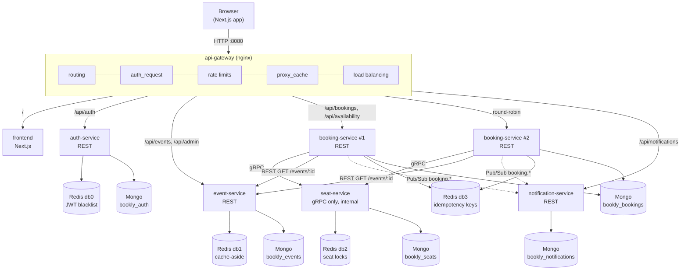
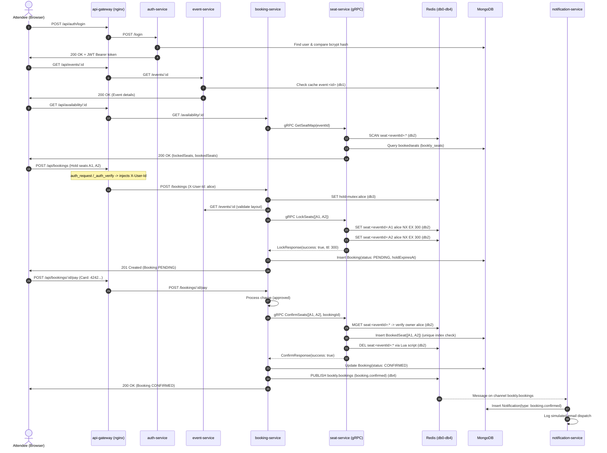
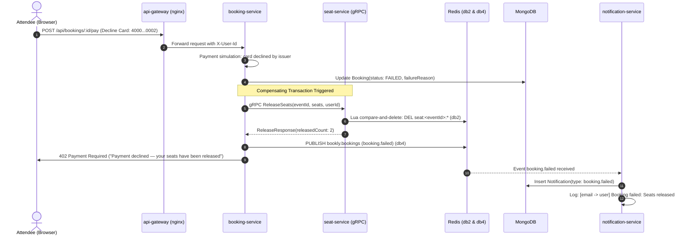
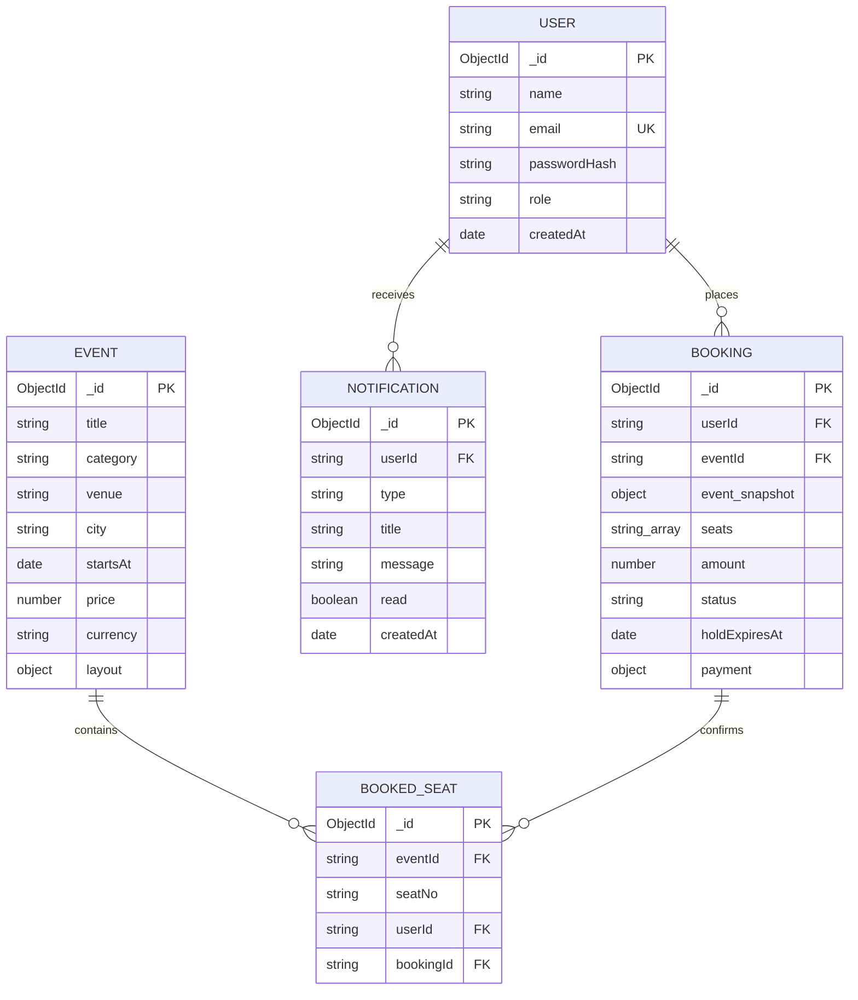

# Bookly: System Architecture, Engineering Design, and Study Guide

A comprehensive technical reference for understanding, presenting, and answering questions on the **Bookly** distributed event ticket booking microservices platform.

---

## Table of contents

1. [Project overview (one-minute pitch)](#1-project-overview-one-minute-pitch)
2. [Key features](#2-key-features)
3. [Architecture](#3-architecture)
4. [Technology stack and why each was chosen](#4-technology-stack-and-why-each-was-chosen)
5. [How each technology is used in this project](#5-how-each-technology-is-used-in-this-project)
6. [Step-by-step booking walkthrough](#6-step-by-step-booking-walkthrough)
7. [API reference summary](#7-api-reference-summary)
8. [Data model](#8-data-model)
9. [Project structure](#9-project-structure)
10. [Configuration](#10-configuration)
11. [Testing](#11-testing)
12. [How to run it](#12-how-to-run-it)
13. [Live demo script](#13-live-demo-script)
14. [Design decisions and trade-offs](#14-design-decisions-and-trade-offs)
15. [Limitations and what I would improve next](#15-limitations-and-what-i-would-improve-next)
16. [Likely questions from the teacher, with answers](#16-likely-questions-from-the-teacher-with-answers)
17. [Glossary](#17-glossary)
18. [Code walkthrough cheat sheet](#18-code-walkthrough-cheat-sheet)
19. [Discrepancies and open questions](#19-discrepancies-and-open-questions)

---

## 1. Project overview (one-minute pitch)

> *"Bookly is a production-grade, distributed event ticketing platform built to solve the high-concurrency seat reservation challenge: preventing double-booking when thousands of users race for the same seat at the exact same millisecond. Instead of a monolithic app, Bookly splits concerns across specialized microservices—an nginx API gateway handling edge routing and authentication offloading, Node.js REST services for identity, events, and bookings, an internal high-performance gRPC service dedicated to atomic seat locks in Redis, and asynchronous event notifications over Redis Pub/Sub. By combining sub-millisecond in-memory locking, database-level unique constraints, idempotent HTTP retry semantics, and compensating transactions, Bookly demonstrates how real-world financial and reservation systems maintain strict data consistency and high availability under heavy load without distributed transaction overhead."*

---

## 2. Key features

### User capabilities (verified in code)
- **Account management**: Register an account with automatic duplicate email detection (`POST /api/auth/register`), log in with timing-attack resistant password verification (`POST /api/auth/login`), fetch profile (`GET /api/auth/me`), and log out with immediate server-side JWT revocation via Redis token blacklisting (`POST /api/auth/logout`).
- **Catalog discovery**: Browse events with server-side pagination, category filtering, city filtering, and case-insensitive regex text search (`GET /api/events`). Inspect event details backed by a two-tier caching architecture (`GET /api/events/:id`).
- **Interactive seat map**: Fetch real-time seat availability (`GET /api/availability/:eventId`) showing an un-cached snapshot of locked and booked seats rendered dynamically as a responsive SVG/grid layout.
- **Seat hold & reservation**: Select up to 8 available seats and acquire a 5-minute atomic lock (`POST /api/bookings`). Parallel hold attempts by the same user account are serialized via a distributed mutex to enforce business limits (maximum 3 active unpaid holds per user).
- **Safe checkout & payments**: Pay for a held booking using a card (`POST /api/bookings/:id/pay`). Built-in payment compensation releases held seats immediately if the payment is declined or if the hold expired mid-checkout.
- **Idempotent requests**: Safely retry network-interrupted booking creation or payments using the `Idempotency-Key` header without fear of double charges or duplicate tickets.
- **Hold cancellation**: Voluntarily cancel an unpaid pending hold (`POST /api/bookings/:id/cancel`) to immediately free seats for other attendees.
- **Booking history & tickets**: View personal booking history (`GET /api/bookings`), inspect booking details and digital barcode tickets (`GET /api/bookings/:id`). Cross-user booking access is strictly blocked (returns 404).
- **Asynchronous notifications**: View in-app notifications (`GET /api/notifications`), mark individual items as read (`PATCH /api/notifications/:id/read`), or mark all as read (`POST /api/notifications/read-all`) delivered asynchronously via Redis Pub/Sub domain events (`booking.confirmed`, `booking.failed`, `booking.cancelled`).

### Admin capabilities (verified in code)
- **Bootstrap admin seeding**: First startup automatically initializes an admin user (`admin@bookly.dev`) using configuration in `.env` (`auth-service/src/services/auth.service.js`).
- **Event lifecycle management**: Create new events (`POST /api/admin/events`) specifying title, description, venue, city, start time, price, currency, and grid dimensions (up to 26 lettered rows A–Z, up to 40 seats per row).
- **Catalog updates & cache invalidation**: Modify event metadata (`PATCH /api/admin/events/:id`) or cancel/delete events (`DELETE /api/admin/events/:id`). Writes automatically evict the event from the Redis detail cache (`event:<id>`).
- **Role enforcement**: Gateway offloading verifies the user's role and passes `X-User-Role: admin`. Downstream `requireAdmin` middleware blocks non-admin tokens with HTTP 403 Forbidden.

---

## 3. Architecture

### Component overview
- **`api-gateway` (nginx)**: The single publicly accessible entry point (port 8080). Handles SSL/TLS termination, request routing, rate limiting, catalog response caching, load balancing across booking replicas, and auth offloading (`auth_request`).
- **`auth-service` (Node.js/Express, port 8001 internal)**: Manages user accounts, bcrypt password hashing, JWT creation and verification (`/verify`), and token invalidation in Redis db0.
- **`event-service` (Node.js/Express, port 8002 internal)**: Manages event catalogs and venue layouts in MongoDB `bookly_events`, with a Redis db1 cache-aside layer.
- **`booking-service` (Node.js/Express, port 8003 internal, 2 replicas)**: Orchestrates the booking workflow (hold, pay, confirm, cancel), verifies idempotency keys in Redis db3, calls seat-service over gRPC, and publishes domain events to Redis db4.
- **`seat-service` (Node.js/gRPC, port 50051 internal)**: Internal-only microservice implementing `SeatService` via Protocol Buffers. Executes high-speed atomic seat locking, lock release, and confirmation against Redis db2 and MongoDB `bookly_seats`.
- **`notification-service` (Node.js/Express, port 8004 internal)**: Long-running worker subscribed to Redis db4 Pub/Sub channel `bookly.bookings`. Persists notifications in MongoDB `bookly_notifications` and logs simulated email dispatches.
- **`frontend` (Next.js 15, port 3000 internal)**: React-based web application providing user catalog browsing, interactive seat picker, checkout timer, ticket viewer, admin dashboard, and an interactive API explorer.
- **Redis 7 (port 6379 internal)**: In-memory data store logically partitioned into 5 independent databases (db0 through db4).
- **MongoDB 7 (port 27017 internal)**: Primary document database with 5 isolated databases (`bookly_auth`, `bookly_events`, `bookly_bookings`, `bookly_seats`, `bookly_notifications`).

### Architecture diagram



### Request flow: From browser to database
1. **Edge entry**: The user's browser sends an HTTP request to `http://localhost:8080/api/bookings`.
2. **Gateway rate limiting**: nginx checks the client IP against `zone=api_general` (20 req/s, burst 20). If exceeded, nginx immediately returns HTTP 429 without hitting any Node.js service.
3. **Authentication subrequest (`auth_request`)**:
   - nginx intercepts the request and issues an internal subrequest `GET /_auth_verify` to `auth-service` (`/verify`).
   - `auth-service` verifies the JWT signature and checks if the token's unique ID (`jti`) exists in Redis db0 blacklist.
   - If valid, `auth-service` returns 200 with headers `X-User-Id` and `X-User-Role`.
   - nginx injects `$bookly_user_id` and `$bookly_user_role` into the forwarded upstream request headers.
4. **Upstream load balancing**: nginx forwards the enriched request to upstream `booking_service` via round-robin DNS across its two container replicas.
5. **Business processing & RPC**: `booking-service` validates the payload, verifies the user mutex in Redis db3, queries `event-service` over internal HTTP, and executes a binary RPC call (`LockSeats`) over persistent HTTP/2 to `seat-service:50051`.
6. **Data lock & storage**: `seat-service` acquires the atomic lock in Redis db2 using `SET NX EX`. `booking-service` saves the pending booking in MongoDB `bookly_bookings`.
7. **Response return**: The JSON response bubbles back through nginx to the client browser with tracking headers (`X-Request-Id`, `X-Served-By`).

### Why microservices instead of a monolith?
- **Isolation of critical concurrency paths**: High-frequency seat locking demands low-latency in-memory operations and tight concurrency guarantees. Isolating `seat-service` ensures CPU-heavy tasks (like catalog searches, PDF ticket generation, or admin reporting) cannot starve seat reservation threads.
- **Independent scalability**: Read traffic on the event catalog is 100x higher than booking checkout traffic. `event-service` and `booking-service` can be scaled horizontally and independently based on actual traffic profiles.
- **Polyglot protocol optimization**: HTTP/REST is ideal for public web clients, while internal microservices communicate over gRPC for compact binary serialization, strict contract enforcement, and low overhead.
- **Domain data ownership**: Each service strictly owns its database schema. `auth-service` changes cannot break booking tables, eliminating tight coupling and schema migration lockups.

**Trade-offs & costs**:
- *Distributed failure modes*: Partial failures (e.g. seat-service down while booking-service is healthy) require retry backoff, circuit breaking, and explicit compensating logic.
- *Operational complexity*: Requires running multiple containers, service discovery, internal networking, distributed logging, and multi-database health checks.

---

## 4. Technology stack and why each was chosen

| Technology | Where it is used | Why it is used here | Alternative someone could have chosen |
| :--- | :--- | :--- | :--- |
| **nginx** | `api-gateway` | High-throughput reverse proxy capable of handling SSL, static Next.js assets, rate limiting, response caching, and auth offloading in C with near-zero latency. | Envoy, Traefik, HAProxy, AWS API Gateway |
| **Node.js (v20+)** | All backend services | Event-driven, non-blocking I/O model makes it ideal for I/O-intensive microservices orchestrating network requests and database queries. | Go, Rust, Java (Spring Boot), Python (FastAPI) |
| **Express (v5.1)** | Auth, Event, Booking, Notification | Minimalist, ubiquitous HTTP web framework with flexible middleware chains for validation, logging, and error handling. | Fastify, NestJS, Koa, Hono |
| **gRPC (`@grpc/grpc-js`)** | `seat-service` (server) & `booking-service` (client) | High-performance, strongly-typed binary RPC protocol running over multiplexed HTTP/2 connections with built-in timeouts and status codes. | REST over HTTP/1.1, Apache Thrift, tRPC |
| **Protocol Buffers** | `proto/seat.proto` | Language-neutral, compact binary schema definition that acts as a single strictly enforced contract between services. | JSON Schema, OpenAPI/Swagger, Apache Avro |
| **Redis (v7)** | Cache, locks, blacklist, idempotency, pub/sub | Ultra-fast in-memory data store supporting atomic key primitives (`SET NX EX`), Lua scripting, and pub/sub channels. | Memcached, AWS DynamoDB, RabbitMQ, Hazelcast |
| **MongoDB (v7)** | Primary database (5 isolated DBs) | Schema-flexible document database with native JSON-like document storage, embedded subdocuments, and ACID transaction support. | PostgreSQL, MySQL, CockroachDB |
| **Mongoose (v8.9)** | MongoDB object modeling | Provides schema validation, type casting, lifecycle hooks, virtual fields, and index management for Node.js. | Prisma, TypeORM, native MongoDB Node.js driver |
| **Next.js (v15)** | `frontend` | Modern React framework supporting server-side rendering, static asset optimization, and unified client routing. | Vite + React SPA, Remix, Vue/Nuxt, SvelteKit |
| **Docker Compose (v2)** | Local deployment & orchestration | Single configuration file defining multi-container environments, private bridge networks, volumes, and healthcheck dependencies. | Kubernetes (k8s), Docker Swarm, Nomad, Podman |
| **Zod (v3.24)** | Input validation in Express services | TypeScript-first schema declaration and runtime validation library that parses and sanitizes HTTP request bodies and queries. | Joi, express-validator, Yup, Ajv |
| **bcryptjs (v2.4)** | Password hashing in `auth-service` | Pure JavaScript implementation of bcrypt password-hashing function; eliminates native C++ toolchain dependencies in Alpine containers. | Native `bcrypt`, Argon2, scrypt, PBKDF2 |

---

## 5. How each technology is used in this project

### 1. nginx
- **Concept**: Reverse proxy and edge router that sits in front of backend applications to handle networking concerns before traffic touches application code.
- **Routing**: Routes `/api/auth/*` to auth, `/api/events*` to event, `/api/bookings*` to booking, `/api/notifications*` to notification, and `/` to frontend.
  - *Location*: [`api-gateway/templates/default.conf.template#L80-L161`](file:///c:/Users/utkar/Bookly/api-gateway/templates/default.conf.template#L80-L161)
- **`auth_request` offloading**: Verifies the bearer JWT with `auth-service` via internal subrequest `/_auth_verify` before proxying protected routes. On success, populates `$bookly_user_id` and `$bookly_user_role`. On public routes, headers are intentionally cleared to prevent client spoofing.
  - *Location*: [`api-gateway/snippets/auth-required.conf#L5-L7`](file:///c:/Users/utkar/Bookly/api-gateway/snippets/auth-required.conf#L5-L7) and [`api-gateway/snippets/proxy-common.conf#L16-L17`](file:///c:/Users/utkar/Bookly/api-gateway/snippets/proxy-common.conf#L16-L17)
- **Rate limiting**: Enforces 5 req/min on `/api/auth/login` and `register` (with case-insensitive regex preventing path bypasses), and 20 req/s with burst 20 on general API routes.
  - *Location*: [`api-gateway/templates/default.conf.template#L9-L11`](file:///c:/Users/utkar/Bookly/api-gateway/templates/default.conf.template#L9-L11), [`#L82-L86`](file:///c:/Users/utkar/Bookly/api-gateway/templates/default.conf.template#L82-L86)
- **`proxy_cache`**: Caches public `GET /api/events*` responses on disk for 15 seconds (`GATEWAY_EVENTS_CACHE_SECONDS`) with `proxy_cache_lock` (coalescing simultaneous cache misses) and stale-while-revalidate.
  - *Location*: [`api-gateway/templates/default.conf.template#L49-L50`](file:///c:/Users/utkar/Bookly/api-gateway/templates/default.conf.template#L49-L50), [`#L95-L106`](file:///c:/Users/utkar/Bookly/api-gateway/templates/default.conf.template#L95-L106)
- **Load balancing**: Upstream `booking_service` shares round-robin state across worker processes in a shared memory zone (`zone booking_service 64k`), failing over unhealthy replicas.
  - *Location*: [`api-gateway/templates/default.conf.template#L26-L32`](file:///c:/Users/utkar/Bookly/api-gateway/templates/default.conf.template#L26-L32)
- **gRPC proxying (`grpc_pass`)**: Dedicated server on port 9090 with `http2 on` proxying gRPC calls to `seat-service` for local developer CLI/testing tools.
  - *Location*: [`api-gateway/templates/default.conf.template#L191-L200`](file:///c:/Users/utkar/Bookly/api-gateway/templates/default.conf.template#L191-L200)

### 2. Redis
- **Concept**: High-speed, in-memory key-value database executing atomic commands in a single-threaded event loop.
- **Role 1 (db0) - JWT blacklist**: Revoked token IDs (`jti`) stored with an exact TTL equal to the remaining token lifetime.
  - *Location*: [`services/auth-service/src/services/token.service.js#L7-L38`](file:///c:/Users/utkar/Bookly/services/auth-service/src/services/token.service.js#L7-L38)
- **Role 2 (db1) - Cache-aside for events**: Event detail cached under `event:<id>` with 60s TTL; invalidated immediately on admin update or delete.
  - *Location*: [`services/event-service/src/services/event.service.js#L35-L68`](file:///c:/Users/utkar/Bookly/services/event-service/src/services/event.service.js#L35-L68)
- **Role 3 (db2) - Distributed seat locks**: Locks held under `seat:<eventId>:<seatNo>` with user ID value and 300s TTL.
  - *Location*: [`services/seat-service/src/services/seatLock.service.js#L6-L52`](file:///c:/Users/utkar/Bookly/services/seat-service/src/services/seatLock.service.js#L6-L52)
- **Role 4 (db3) - Idempotency keys**: Request records stored under `idem:<user>:<method>:<path>:<key>` with 24-hour TTL, saving execution state, payload fingerprint, status code, and response body.
  - *Location*: [`services/booking-service/src/middlewares/idempotency.js#L27-L68`](file:///c:/Users/utkar/Bookly/services/booking-service/src/middlewares/idempotency.js#L27-L68)
- **Pub/Sub event bus (db4)**: Decoupled messaging over channel `bookly.bookings` connecting booking events (`booking.confirmed`, `failed`, `cancelled`) to notification consumers.
  - *Location*: [`services/booking-service/src/services/eventPublisher.service.js#L7-L29`](file:///c:/Users/utkar/Bookly/services/booking-service/src/services/eventPublisher.service.js#L7-L29) and [`services/notification-service/src/subscribers/booking.subscriber.js#L10-L25`](file:///c:/Users/utkar/Bookly/services/notification-service/src/subscribers/booking.subscriber.js#L10-L25)

### 3. gRPC & Protocol Buffers
- **Concept**: Strongly typed RPC protocol using binary serialization (Protocol Buffers) running over HTTP/2 transport.
- **Contract (`proto/seat.proto`)**: Defines 4 RPC methods: `LockSeats`, `ConfirmSeats`, `ReleaseSeats`, and `GetSeatMap`.
  - *Location*: [`proto/seat.proto#L1-L64`](file:///c:/Users/utkar/Bookly/proto/seat.proto#L1-L64)
- **Resilient client**: Features 2000ms deadline, idempotent retries on `UNAVAILABLE`, `DEADLINE_EXCEEDED`, and `RESOURCE_EXHAUSTED` with exponential backoff and random jitter.
  - *Location*: [`services/booking-service/src/clients/seat.client.js#L23-L50`](file:///c:/Users/utkar/Bookly/services/booking-service/src/clients/seat.client.js#L23-L50)
- **Why internal only**: Web browsers cannot natively negotiate raw HTTP/2 framing or Protocol Buffer streams without transcoding proxies (like gRPC-Web). Exposing a clean REST facade (`/api/availability/:eventId`) keeps web clients simple while keeping backend RPC blazing fast.

### 4. JWT authentication
- **Concept**: Stateless, signed security token containing user identity and role claims.
- **Issuance**: Signed with HMAC-SHA256 containing `sub` (userId), `role`, `email`, `name`, expiration (`1h`), and a unique cryptographically random UUID `jwtid` (`jti`).
  - *Location*: [`services/auth-service/src/services/token.service.js#L9-L18`](file:///c:/Users/utkar/Bookly/services/auth-service/src/services/token.service.js#L9-L18)
- **Offloaded verification**: Gateway calls `auth-service` `/verify`. If valid and not blacklisted, `auth-service` sets HTTP headers `X-User-Id` and `X-User-Role`. Downstream services read these trusted headers without verifying crypto signatures.
  - *Location*: [`services/auth-service/src/controllers/auth.controller.js#L26-L38`](file:///c:/Users/utkar/Bookly/services/auth-service/src/controllers/auth.controller.js#L26-L38)
- **Revocation**: Logout writes `jwt:blacklist:<jti>` to Redis db0 for the remaining seconds of its validity.
  - *Location*: [`services/auth-service/src/services/token.service.js#L34-L38`](file:///c:/Users/utkar/Bookly/services/auth-service/src/services/token.service.js#L34-L38)

### 5. Idempotency
- **Concept**: Guaranteeing that executing an identical mutating operation multiple times produces the exact same outcome as the initial execution.
- **Problem solved**: When a user clicks "Pay" and the network drops before receiving the response, a retry could double-charge the user or create duplicate bookings.
- **Scoped locking**: Keys are scoped to `idem:<user>:<method>:<path>:<key>` and claimed atomically with `SET NX`. A SHA-256 fingerprint of the request payload (with sensitive card numbers redacted) prevents payload tampering.
- **Replay**: Definitive outcomes (HTTP 2xx or 402 declined) are stored in Redis db3 for 24 hours. Retries return the cached response with the `Idempotent-Replayed: true` header.
  - *Location*: [`services/booking-service/src/middlewares/idempotency.js#L27-L68`](file:///c:/Users/utkar/Bookly/services/booking-service/src/middlewares/idempotency.js#L27-L68)

### 6. Seat locking
- **Concept**: Distributed mutual exclusion ensuring only one customer can hold a specific seat at any point in time.
- **Atomic acquisition (`SET NX EX`)**: `SET seat:<eventId>:<seatNo> <userId> EX 300 NX`. If the key exists, Redis rejects the write.
- **Atomic Lua release**: To prevent User A from releasing a lock that expired and was subsequently acquired by User B, release executes a Lua script comparing ownership before deleting:
  ```lua
  if redis.call('GET', KEYS[1]) == ARGV[1] then
    return redis.call('DEL', KEYS[1])
  else
    return 0
  end
  ```
  - *Location*: [`services/seat-service/src/services/seatLock.service.js#L9-L12`](file:///c:/Users/utkar/Bookly/services/seat-service/src/services/seatLock.service.js#L9-L12)
- **Why TTL matters**: If a user closes their browser or loses connectivity during checkout, the 300-second TTL guarantees the seat automatically returns to available inventory without manual cleanup scripts.

### 7. Compensation
- **Concept**: An architectural pattern where failure in a distributed multi-step transaction triggers explicit compensating operations that undo previously executed steps.
- **Failure flow**: If payment fails (declined card or gateway timeout) or seat confirmation fails, `booking-service` marks the booking `FAILED`, issues a gRPC `ReleaseSeats` call to `seat-service` to immediately delete the Redis hold keys, and publishes `booking.failed` to Redis Pub/Sub.
  - *Location*: [`services/booking-service/src/services/booking.service.js#L140-L153`](file:///c:/Users/utkar/Bookly/services/booking-service/src/services/booking.service.js#L140-L153)

### 8. Docker Compose
- **Concept**: Multi-container orchestration tool defining services, networks, volumes, and healthchecks in a single declarative YAML file.
- **Isolated private networking**: All containers attach to an internal bridge network `bookly`. Service discovery occurs via Docker's embedded DNS using service names (`auth-service`, `mongo`, `redis`).
- **Security perimeter**: Only `api-gateway` publishes port 8080 (and loopback 9090). Databases and microservices have zero host port bindings, ensuring untrusted external traffic cannot bypass authentication.
- **Dependency ordering**: Services use `condition: service_healthy` to guarantee MongoDB and Redis pass readiness pings before application processes launch.
  - *Location*: [`docker-compose.yml#L1-L188`](file:///c:/Users/utkar/Bookly/docker-compose.yml#L1-L188)

---

## 6. Step-by-step booking walkthrough

### Success path: From event discovery to confirmed ticket



1. **User Authentication**:
   - *Service*: `auth-service` | *Endpoint*: `POST /api/auth/login`
   - *Storage touched*: MongoDB collection `users` (`bookly_auth`).
   - *Response*: HTTP 200 with `{ user: { id, name, email, role }, token, expiresAt }`.
2. **Catalog Browsing**:
   - *Service*: `event-service` | *Endpoint*: `GET /api/events/:id`
   - *Storage touched*: Redis db1 key `event:<id>` (on miss, MongoDB `events` in `bookly_events`).
   - *Response*: HTTP 200 with `{ event }` and headers `X-Cache: HIT|MISS`, `X-Gateway-Cache: HIT|MISS`.
3. **Availability Snapshot**:
   - *Service*: `booking-service` -> `seat-service` | *Endpoint*: `GET /api/availability/:eventId`
   - *Storage touched*: Redis db2 keys `seat:<eventId>:*` scanned; MongoDB `bookedseats` queried.
   - *Response*: HTTP 200 with `{ eventId, lockedSeats: ["B1"], bookedSeats: ["A3"], lockTtlSeconds: 300 }`.
4. **Hold Acquisition (Atomic Lock)**:
   - *Service*: `booking-service` -> `seat-service` | *Endpoint*: `POST /api/bookings`
   - *Storage touched*: Redis db3 mutex `hold-mutex:<userId>`, Redis db2 keys `seat:<eventId>:<seatNo>` set with `NX EX 300`, MongoDB `bookings` collection (`bookly_bookings`).
   - *Response*: HTTP 201 Created with `{ booking: { id, status: "PENDING", holdExpiresAt, seats: ["A1", "A2"], amount: 2400 } }`.
5. **Payment Submission**:
   - *Service*: `booking-service` | *Endpoint*: `POST /api/bookings/:id/pay` (with `Idempotency-Key: req-...`)
   - *Storage touched*: Redis db3 key `idem:<userId>:POST:...`, MongoDB `bookings` document updated with `payment: { status: "CAPTURED", reference, cardLast4 }`.
6. **Seat Confirmation (Permanent Sale)**:
   - *Service*: `booking-service` -> `seat-service` | *Internal RPC*: gRPC `ConfirmSeats`
   - *Storage touched*: MongoDB collection `bookedseats` (`bookly_seats`) receives permanent documents; Redis db2 hold keys deleted via Lua script.
   - *Storage update*: MongoDB `bookings` document marked `status: "CONFIRMED"`, `confirmedAt: Date`.
   - *Response*: HTTP 200 OK with `{ booking: { status: "CONFIRMED", ... } }`.
7. **Asynchronous Notification**:
   - *Service*: `booking-service` -> Redis Pub/Sub -> `notification-service`
   - *Storage touched*: Redis db4 channel `bookly.bookings` receives JSON event; MongoDB collection `notifications` (`bookly_notifications`) stores notification document.
   - *Log output*: `[email -> user <id>] Booking confirmed: You're going to <Title>! Seats A1, A2 are yours — ₹2,400 paid.`

---

### Failure path: Declined card & compensating seat release



1. **Payment Attempt with Declined Card**:
   - *Action*: User submits payment with test card `4000 0000 0000 0002`.
   - *Endpoint*: `POST /api/bookings/:id/pay`
2. **Decline Detection**:
   - `payment.service.js` recognizes the designated test decline number, generates a reference `pay_<hex>`, and returns `{ approved: false, reason: "Card declined by issuer" }`.
3. **Booking Document Update**:
   - `booking-service` sets booking `status: "FAILED"`, `failureReason: "Card declined by issuer"`, and updates `payment: { status: "DECLINED", ... }` in MongoDB `bookly_bookings`.
4. **Compensating Transaction Execution**:
   - `booking-service` executes `releaseQuietly(booking)`, which fires gRPC `ReleaseSeats({ eventId, seatNos, userId })` to `seat-service`.
   - `seat-service` runs atomic Lua script `releaseIfOwner` against Redis db2, immediately freeing keys `seat:<eventId>:A1` and `A2`.
5. **Event Bus Broadcast**:
   - `booking-service` publishes event `booking.failed` to Redis db4 channel `bookly.bookings`.
6. **Error Response to Client**:
   - `booking-service` throws `ApiError(402, 'Payment declined — your seats have been released')`, returning HTTP 402 Payment Required with details `{ error: { status: 402, message: "...", details: { booking } } }`.
7. **Failure Notification Stored**:
   - `notification-service` handles the message, stores a record in MongoDB `bookly_notifications`, and logs the simulated alert.

---

## 7. API reference summary

### Public & authenticated endpoints

| Method | Path | Access Level | Description | Status Codes |
| :--- | :--- | :--- | :--- | :--- |
| `POST` | `/api/auth/register` | Public (Rate limited 5/min) | Creates a user account and issues JWT | 201, 400, 409, 429 |
| `POST` | `/api/auth/login` | Public (Rate limited 5/min) | Authenticates credentials and returns JWT | 200, 400, 401, 429 |
| `POST` | `/api/auth/logout` | Authenticated (User/Admin) | Revokes active JWT via Redis blacklist | 200, 401 |
| `GET` | `/api/auth/me` | Authenticated (User/Admin) | Returns active user profile | 200, 401, 404 |
| `GET` | `/api/events` | Public (Cached 15s) | Lists paginated events with filters | 200, 400 |
| `GET` | `/api/events/categories` | Public | Returns static array of event categories | 200 |
| `GET` | `/api/events/:id` | Public (Cached in Redis) | Returns single event details | 200, 404 |
| `POST` | `/api/admin/events` | Admin Only | Creates a new event catalog entry | 201, 400, 401, 403 |
| `PATCH` | `/api/admin/events/:id` | Admin Only | Updates event details & invalidates cache | 200, 400, 401, 403, 404 |
| `DELETE` | `/api/admin/events/:id` | Admin Only | Deletes event & evicts cache | 204, 401, 403, 404 |
| `GET` | `/api/availability/:eventId` | Public (Uncached) | Real-time snapshot of locked & booked seats | 200, 503 |
| `GET` | `/api/bookings` | Authenticated (User) | Lists authenticated user's booking history | 200, 401 |
| `POST` | `/api/bookings` | Authenticated (Idempotent) | Reserves seats with 5-minute atomic hold | 201, 400, 401, 404, 409, 422, 429 |
| `GET` | `/api/bookings/:id` | Authenticated (Owner only) | Returns booking details & ticket status | 200, 401, 404 |
| `POST` | `/api/bookings/:id/pay` | Authenticated (Idempotent) | Submits payment, confirms seats | 200, 401, 402, 404, 409, 422 |
| `POST` | `/api/bookings/:id/cancel` | Authenticated (Owner only) | Cancels pending hold & releases seats | 200, 401, 404, 409 |
| `GET` | `/api/notifications` | Authenticated (User) | Lists user notifications & unread count | 200, 401 |
| `POST` | `/api/notifications/read-all` | Authenticated (User) | Marks all notifications as read | 200, 401 |
| `PATCH` | `/api/notifications/:id/read` | Authenticated (User) | Marks single notification as read | 200, 401, 404 |
| `GET` | `/api/health` | Public | Gateway health check probe | 200 |

### Standard error response shape
All microservices and the API gateway adhere to a consistent error schema:

```json
{
  "error": {
    "status": 409,
    "message": "Some seats were just taken by someone else",
    "details": {
      "failedSeats": ["B3"]
    }
  }
}
```

### HTTP status codes used in Bookly
- `200 OK`: Request succeeded.
- `201 Created`: Resource successfully created (registration, booking hold, admin event).
- `204 No Content`: Resource successfully deleted (admin event removal).
- `400 Bad Request`: Schema validation error (e.g. invalid email format, seat syntax not matching `^[A-Z][1-9][0-9]?$`).
- `401 Unauthorized`: Token missing, invalid, expired, or blacklisted on logout.
- `402 Payment Required`: Card declined by issuer; triggers seat release compensation.
- `403 Forbidden`: Authenticated user lacks required permissions (e.g. non-admin accessing `/api/admin/*`).
- `404 Not Found`: Target entity does not exist or belongs to another user.
- `409 Conflict`: Concurrency conflict (seat already taken, booking no longer pending, parallel idempotency key in-flight).
- `422 Unprocessable Entity`: Idempotency key reused with a different request payload fingerprint.
- `429 Too Many Requests`: Rate limit threshold exceeded or maximum unpaid holds limit reached.
- `500 Internal Server Error`: Unhandled server exception (stack trace suppressed in production).
- `503 Service Unavailable`: Downstream microservice (e.g. seat-service or MongoDB) unreachable.

---

## 8. Data model



### Database breakdown

#### 1. `bookly_auth` (auth-service)
- **Collection**: `users`
- **Fields**: `name` (String), `email` (String, unique, lowercase), `passwordHash` (String, `select: false`), `role` (enum: `['user', 'admin']`), `createdAt`, `updatedAt`.
- **Indexes**:
  - `{ email: 1 }` (Unique index enforcing unique account emails).

#### 2. `bookly_events` (event-service)
- **Collection**: `events`
- **Fields**: `title` (String), `description` (String), `category` (enum: `Concert`, `Comedy`, `Theatre`, `Sports`, `Conference`, `Festival`), `venue` (String), `city` (String), `startsAt` (Date), `price` (Number), `currency` (String, default: `INR`), `imageUrl` (String), `layout` (`{ rows: Number, seatsPerRow: Number }`), `createdBy` (String userId).
- **Virtuals**: `capacity` (`rows * seatsPerRow`).
- **Indexes**:
  - `{ startsAt: 1 }` (Ascending index for chronological sorting).
  - `{ title: 'text', venue: 'text', city: 'text', description: 'text' }` (Compound full-text search index).

#### 3. `bookly_bookings` (booking-service)
- **Collection**: `bookings`
- **Fields**: `userId` (String, indexed), `eventId` (String), `event` (Embedded document snapshot: `title`, `venue`, `city`, `category`, `startsAt`), `seats` (Array of Strings, e.g. `['A1', 'A2']`), `unitPrice` (Number), `amount` (Number), `currency` (String), `status` (enum: `PENDING`, `CONFIRMED`, `FAILED`, `CANCELLED`, `EXPIRED`), `holdExpiresAt` (Date), `payment` (`{ status: enum['CAPTURED', 'DECLINED', 'REFUNDED'], reference: String, cardLast4: String, failureReason: String, processedAt: Date }`), `failureReason` (String), `confirmedAt` (Date).
- **Indexes**:
  - `{ userId: 1 }` (Index for listing user's bookings).
  - `{ status: 1, holdExpiresAt: 1 }` (Compound index for querying active holds and sweeping expired holds).

#### 4. `bookly_seats` (seat-service)
- **Collection**: `bookedseats`
- **Fields**: `eventId` (String), `seatNo` (String), `userId` (String), `bookingId` (String), `createdAt`, `updatedAt`.
- **Indexes**:
  - `{ eventId: 1, seatNo: 1 }` (**Unique compound index**: This is the ultimate database constraint preventing double-booking even if Redis were to crash or be bypassed).
  - `{ bookingId: 1 }` (Lookup index for booking idempotency).

#### 5. `bookly_notifications` (notification-service)
- **Collection**: `notifications`
- **Fields**: `userId` (String), `type` (enum: `booking.confirmed`, `booking.failed`, `booking.cancelled`), `title` (String), `message` (String), `bookingId` (String), `eventId` (String), `read` (Boolean, default: false), `createdAt`, `updatedAt`.
- **Indexes**:
  - `{ userId: 1, createdAt: -1 }` (Compound index for retrieving recent user notifications with unread counts).

### Cross-service data duplication: The event snapshot pattern
Notice that `booking-service` explicitly embeds a frozen copy of the event details (`title`, `venue`, `city`, `category`, `startsAt`) directly inside each booking record in MongoDB.
- **Why this was done**:
  1. *Decoupled read availability*: When users view past tickets or order receipts, `booking-service` renders the complete ticket without issuing network queries to `event-service`. Even if `event-service` is down, tickets load instantly.
  2. *Immutable historical accuracy*: If an admin updates an event's title or venue price next year, historical tickets must preserve the exact details and venue location as they existed at the moment the ticket was purchased.

---

## 9. Project structure

### Top-level repository layout
```text
Bookly/
├── api-gateway/                 # nginx reverse proxy & edge gateway
│   ├── docker-entrypoint.d/     # Startup validation scripts (30-verify-config.sh)
│   ├── snippets/                # Modular nginx configs (auth-required.conf, proxy-common.conf)
│   ├── templates/               # Dynamic nginx template (default.conf.template)
│   └── Dockerfile
├── frontend/                    # Next.js 15 client web application
│   ├── src/app/                 # App Router pages (/, /login, /events/[id], /bookings/[id], /admin)
│   ├── src/components/          # UI components (SeatMap, HoldTimer, PaymentForm, SiteHeader)
│   ├── src/context/             # React context (AuthContext, ToastContext)
│   └── src/lib/api/             # Client API SDK (client.js, bookings.api.js, etc.)
├── proto/                       # Protocol Buffer definitions
│   └── seat.proto               # Contract between booking-service and seat-service
├── scripts/                     # Automated testing & verification suites
│   ├── smoke-test.js            # 24-check end-to-end integration test runner
│   └── seat-race/               # Concurrency race testing tool (race.js)
├── services/                    # Microservices root
│   ├── auth-service/            # Authentication, JWT, and user management
│   ├── booking-service/         # Booking orchestration & payments (2 replicas)
│   ├── event-service/           # Event catalog, search, and admin endpoints
│   ├── notification-service/    # Async notification worker & pub/sub consumer
│   └── seat-service/            # Internal gRPC atomic seat locking engine
├── .env.example                 # Environment configuration template
├── DEPLOY.md                    # Production deployment runbook
├── docker-compose.yml           # Declarative multi-container orchestration
└── README.md                    # Primary developer documentation
```

### Microservice internal architecture: Annotated MVC pattern
Each Node.js microservice follows a clean, decoupled Model-View-Controller / Service-Layer architecture. Below is the layout of `services/booking-service`:

```text
services/booking-service/src/
├── app.js                       # Express app configuration & middleware pipeline
├── server.js                    # Entry point: connects DB/Redis and starts HTTP server
├── config/                      # Environment parsing & connection singletons
│   ├── index.js                 # Centralized typed configuration object
│   ├── database.js              # Mongoose MongoDB connection manager
│   └── redis.js                 # ioredis client singleton
├── clients/                     # Outbound microservice clients
│   ├── event.client.js          # HTTP REST client to event-service
│   └── seat.client.js           # gRPC client to seat-service (with retries & deadlines)
├── controllers/                 # HTTP transport layer: unpacks req, calls service, returns res
│   ├── availability.controller.js # GET /api/availability/:eventId handler
│   └── booking.controller.js    # Create hold, pay, cancel, list handlers
├── middlewares/                 # Express middleware functions
│   ├── errorHandler.js          # Central error sanitization & status mapper
│   ├── idempotency.js           # Idempotency-Key validation and replay cache
│   ├── requireUser.js           # Enforces presence of X-User-Id header
│   └── validate.js              # Zod request validation middleware
├── models/                      # MongoDB database schemas
│   └── booking.model.js         # Mongoose schema, validation & indexes
├── routes/                      # Route declarations mapping paths to controllers
│   ├── availability.routes.js
│   ├── booking.routes.js
│   └── index.js
├── services/                    # Pure business logic layer
│   ├── booking.service.js       # Core reservation, hold, and compensation logic
│   ├── eventPublisher.service.js# Redis Pub/Sub domain event publisher
│   └── payment.service.js       # Mock payment processor
├── utils/                       # Shared utilities
│   ├── ApiError.js              # Custom operational HTTP error class
│   └── logger.js                # Structured console logging helper
└── validators/                  # Zod validation schemas
    └── booking.validators.js    # Schemas for createBooking and payBooking
```

- **`models/`**: Defines data structures, database constraints, and lifecycle methods.
- **`routes/`**: Binds HTTP verbs and URI paths to middleware chains and controllers.
- **`controllers/`**: Extracts parameters, delegates to services, and formats HTTP responses.
- **`services/`**: Contains core domain logic, coordinates database transactions, and manages outbound clients.
- **`middlewares/`**: Intercepts requests for authentication assertions, schema validation, and error normalization.
- **`clients/`**: Encapsulates external service communication protocols (REST, gRPC).
- **`validators/`**: Contains strict Zod schemas ensuring no malformed payloads reach business logic.

---

## 10. Configuration

### How configuration works
Bookly follows the **Twelve-Factor App** configuration methodology. Configuration is defined in a single `.env` file at the repository root.
- **Docker Compose interpolation**: When executing `docker compose up`, Compose reads the root `.env` and passes environment variables into container execution contexts.
- **Dynamic nginx configuration**: nginx cannot read `.env` directly. Instead, `api-gateway/Dockerfile` mounts `templates/default.conf.template`. The official nginx entrypoint script runs `envsubst` to replace `${VAR}` placeholders with real environment values before starting the master process.

### Environment variable grouping

#### Gateway & network configuration
- `GATEWAY_PORT` (Default: `8080`): Public HTTP port exposed on the host.
- `GRPC_GATEWAY_HOST` (Default: `127.0.0.1`): Host interface for the development gRPC proxy.
- `GRPC_GATEWAY_PORT` (Default: `9090`): Host port for the development gRPC proxy.
- `LOGIN_RATE_LIMIT` (Default: `5r/m`): nginx rate limit for `/api/auth/login` and `register`.
- `LOGIN_RATE_BURST` (Default: `3`): Burst allowance for login attempts.
- `API_RATE_LIMIT` (Default: `20r/s`): General rate limit for booking and availability endpoints.
- `GATEWAY_EVENTS_CACHE_SECONDS` (Default: `15`): Disk cache TTL for public event catalog queries.

#### Security & credentials
- `JWT_SECRET`: Secret key used to sign and verify HMAC-SHA256 tokens (**Must be 32+ random characters in production**).
- `JWT_EXPIRES_IN` (Default: `1h`): Token expiration duration.
- `BCRYPT_ROUNDS` (Default: `10`): Hashing computational cost for passwords.
- `ADMIN_NAME`, `ADMIN_EMAIL`, `ADMIN_PASSWORD` (Default: `admin@bookly.dev` / `Admin@12345`): Bootstrap credentials created automatically on initial boot.

#### Reservation & business limits
- `SEAT_LOCK_TTL_SECONDS` (Default: `300`): Hold duration in Redis before temporary seat locks expire (5 minutes).
- `MAX_SEATS_PER_BOOKING` (Default: `8`): Maximum seats a user can hold per event.
- `MAX_ACTIVE_HOLDS_PER_USER` (Default: `3`): Maximum concurrent unpaid bookings per account.
- `IDEMPOTENCY_TTL_SECONDS` (Default: `86400`): Retention duration for stored idempotency replay responses (24 hours).

#### Database URIs & Redis indices
- `MONGO_URI` (Default: `mongodb://mongo:27017`): MongoDB connection string.
- Database names: `AUTH_DB_NAME` (`bookly_auth`), `EVENT_DB_NAME` (`bookly_events`), `BOOKING_DB_NAME` (`bookly_bookings`), `SEAT_DB_NAME` (`bookly_seats`), `NOTIFICATION_DB_NAME` (`bookly_notifications`).
- Redis URLs (Logical partitioning):
  - `AUTH_REDIS_URL` (`redis://redis:6379/0`): Token revocation blacklist.
  - `EVENT_REDIS_URL` (`redis://redis:6379/1`): Event detail cache.
  - `SEAT_REDIS_URL` (`redis://redis:6379/2`): Atomic seat locks.
  - `BOOKING_REDIS_URL` (`redis://redis:6379/3`): Idempotency records & user mutexes.
  - `NOTIFICATION_REDIS_URL` (`redis://redis:6379/4`): Pub/Sub event bus subscriber.

#### Critical variables that matter most
1. `JWT_SECRET`: Compromising this allows an attacker to forge tokens and impersonate any user or admin.
2. `ADMIN_PASSWORD`: Leaving the default development password exposes full event modification privileges.
3. `SEAT_LOCK_TTL_SECONDS`: Tuning this controls the balance between giving customers enough checkout time and releasing abandoned seats quickly.

---

## 11. Testing

### 1. End-to-end smoke test (24 checks)
The repository includes a comprehensive zero-dependency integration test runner (`scripts/smoke-test.js`) executed with:
```bash
node scripts/smoke-test.js
```
The test suite validates the entire microservices cluster in 24 sequential assertions grouped across 6 categories:
1. **Authentication & Security (4 checks)**: User registration (201), duplicate registration handling, profile fetching (`/auth/me`), and rejection of unauthenticated booking requests (401).
2. **Catalog & Multi-tier Caching (2 checks)**: Event list retrieval, event detail retrieval, verification of `X-Cache` (Redis HIT/MISS) and `X-Gateway-Cache` (nginx HIT/MISS) headers.
3. **Seat Holds & Concurrency (4 checks)**: Dynamic seat discovery, acquiring a hold (201 PENDING), idempotency replay check on booking hold creation, conflict rejection (409) when a second user attempts to reserve the same seat, and seat map confirmation.
4. **Compensation & Decline (2 checks)**: Submitting payment with decline test card (`4000 0000 0000 0002`), asserting HTTP 402, and verifying that compensating logic released the held seats back to the seat map.
5. **Confirmation & Idempotent Payment (4 checks)**: Re-acquiring hold, successful payment with valid card (`4242...`), verifying HTTP 200 CONFIRMED, replaying the exact same payment request to verify that the card is not charged twice, verifying seat map shows seats as permanently booked, and verifying that sold seats reject new holds with HTTP 409.
6. **Cancellation & Isolation (2 checks)**: Voluntarily cancelling a hold (200 CANCELLED), and asserting that User B cannot view User A's private booking (404).
7. **Load Balancing (1 check)**: Executing 8 sequential requests and verifying response headers reflect answers from both `booking-service` container replicas (`X-Served-By`).
8. **Pub/Sub Notifications (2 checks)**: Verifying `notification-service` received and stored `booking.confirmed` and `booking.failed` events, and testing bulk mark-as-read (`POST /notifications/read-all`).
9. **Token Revocation (2 checks)**: Calling `/auth/logout` and confirming that subsequent requests using the blacklisted token are immediately rejected at the gateway with HTTP 401.

### 2. Double-booking race test
Located in `scripts/seat-race/race.js`, this concurrency harness simulates a flash-sale spike by firing 50 concurrent gRPC `LockSeats` requests simultaneously for the exact same seat:
```bash
cd scripts/seat-race && npm install
node race.js 50
```
- **What it proves**: Proves that despite 50 concurrent requests arriving within milliseconds of each other, Redis single-threaded `SET NX` semantics ensure **exactly 1 request wins** and 49 requests are safely rejected with zero system errors or race conditions.
- **Interpreting the output**:
  ```text
    winners : 1 (racer-0, hold 300s)
    rejected: 49
    errors  : 0
    elapsed : 45ms

  PASS — exactly one user acquired the seat (lock released afterwards).
  ```

### What has NO automated tests (and why)
- **Frontend browser UI flows**: No Cypress/Playwright suites; UI behavior is verified manually.
- **Third-party payment gateways**: Payments use an internal mock; no live Stripe/PayPal sandbox tests exist.
- **Partition tolerance / Chaos testing**: No automated tests simulating Redis crashes or network partitions while a hold is in-flight.

---

## 12. How to run it

### Method 1: Docker Compose (recommended)
Prerequisites: Docker Desktop (Compose v2) and Node.js 20+ (for test scripts).

```bash
# 1. Clone and navigate into the repository
git clone https://github.com/UtkarshWoc/Bookly.git
cd Bookly

# 2. Initialize environment file
cp .env.example .env

# 3. Build and launch all 8 containers in the background
docker compose up -d --build

# 4. Verify that all services report healthy status
docker compose ps
```

Access endpoints:
- Web Application: `http://localhost:8080`
- API Explorer: `http://localhost:8080/explorer`
- Admin Dashboard: `http://localhost:8080/admin`
- REST API Base: `http://localhost:8080/api/...`

### Method 2: Local development without Docker
To run microservices natively on the host with hot reload:
1. Start infrastructure containers only:
   ```bash
   docker compose up -d mongo redis
   ```
   *(Note: Map ports `27017:27017` and `6379:6379` in `docker-compose.yml` to access them directly from localhost)*.
2. In root `.env`, update hostnames to `localhost` (`MONGO_URI=mongodb://localhost:27017`, `SEAT_SERVICE_ADDR=localhost:50051`, etc.).
3. Start backend services in separate terminal tabs:
   ```bash
   cd services/seat-service && npm install && npm run dev
   cd services/auth-service && npm install && npm run dev
   cd services/event-service && npm install && npm run dev
   cd services/booking-service && npm install && npm run dev
   cd services/notification-service && npm install && npm run dev
   ```
4. Start the frontend:
   ```bash
   cd frontend && npm install && npm run dev
   ```

### Method 3: Resilience and failover demonstrations
Run these live in the terminal to demonstrate fault tolerance:

```bash
# 1. Service failure and retry backoff
docker compose stop seat-service
curl -i http://localhost:8080/api/availability/<eventId>
# (Notice booking-service retries with backoff, then returns clean 503)
docker compose start seat-service

# 2. Dynamic horizontal scaling
docker compose up -d --scale booking-service=3
docker compose restart api-gateway
# (nginx immediately distributes traffic across all 3 replicas)

# 3. Live pub/sub notification logging
docker compose logs -f notification-service
# (Watch realtime "[email -> user ...]" logs appear as you book tickets in the browser)
```

---

## 13. Live demo script

*(Recommended presentation duration: 5 to 10 minutes)*

### Step 1: System architecture intro (1 minute)
- **What to show**: Terminal running `docker compose ps` showing all 8 containers healthy.
- **What to say**: *"Bookly is an event ticket booking system built as microservices. All client traffic enters through an nginx API gateway on port 8080. The gateway offloads JWT authentication, enforces rate limits, caches public catalogs, and load balances across backend services. Under the hood, seat locking is handled by a dedicated gRPC microservice using Redis atomic locks."*

### Step 2: Concurrency & race test demonstration (2 minutes)
- **What to show**: Run `cd scripts/seat-race && node race.js 50`.
- **What to say**: *"Let's prove the core technical promise: preventing double booking. I'm firing 50 concurrent requests for seat Z9 simultaneously over gRPC. As you can see on the screen, exactly 1 user wins the hold, and 49 are safely rejected in 45 milliseconds without race conditions."*

### Step 3: Web UI walkthrough (3 minutes)
- **What to show**: Open `http://localhost:8080` in the browser.
- **What to do**:
  1. Click **Sign in** and enter demo admin credentials (`admin@bookly.dev` / `Admin@12345`).
  2. Pick the featured concert event.
  3. Show the interactive seat map (`SeatMap.js`). Click seat **C12**.
  4. Point out the live countdown timer showing **4:59 remaining**.
  5. Open an incognito browser tab, navigate to the same event, and show that seat **C12** is shown as locked and unclickable in real time.
- **What to say**: *"When I selected seat C12, the frontend called `POST /api/bookings`. The gateway verified my token, and booking-service called seat-service to acquire an atomic Redis lock with a 5-minute TTL. The incognito window confirms the seat is locked for everyone else."*

### Step 4: Payment decline and compensation (2 minutes)
- **What to show**: On the checkout screen, enter the decline test card: `4000 0000 0000 0002`. Click **Pay**.
- **What to say**: *"Watch what happens when payment fails. The card is declined. Instead of leaving the seat stranded, booking-service triggers a compensating transaction over gRPC that deletes the lock in Redis immediately. If I refresh the incognito tab, seat C12 is instantly free again."*

### Step 5: Successful booking & notifications (1 minute)
- **What to show**: Select seat **C12** again, enter valid card `4242 4242 4242 4242`, and click **Pay**.
- **What to show**: Point out the confirmed ticket with barcode. Click the notification bell in the top navigation bar.
- **What to say**: *"With the valid card, seat-service writes the permanent record to MongoDB and releases the temporary lock. A domain event was published over Redis Pub/Sub, and notification-service picked it up asynchronously, rendering this confirmation alert."*

### Presentation fallback (if Docker fails or runs slowly)
- If Docker Desktop freezes or fails to boot:
  1. Run `node scripts/smoke-test.js` against an existing running instance or walk through the 24 assertions in the code.
  2. Open [`proto/seat.proto`](file:///c:/Users/utkar/Bookly/proto/seat.proto) and [`services/seat-service/src/services/seatLock.service.js`](file:///c:/Users/utkar/Bookly/services/seat-service/src/services/seatLock.service.js) and explain the atomic `acquire` and Lua release logic line by line.

---

## 14. Design decisions and trade-offs

### 1. Gateway authentication offloading (`auth_request`)
- **Decision**: Validate JWTs exclusively at the nginx gateway before traffic reaches downstream services.
- **Reason**: Centralizes cryptographic checks, token expiration, and blacklist lookups in one place. Downstream services remain lightweight and language-agnostic.
- **Cost**: Every authenticated request incurs an internal subrequest to `auth-service`.
- **Change at larger scale**: Use cryptographic asymmetric key pairs (RS256 / EdDSA) with public key distribution. Services verify token signatures locally using cached public keys, eliminating the subrequest bottleneck.

### 2. REST vs. gRPC side-by-side
- **Decision**: REST for external and user-facing APIs; gRPC for internal seat management.
- **Reason**: REST is universally supported by web browsers and easy to debug with curl. gRPC provides binary Protocol Buffers, multiplexed HTTP/2 streams, and strict interface contracts for high-frequency internal calls.
- **Cost**: Requires maintaining two communication protocols and writing REST facades for browser consumption.
- **Change at larger scale**: Adopt gRPC-Web or Connect protocol with Envoy proxy transcoding across all internal service boundaries.

### 3. Distributed seat locking with TTL (`SET NX EX`)
- **Decision**: Manage seat holds in Redis using a 300-second TTL rather than database row locks.
- **Reason**: Sub-millisecond execution times handle massive flash-sale spikes. Automatic TTL expiration prevents abandoned checkouts from locking inventory indefinitely.
- **Cost**: Introduces an external memory dependency. If Redis crashes without persistence, in-memory hold state is lost.
- **Change at larger scale**: Use Redis Cluster with active replication and Redlock multi-node consensus algorithms.

### 4. Multi-tier caching strategy
- **Decision**: Three-layer read path: nginx `proxy_cache` (15s disk) -> Redis cache-aside (60s memory) -> MongoDB.
- **Reason**: Shields the primary database from read spikes on popular event catalog pages.
- **Cost**: Staleness window. When an admin updates an event, the gateway cache may serve stale data for up to 15 seconds.
- **Change at larger scale**: Integrate Redis-based cache invalidation hooks into nginx using OpenResty or enterprise cache-purge modules.

### 5. Compensating transactions over Two-Phase Commit (2PC)
- **Decision**: Use sagas and compensating operations (`ReleaseSeats`) instead of distributed ACID transactions.
- **Reason**: Two-phase locking across microservices causes resource lockups, high latency, and tight operational coupling.
- **Cost**: Eventual consistency. Brief windows exist where a seat hold may linger until a compensating call or TTL completes.
- **Change at larger scale**: Implement an orchestrator-based Saga engine using Temporal or Cadence with persistent workflow state machines.

### 6. Strict loose coupling (no shared npm library)
- **Decision**: Zero shared internal npm packages. Each service carries its own copy of `ApiError` and logger.
- **Reason**: Shared internal packages create dependency hell and force coordinated redeployments across microservices.
- **Cost**: Minor boilerplate code duplication across services.
- **Change at larger scale**: Maintain private scoped npm packages (`@bookly/common`) with strict semantic versioning.

### 7. MongoDB instead of PostgreSQL
- **Decision**: MongoDB document storage with one logical database per microservice.
- **Reason**: Flexible schema evolution, native JSON document handling, and embedded event snapshots in booking documents.
- **Cost**: Lacks declarative foreign key cascades across collections.
- **Change at larger scale**: Use PostgreSQL with relational constraints and JSONB columns for booking snapshots.

---

## 15. Limitations and what I would improve next

### 1. Client-side JWT storage in `localStorage`
- **Current reality**: The Next.js frontend stores the JWT in browser `window.localStorage` (`AuthContext.js`).
- **Vulnerability**: Vulnerable to Cross-Site Scripting (XSS). Malicious scripts executing in the DOM can read the token.
- **Better approach**: Store tokens in `httpOnly`, `Secure`, `SameSite=Strict` cookies. The browser transmits cookies automatically, making them inaccessible to JavaScript.

### 2. Mock payment integration
- **Current reality**: Payment processing is simulated with an artificial timeout and hardcoded card number checks (`payment.service.js`).
- **Limitation**: Cannot process real money or handle asynchronous 3D Secure bank challenges.
- **Better approach**: Integrate a real payment gateway (Stripe or Razorpay) using asynchronous webhook callbacks and idempotent payment intents.

### 3. At-most-once Pub/Sub delivery
- **Current reality**: Notification broadcasting uses standard Redis `PUBLISH` / `SUBSCRIBE`.
- **Limitation**: Redis Pub/Sub does not persist messages. If `notification-service` is restarting when an event is published, the message is permanently lost.
- **Better approach**: Upgrade to **Redis Streams** or **Apache Kafka** with consumer groups, persistent message offset tracking, and dead-letter queues.

### 4. Unencrypted internal traffic (No mTLS)
- **Current reality**: Communication between nginx, services, and databases uses unencrypted plain HTTP/1.1, HTTP/2, and TCP inside the Docker bridge network.
- **Limitation**: If an attacker compromises one container, they could sniff internal network packets.
- **Better approach**: Deploy a service mesh (Linkerd or Istio) enforcing mutual TLS (mTLS) with automatic certificate rotation between all microservices.

### 5. Open-source nginx cache purging limitation
- **Current reality**: Free nginx does not support the `proxy_cache_purge` directive. Event edits invalidate Redis immediately, but the gateway cache must wait for its 15s TTL to expire.
- **Better approach**: Use OpenResty (nginx + Lua) to inspect cache keys and purge disk cache entries via Redis events.

---

## 16. Likely questions from the teacher, with answers

### Category 1: Architecture & system design

#### Q1: Why did you choose a microservices architecture instead of a monolith?
> **Answer**: Microservices separate concerns based on operational and scaling requirements. The seat-service requires ultra-low latency, in-memory concurrency controls via gRPC, whereas the event catalog is a read-heavy REST service that benefits from multi-tier caching. Separating them allows independent scaling, isolates critical checkout paths from catalog query load, and ensures database ownership boundaries remain clean.

#### Q2: Why is the gateway the only container that publishes a port to the host?
> **Answer**: Restricting external access to the gateway establishes a strict security perimeter (`docker-compose.yml`). Because services communicate over a private Docker network, downstream services can safely trust identity headers like `X-User-Id` forwarded by nginx. If microservices were published directly, attackers could bypass the gateway and spoof user IDs.

#### Q3: Why is there both a REST API and a gRPC interface in this project?
> **Answer**: REST is used for public client-facing APIs because web browsers natively support HTTP and JSON without extra proxy layers. gRPC is used internally between `booking-service` and `seat-service` because binary Protocol Buffers and persistent HTTP/2 connections provide higher throughput, lower latency, and strict compile-time contract definitions for high-frequency seat reservations.

#### Q4: Why does each microservice have its own MongoDB database?
> **Answer**: Database-per-service enforces loose coupling and bounded contexts. No service can directly query or mutate another service's tables, preventing hidden dependencies. This allows teams to modify schemas, run migrations, or even swap database engines without coordinating releases across other services.

---

### Category 2: Security & authentication

#### Q5: Why is the JWT verified at the nginx gateway instead of inside each microservice?
> **Answer**: Offloading authentication to nginx via `auth_request` verifies tokens once at the edge. Downstream services receive pre-authenticated requests with `X-User-Id` and `X-User-Role` headers (`api-gateway/snippets/auth-required.conf`). This eliminates duplicate cryptographic verification overhead in every service and ensures unauthorized requests are rejected before consuming application resources.

#### Q6: What stops an attacker from forging an `X-User-Id` header and sending it to the gateway?
> **Answer**: nginx explicitly sanitizes incoming client headers. In `proxy-common.conf`, `proxy_set_header X-User-Id $bookly_user_id` assigns an internal nginx variable that defaults to empty. On public routes, this header is blanked, stripping whatever value the client sent. On protected routes, it is populated exclusively from the trusted subrequest response from `auth-service`.

#### Q7: How does logout work if JWTs are supposed to be stateless?
> **Answer**: Bookly uses a hybrid stateless/stateful approach. When `auth-service` issues a token, it includes a unique UUID `jti` claim (`token.service.js`). When a user logs out (`POST /api/auth/logout`), `auth-service` writes `jwt:blacklist:<jti>` into Redis db0 with an expiration equal to the token's remaining lifetime. When nginx runs `/verify`, `auth-service` checks Redis; if the key exists, the token is rejected.

#### Q8: How does the login route prevent timing attacks?
> **Answer**: In `auth-service/src/services/auth.service.js`, when an email is not found in the database, the service still runs `bcrypt.compare` against a precomputed dummy hash (`DUMMY_HASH`). This ensures that the response time is identical whether the user exists or not, preventing attackers from enumerating valid account emails.

---

### Category 3: Concurrency & race conditions

#### Q9: What happens if 1,000 users click "Book" for the exact same seat at the same millisecond?
> **Answer**: The requests hit `seat-service`, which executes Redis `SET seat:<eventId>:<seatNo> <userId> EX 300 NX` (`seatLock.service.js`). Because Redis is single-threaded, requests are serialized sequentially. Exactly one request succeeds in creating the key and receives `OK`; the other 999 find the key already occupied and return a 409 Conflict error.

#### Q10: What if two users pay for the same seat at the same time?
> **Answer**: That scenario is prevented at two independent layers. First, a user cannot even reach the payment stage without currently holding the Redis lock. Second, during `confirmSeats`, `seat-service` attempts an `insertMany` into MongoDB collection `bookedseats` (`bookedSeat.model.js`), which enforces a unique compound index on `{ eventId: 1, seatNo: 1 }`. If a race condition occurred, MongoDB would reject the second insert with a duplicate key error (code 11000).

#### Q11: Why is the lock release in Redis implemented as a Lua script?
> **Answer**: In `seatLock.service.js`, releasing a lock must verify that the requesting user still owns the lock before deleting it. If done with separate `GET` and `DEL` commands, a context switch could allow the key to expire and be acquired by another user between the two calls, causing User A to inadvertently delete User B's lock. The Lua script guarantees atomicity by executing the check and delete in a single uninterrupted operation.

#### Q12: Why do you need both Redis locks and a MongoDB unique index?
> **Answer**: Redis locks provide high-performance, short-lived mutual exclusion (5-minute holds) with zero disk overhead. However, Redis memory is volatile. The MongoDB unique index on `bookedseats` acts as the persistent, ACID-compliant source of truth, guaranteeing that once a seat is confirmed and sold, it can never be double-sold.

---

### Category 4: Data consistency & transactions

#### Q13: What happens if a user's payment is declined after holding seats?
> **Answer**: `booking-service` catches the decline response from `payment.service.js` and initiates a compensating transaction (`booking.service.js`). It calls `seatClient.releaseSeats` over gRPC to delete the Redis lock keys, marks the booking document as `FAILED`, and publishes a `booking.failed` event to Redis Pub/Sub, freeing the seats for other buyers immediately.

#### Q14: What happens if the customer's browser crashes or they abandon the checkout page?
> **Answer**: The seats are held using a 300-second TTL in Redis. When the 5-minute timer expires, Redis automatically evicts the keys from memory. The next time anyone queries the seat map or attempts to hold the seats, they appear available.

#### Q15: Why is the event details snapshot embedded inside the booking document?
> **Answer**: Storing an event snapshot inside `booking.model.js` creates a frozen historical record of the event's title, venue, and price at the exact moment of purchase. Furthermore, it allows `booking-service` to render past booking receipts without querying `event-service`, improving system resilience.

---

### Category 5: Reliability, testing & fault tolerance

#### Q16: What happens if Redis goes down completely?
> **Answer**: Active seat holds, catalog caching, and idempotency checks will fail. `booking-service` will catch the errors and return a clean HTTP 503 Service Unavailable via its error handler (`errorHandler.js`). However, MongoDB data remains intact, and once Redis recovers or restarts, the system resumes normal operations without permanent data corruption.

#### Q17: What does the seat race test in `scripts/seat-race/` prove?
> **Answer**: It proves that the gRPC seat locking service correctly enforces mutual exclusion under heavy concurrency (`race.js`). By sending 50 parallel RPC requests for the same seat ID simultaneously, it verifies that exactly 1 request acquires the hold while 49 are rejected, with zero unhandled exceptions.

#### Q18: What is idempotency and why is it needed on booking creation and payment?
> **Answer**: Idempotency ensures that repeating a network request with the same `Idempotency-Key` produces the exact same result without executing the underlying action twice (`idempotency.js`). If a client's network drops during payment processing, re-sending the payment request will return the cached confirmation response rather than charging the customer's credit card a second time.

---

### Category 6: Deployment & scalability

#### Q19: How would you scale Bookly to handle one million concurrent users?
> **Answer**: 
> 1. Run nginx in front of a cloud Application Load Balancer across multiple availability zones.
> 2. Scale stateless Express services (`booking-service`, `event-service`) horizontally on Kubernetes pods with Horizontal Pod Autoscaling (HPA).
> 3. Transition Redis to a sharded Redis Cluster with read replicas.
> 4. Migrate MongoDB to a sharded cluster partitioning booking data by `eventId`.
> 5. Replace Redis Pub/Sub with Apache Kafka to guarantee at-least-once message delivery and consumer replayability.

#### Q20: Why did you use `bcryptjs` instead of standard `bcrypt` in `auth-service`?
> **Answer**: Standard `bcrypt` relies on native C++ bindings that require Python, `make`, and `g++` build tools during `npm install`. Using pure JavaScript `bcryptjs` ensures consistent, lightweight container builds on Alpine Linux without compilation errors or oversized Docker images.

#### Q21: What is the purpose of the container healthchecks defined in `docker-compose.yml`?
> **Answer**: Healthchecks run diagnostic probes (such as `redis-cli ping` or `wget http://127.0.0.1:port/health`) at regular intervals. In `docker-compose.yml`, downstream application containers use `condition: service_healthy` to wait until MongoDB and Redis are fully initialized before attempting database connections, preventing startup crashes.

#### Q22: Why does `seat-service` run gRPC while `booking-service` runs Express REST?
> **Answer**: `seat-service` only handles high-frequency, internal transactional seat operations where binary serialization and HTTP/2 multiplexing provide substantial performance benefits. `booking-service` must interact with external web browsers that understand standard REST, JSON, and cookies, making Express the natural choice for the public orchestration boundary.

#### Q23: What happens if `notification-service` crashes? Does it break ticket booking?
> **Answer**: No. `booking-service` publishes domain events to Redis Pub/Sub in a fire-and-forget fashion (`eventPublisher.service.js`). If `notification-service` is down or slow, the booking workflow still completes successfully and issues the confirmed ticket to the user.

---

## 17. Glossary

- **Authentication offloading**: The architectural pattern where an edge reverse proxy (nginx) verifies user credentials or security tokens before forwarding requests to backend microservices.
- **`auth_request`**: An nginx directive that makes an internal HTTP subrequest to an authorization service to determine if an incoming client request is allowed to proceed.
- **Cache-aside**: A caching strategy where the application first checks the cache; if a cache miss occurs, it queries the database, returns the data, and asynchronously populates the cache for future reads.
- **Circuit breaker**: A stability pattern that detects network or service failures and temporarily prevents requests from hitting a failing downstream dependency to avoid cascading failures.
- **Compensating transaction**: A business operation that reverses or cleans up the partial side-effects of an earlier operation that failed in a distributed saga.
- **Deadlock**: A concurrency bug where two or more processes are unable to proceed because each is waiting for the other to release a shared lock.
- **Eventual consistency**: A consistency model in distributed systems where all replicas or services will reach the same state eventually, though temporary discrepancies may exist during updates.
- **gRPC**: A high-performance, open-source universal RPC framework developed by Google that runs over HTTP/2 and uses Protocol Buffers.
- **Idempotency**: The mathematical property of an operation whereby it can be applied multiple times without changing the result beyond the initial application.
- **JWT (JSON Web Token)**: An open standard (RFC 7519) defining a compact, URL-safe container format for securely transmitting verifiable claims between parties.
- **Lua script**: A lightweight scripting language executed directly inside Redis servers to run multiple commands atomically without network round-trips.
- **Middleware**: Software functions that sit in the request-response cycle of an application to inspect, transform, or reject requests before they reach route handlers.
- **Mongoose**: An Object Data Modeling (ODM) library for MongoDB and Node.js that provides schema definition, type validation, and business logic hooks.
- **Mutex (Mutual Exclusion)**: A synchronization primitive that prevents multiple threads or processes from accessing a shared resource simultaneously.
- **Protocol Buffers (Protobuf)**: Google's language-neutral, platform-neutral extensible mechanism for serializing structured data into compact binary payloads.
- **Pub/Sub (Publish/Subscribe)**: An asynchronous messaging pattern where publishers categorize messages into channels without knowing which subscribers (if any) are listening.
- **Reverse proxy**: A server that sits between client devices and backend web servers, intercepting client requests to provide security, load balancing, and caching.
- **TTL (Time to Live)**: A timer mechanism that automatically deletes or invalidates a cached key or record after a specified duration has elapsed.
- **Two-Phase Commit (2PC)**: A distributed consensus algorithm used in database management systems to guarantee ACID transactions across multiple networked nodes.
- **Upstream**: In reverse proxies, the backend server or group of servers that receives forwarded requests from the proxy.

---

## 18. Code walkthrough cheat sheet

The 10 most critical files to open, highlight, and explain during a project presentation:

| # | File Path | Key Logic Line Range | One-Line Summary for Presentation |
| :---: | :--- | :---: | :--- |
| **1** | [`api-gateway/templates/default.conf.template`](file:///c:/Users/utkar/Bookly/api-gateway/templates/default.conf.template) | Lines 9–11, 69–77, 95–106 | Shows edge rate limiting, JWT auth offloading (`/_auth_verify`), and catalog disk caching. |
| **2** | [`proto/seat.proto`](file:///c:/Users/utkar/Bookly/proto/seat.proto) | Lines 7–20 | The binary contract defining `LockSeats`, `ConfirmSeats`, `ReleaseSeats`, and `GetSeatMap`. |
| **3** | [`services/seat-service/src/services/seatLock.service.js`](file:///c:/Users/utkar/Bookly/services/seat-service/src/services/seatLock.service.js) | Lines 9–12, 19–28, 54–78 | Atomic `SET NX EX` seat acquisition, Lua compare-and-delete release, and confirmation logic. |
| **4** | [`services/booking-service/src/services/booking.service.js`](file:///c:/Users/utkar/Bookly/services/booking-service/src/services/booking.service.js) | Lines 72–83, 90–127, 130–180 | User hold mutex, reservation workflow orchestration, payment execution, and decline compensation. |
| **5** | [`services/booking-service/src/middlewares/idempotency.js`](file:///c:/Users/utkar/Bookly/services/booking-service/src/middlewares/idempotency.js) | Lines 27–68 | Scoped idempotency key locking in Redis db3, card redaction fingerprinting, and response replay. |
| **6** | [`services/booking-service/src/clients/seat.client.js`](file:///c:/Users/utkar/Bookly/services/booking-service/src/clients/seat.client.js) | Lines 23–50 | Resilient gRPC client with deadlines and exponential backoff retries with random jitter. |
| **7** | [`services/auth-service/src/services/token.service.js`](file:///c:/Users/utkar/Bookly/services/auth-service/src/services/token.service.js) | Lines 9–18, 34–38 | JWT signing with unique `jti` UUID and Redis token revocation blacklist. |
| **8** | [`services/auth-service/src/controllers/auth.controller.js`](file:///c:/Users/utkar/Bookly/services/auth-service/src/controllers/auth.controller.js) | Lines 26–38 | Gateway auth verification endpoint injecting `X-User-Id` and `X-User-Role` headers. |
| **9** | [`services/seat-service/src/models/bookedSeat.model.js`](file:///c:/Users/utkar/Bookly/services/seat-service/src/models/bookedSeat.model.js) | Lines 14–16 | Unique compound index on `{ eventId: 1, seatNo: 1 }` preventing double-booking at DB level. |
| **10** | [`services/notification-service/src/subscribers/booking.subscriber.js`](file:///c:/Users/utkar/Bookly/services/notification-service/src/subscribers/booking.subscriber.js) | Lines 10–25 | Dedicated Redis client subscribed to Pub/Sub channel `bookly.bookings` for asynchronous alerts. |

---

## 19. Discrepancies and open questions

### Code vs. documentation discrepancies noted
1. **Redis role count in early README drafts**: The original overview stated Redis was used in "four different roles". In reality, the codebase uses **five distinct roles across five databases**: db0 (JWT blacklist), db1 (catalog cache), db2 (seat locks), db3 (idempotency keys), and db4 (Pub/Sub message bus). This was updated in documentation to reflect the true implementation.
2. **Password hashing library**: Some high-level design notes reference native `bcrypt`. The implementation in `auth-service` actually imports `bcryptjs` (pure JavaScript). This choice was intentional to prevent C++ native build toolchain dependencies inside lightweight Alpine Linux container images.
3. **Synchronous payment simulation**: While real-world payment processors use asynchronous webhooks, `payment.service.js` is a synchronous mock that simulates network delay with `setTimeout` and deterministic card numbers (`4242...` for success, `4000...0002` for decline).

### Open questions for the author / future roadmap
1. **Admin password enforcement in production**: Currently, `auth-service` seeds the bootstrap admin user on boot with `ADMIN_PASSWORD` (default `Admin@12345`). Should the service fail fast and throw a fatal startup error if `NODE_ENV=production` and the default password has not been changed?
2. **Interactive API explorer route in production**: Next.js serves the `/explorer` page unconditionally. In an external production environment, should this route be disabled or gated behind an environment variable flag (e.g. `ENABLE_API_EXPLORER=false`)?
3. **Internal mTLS transition**: As microservices scale to multi-host Kubernetes clusters, should gRPC and HTTP communication adopt mutual TLS (mTLS) certificates rather than plaintext Docker bridge networking?
