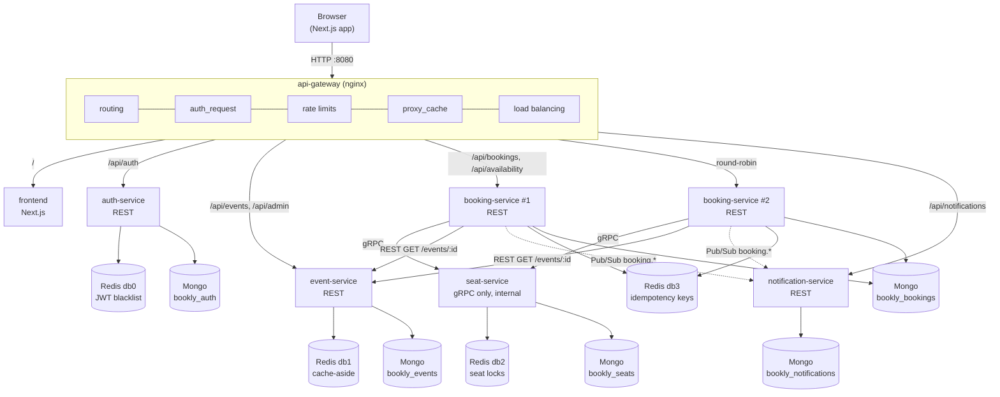
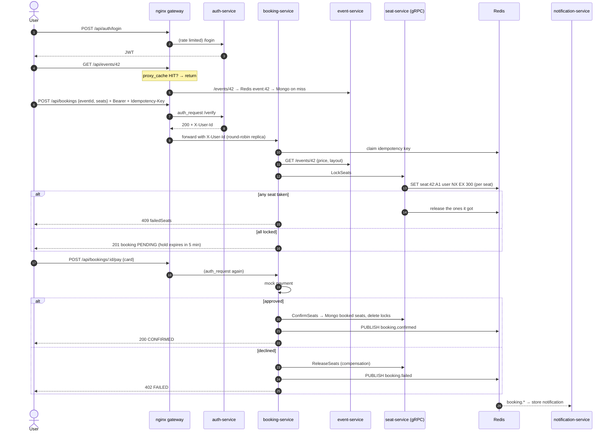

# Bookly 🎟️

**Event ticket booking built as loosely coupled microservices.** Browse events, pick the exact seats you want on a live seat map, hold them for five minutes, pay, and get a ticket. Under the hood the project uses an nginx API gateway, REST and gRPC, Redis in four different roles, and per-service MongoDB databases.

     

---

## Table of contents

1. [Quick start](#quick-start)
2. [Architecture](#architecture)
3. [The services](#the-services)
4. [Where each technology is used](#where-each-technology-is-used)
5. [Booking a seat, step by step](#booking-a-seat-step-by-step)
6. [API reference](#api-reference)
7. [Project structure](#project-structure)
8. [Configuration (`.env`)](#configuration-env)
9. [Testing](#testing)
10. [Local development without Docker](#local-development-without-docker)
11. [Design decisions and trade-offs](#design-decisions-and-trade-offs)
12. [Troubleshooting](#troubleshooting)

---

## Quick start

**Prerequisites:** Docker Desktop (Compose v2) and Node.js 20+. Node is only needed for the test scripts.

```bash
git clone https://github.com/UtkarshWoc/Bookly.git
cd Bookly
cp .env.example .env          # then set a long random JWT_SECRET
docker compose up -d --build  # first build takes a few minutes
```

| What | URL |
| --- | --- |
| Web app | http://localhost:8080 |
| API explorer (try every endpoint) | http://localhost:8080/explorer |
| REST API (through the gateway) | http://localhost:8080/api/... |
| gRPC proxy to seat-service (dev only, loopback) | `127.0.0.1:9090` |

**Demo accounts and cards**

| | |
| --- | --- |
| Admin login | `admin@bookly.dev` / `Admin@12345` (from `.env`, created on first start) |
| Card that succeeds | `4242 4242 4242 4242`, any future expiry, any CVC |
| Card that is declined | `4000 0000 0000 0002` |

Eight sample events are seeded automatically (`SEED_EVENTS=true`).

---

## Architecture



- **Only the gateway is published to the host.** Every service sits on the private Docker network, which is why services can trust the `X-User-Id` header the gateway forwards.
- **Each service owns its data.** It has its own logical MongoDB database and its own Redis database index. No service ever reads another service's tables.
- **Services talk through contracts only:** a REST URL, the `proto/seat.proto` file, or a Pub/Sub message shape. There is no shared code library, and each service builds and deploys independently.

---

## The services

| Service | Protocol | Responsibility | Storage |
| --- | --- | --- | --- |
| **api-gateway** | HTTP, HTTP/2 | Single entry point: routing, JWT check via `auth_request`, rate limiting, response caching, load balancing, JSON error pages | nginx disk cache |
| **auth-service** | REST | Register, login, issue JWTs, `/verify` for nginx, logout via a token blacklist, bootstrap admin | Mongo `bookly_auth` + Redis db0 |
| **event-service** | REST | Event catalog (list, search, filter, detail), admin create/update/delete, seed data | Mongo `bookly_events` + Redis db1 cache |
| **seat-service** | **gRPC only** | Lock, confirm and release seats; seat map. Not reachable from outside | Redis db2 locks + Mongo `bookly_seats` (sold seats) |
| **booking-service** ×2 | REST | Orchestrates hold → pay → confirm, calls seat-service over gRPC, mock payment, compensation, idempotency | Mongo `bookly_bookings` + Redis db3 |
| **notification-service** | REST + Pub/Sub | Subscribes to `booking.*` events, stores in-app notifications, logs simulated emails | Mongo `bookly_notifications` |
| **frontend** | HTTP | Next.js app: events, seat map, checkout, tickets, admin, API explorer | — |

---

## Where each technology is used

### nginx ([`api-gateway/templates/default.conf.template`](api-gateway/templates/default.conf.template))

| Feature | How |
| --- | --- |
| Routing | `/api/auth/*` → auth, `/api/events*` and `/api/admin/*` → event, `/api/bookings*` and `/api/availability/*` → booking, `/api/notifications*` → notification, `/` → frontend |
| Auth offloading | `auth_request /_auth_verify` calls auth-service `/verify`; `auth_request_set` copies `X-User-Id` / `X-User-Role` into the upstream request. Downstream services never parse a JWT. Public routes **blank** those headers so clients can't spoof them |
| Rate limiting | `limit_req` at 5 req/min per IP on login/register (regex location, so `/LOGIN/` can't bypass it) and 20 req/s on booking routes. Exceeding it returns a JSON 429 |
| Response caching | `proxy_cache` on public `GET /api/events*` for 15s with `proxy_cache_lock` and stale-while-revalidate. Exposed as the `X-Gateway-Cache: HIT/MISS` header |
| Load balancing | `upstream booking_service` resolves to both replicas, round-robin with `max_fails`/`fail_timeout`. The replica that answered is shown in the `X-Served-By` header |
| gRPC proxying | A second `server` with `http2 on` and `grpc_pass` to seat-service, bound to `127.0.0.1:9090` for tooling only |

The config is a **template**. nginx's entrypoint fills in ports, rate limits and cache TTLs from the same root `.env` with `envsubst`.

### Redis: four different jobs

| # | Job | Where | Keys |
| --- | --- | --- | --- |
| 1 | **Cache-aside** for event detail | event-service | `event:{id}` with TTL. Deleted on admin update/delete. Exposed as the `X-Cache: HIT/MISS` header |
| 2 | **Distributed seat lock** | seat-service | `SET seat:{eventId}:{seatNo} {userId} NX EX 300`. Two users can't hold the same seat, and abandoned holds expire on their own. Release is a Lua compare-and-delete so you can only free your own lock |
| 3 | **JWT blacklist** (logout) | auth-service | `jwt:blacklist:{jti}` with TTL equal to the token's remaining lifetime |
| 4 | **Idempotency keys** | booking-service | `idem:{user}:{route}:{key}`, so a retried `POST /bookings` or `/pay` replays the first response instead of creating a duplicate or charging twice. Shared by both replicas |

Bonus: **Pub/Sub**. booking-service publishes `booking.confirmed / failed / cancelled` on `bookly.bookings`, and notification-service consumes them.

### gRPC ([`proto/seat.proto`](proto/seat.proto))

```proto
service SeatService {
  rpc LockSeats(LockRequest)       returns (LockResponse);
  rpc ConfirmSeats(ConfirmRequest) returns (ConfirmResponse);
  rpc ReleaseSeats(ReleaseRequest) returns (ReleaseResponse);
  rpc GetSeatMap(SeatMapRequest)   returns (SeatMapResponse);
}
```

- **booking-service is the client** ([`clients/seat.client.js`](services/booking-service/src/clients/seat.client.js)). Every call has a **deadline** (`GRPC_DEADLINE_MS`) and up to `GRPC_MAX_RETRIES` **retries with exponential backoff** on `UNAVAILABLE` and `DEADLINE_EXCEEDED`. Retrying is safe because every RPC is idempotent. If seat-service is down, the user gets a clean `503` instead of a hang.
- Stubs are generated from the `.proto` at runtime with `@grpc/proto-loader`. The `.proto` reaches both images through a Docker Compose `additional_contexts` entry, so it is the only artifact the two services share.

---

## Booking a seat, step by step



If the user never pays, nothing needs cleaning up. The Redis lock expires after `SEAT_LOCK_TTL_SECONDS`, and the booking is marked `EXPIRED` the next time it is read.

**Booking states:** `PENDING` → `CONFIRMED` | `FAILED` | `CANCELLED` | `EXPIRED`

**Abuse protection:** at most `MAX_ACTIVE_HOLDS_PER_USER` unpaid holds, and at most `MAX_SEATS_PER_BOOKING` seats held per event. Hold creation is serialized per user with a short Redis mutex, so parallel requests can't slip past those limits.

---

## API reference

All routes are relative to `http://localhost:8080/api`. Access levels:

- **Public:** no token needed.
- **User:** `Authorization: Bearer <jwt>`, verified by nginx.
- **Admin:** a user token whose role is `admin`.

The **API explorer** at `/explorer` lets you call each of these from the browser and highlights the interesting headers.

### auth-service

| Method | Path | Access | Description |
| --- | --- | --- | --- |
| POST | `/auth/register` | Public | `{ name, email, password }` → `{ user, token, expiresAt }` (rate limited) |
| POST | `/auth/login` | Public | `{ email, password }` → `{ user, token, expiresAt }` (5/min per IP) |
| GET | `/auth/me` | User | Current profile |
| GET | `/auth/verify` | User | Used by nginx; returns `X-User-Id`, `X-User-Role` headers |
| POST | `/auth/logout` | User | Blacklists the token until it expires |

### event-service

| Method | Path | Access | Description |
| --- | --- | --- | --- |
| GET | `/events` | Public | Query: `q, category, city, upcoming (true), page, limit (≤50)` → `{ data, pagination }` |
| GET | `/events/categories` | Public | `{ categories }` |
| GET | `/events/:id` | Public | `{ event }` + `X-Cache`, `X-Gateway-Cache` headers |
| POST | `/admin/events` | Admin | Create: `{ title, description, category, venue, city, startsAt, price, currency, layout: { rows, seatsPerRow } }` |
| PATCH | `/admin/events/:id` | Admin | Partial update; invalidates Redis cache |
| DELETE | `/admin/events/:id` | Admin | Delete (204) |

### booking-service

| Method | Path | Access | Description |
| --- | --- | --- | --- |
| GET | `/availability/:eventId` | Public | `{ lockedSeats, bookedSeats, lockTtlSeconds }`, never cached |
| GET | `/bookings` | User | Your bookings |
| POST | `/bookings` | User | Hold seats: `{ eventId, seats: ["A1","A2"] }` → 201 `PENDING`. Supports `Idempotency-Key` |
| GET | `/bookings/:id` | User | One booking (only your own) |
| POST | `/bookings/:id/pay` | User | `{ cardHolder, cardNumber, expiry: "MM/YY", cvc }` → `CONFIRMED`, or 402 if declined. Supports `Idempotency-Key` |
| POST | `/bookings/:id/cancel` | User | Release a pending hold |

### notification-service

| Method | Path | Access | Description |
| --- | --- | --- | --- |
| GET | `/notifications` | User | `{ data, unread }` |
| POST | `/notifications/read-all` | User | Mark all read |
| PATCH | `/notifications/:id/read` | User | Mark one read |

### Errors

Every service and the gateway return the same shape:

```json
{ "error": { "status": 409, "message": "Some seats were just taken by someone else", "details": { "failedSeats": ["A2"] } } }
```

| Status | Meaning |
| --- | --- |
| 400 | Validation failed (`details` lists each field) |
| 401 | Missing, invalid, expired or revoked token (answered by nginx) |
| 402 | Payment declined (seats released) |
| 403 | Not allowed (e.g. non-admin, or a write to `/api/events`) |
| 404 | Not found |
| 409 | Seat conflict, wrong booking state, or a request already in flight |
| 422 | `Idempotency-Key` reused with a different body |
| 429 | Rate limit or hold limit reached |
| 503 | A dependency (seat-service, event catalog) is unavailable |

---

## Project structure

```text
Bookly/
├── .env.example                 # the single source of configuration (copy to .env)
├── docker-compose.yml           # whole stack; every value comes from .env
├── proto/
│   └── seat.proto               # gRPC contract between booking-service and seat-service
├── api-gateway/                 # nginx
│   ├── templates/default.conf.template
│   └── snippets/                # proxy-common.conf, auth-required.conf
├── services/
│   ├── auth-service/
│   ├── event-service/
│   ├── seat-service/
│   ├── booking-service/
│   └── notification-service/
├── frontend/                    # Next.js app (all UI code lives here)
└── scripts/
    ├── smoke-test.js            # end-to-end test through the gateway
    └── seat-race/               # 50 concurrent LockSeats for one seat
```

### Inside every backend service (MVC)

```text
services/<name>-service/
├── Dockerfile
├── package.json
└── src/
    ├── server.js          # bootstrap: connect DB/Redis, start server, graceful shutdown
    ├── app.js             # express app: security headers, parsers, routes, error handler
    ├── config/            # env parsing (reads root .env), database, redis
    ├── models/            # Mongoose schemas                     (M)
    ├── controllers/       # HTTP/gRPC in → service call → out    (C)
    ├── routes/            # URL → middleware → controller        (routing)
    ├── services/          # business logic
    ├── middlewares/       # validate, auth/identity, idempotency, errors
    ├── validators/        # zod request schemas
    ├── clients/           # (booking) outbound gRPC/REST clients
    ├── subscribers/       # (notification) Redis Pub/Sub consumers
    └── utils/             # ApiError, logger
```

The "view" in MVC is JSON. The UI lives entirely in `frontend/`:

```text
frontend/src/
├── app/            # routes: /, /events/[id], /bookings, /bookings/[id], /login, /register, /admin, /explorer
├── components/     # ui/, layout/, events/, seats/, booking/, admin/, explorer/, auth/
├── context/        # AuthContext (session), ToastContext
├── hooks/          # useCountdown, useRequireAuth
└── lib/
    ├── api/        # client.js + one module per backend service
    ├── endpoints.js# catalog that powers the API explorer
    ├── format.js
    └── seats.js
```

---

## Configuration (`.env`)

There is **one** `.env` at the repository root. Docker Compose reads it for `${VAR}` interpolation and passes it to every container as its `env_file`. nginx renders its config from it. When run outside Docker, each Node service and the Next.js config load the same file by path. `.env` is git-ignored; `.env.example` is the committed template.

| Group | Variables |
| --- | --- |
| Gateway | `GATEWAY_PORT`, `GRPC_GATEWAY_PORT`, `LOGIN_RATE_LIMIT`, `LOGIN_RATE_BURST`, `API_RATE_LIMIT`, `GATEWAY_EVENTS_CACHE_SECONDS` |
| Infra | `MONGO_URI`, `MONGO_PORT`, `REDIS_PORT` |
| auth-service | `AUTH_SERVICE_PORT`, `AUTH_DB_NAME`, `AUTH_REDIS_URL`, `JWT_SECRET`, `JWT_EXPIRES_IN`, `BCRYPT_ROUNDS`, `ADMIN_NAME`, `ADMIN_EMAIL`, `ADMIN_PASSWORD` |
| event-service | `EVENT_SERVICE_PORT`, `EVENT_DB_NAME`, `EVENT_REDIS_URL`, `EVENT_CACHE_TTL_SECONDS`, `SEED_EVENTS` |
| seat-service | `SEAT_SERVICE_PORT`, `SEAT_DB_NAME`, `SEAT_REDIS_URL`, `SEAT_LOCK_TTL_SECONDS` |
| booking-service | `BOOKING_SERVICE_PORT`, `BOOKING_REPLICAS`, `BOOKING_DB_NAME`, `BOOKING_REDIS_URL`, `SEAT_SERVICE_ADDR`, `EVENT_SERVICE_URL`, `EVENT_SERVICE_TIMEOUT_MS`, `GRPC_DEADLINE_MS`, `GRPC_MAX_RETRIES`, `IDEMPOTENCY_TTL_SECONDS`, `MAX_SEATS_PER_BOOKING`, `MAX_ACTIVE_HOLDS_PER_USER`, `PAYMENT_LATENCY_MS`, `PAYMENT_DECLINE_CARD` |
| notification-service | `NOTIFICATION_SERVICE_PORT`, `NOTIFICATION_DB_NAME`, `NOTIFICATION_REDIS_URL`, `BOOKING_EVENTS_CHANNEL` |
| frontend | `FRONTEND_PORT`, `API_GATEWAY_URL` (dev proxy target) |

> ⚠️ Always change `JWT_SECRET` and `ADMIN_PASSWORD` before running anywhere other than your own machine.

---

## Testing

### End-to-end smoke test (24 checks)

```bash
node scripts/smoke-test.js            # default http://localhost:8080
```

It covers:

- registration, login and logout, and that a revoked token is rejected
- cache headers on event reads
- seat holds and seat conflicts (409)
- idempotent replay of a retried request
- a declined payment and the seat release that follows it
- confirmation, and that paying twice charges once
- cancellation, and that users can't read each other's bookings
- round-robin across both booking replicas
- Pub/Sub notifications

It picks free seats on its own, so you can rerun it at any time.

### Double-booking race test

```bash
cd scripts/seat-race && npm install
node race.js 50          # 50 users race for one seat through nginx grpc_pass
```

Expected output: `winners: 1, rejected: 49 … PASS`.

### Try the resilience yourself

```bash
docker compose stop seat-service
curl -i localhost:8080/api/availability/<eventId>   # retries with backoff, then a clean 503
docker compose start seat-service
```

```bash
docker compose up -d --scale booking-service=3      # start a third replica
docker compose restart api-gateway                  # nginx resolves upstreams at startup, so reload it
docker compose logs -f notification-service         # watch "[email -> user …]" lines as you book
```

---

## Local development without Docker

Each service is a plain Node app that reads the root `.env`.

1. Start just the infrastructure: `docker compose up -d mongo redis`. To reach them from your host, add `ports: ["27017:27017"]` and `["6379:6379"]` to those services.
2. In `.env`, point hostnames at localhost:
   - `MONGO_URI=mongodb://localhost:27017`
   - `*_REDIS_URL=redis://localhost:6379/N`
   - `SEAT_SERVICE_ADDR=localhost:50051`
   - `EVENT_SERVICE_URL=http://localhost:8002`
3. Run a service with hot reload: `cd services/booking-service && npm install && npm run dev`.
4. Run the frontend: `cd frontend && npm install && npm run dev`. It proxies `/api/*` to `API_GATEWAY_URL`.

The gateway's features (`auth_request`, caching, rate limits) only exist in nginx. So for the full experience, keep using `docker compose up` and rebuild a single service with `docker compose up -d --build booking-service`.

---

## Design decisions and trade-offs

**Why the gateway validates auth once.** One component holds JWT logic. Services only see a trusted `X-User-Id`, so they stay smaller and can be written in any language. Logout works everywhere instantly because every request passes the blacklist check in one place. The cost: services must never be exposed directly, so only nginx publishes a port.

**REST vs gRPC, side by side.**
- REST (browser → gateway → services, booking → event) is easy to cache, debug with curl and proxy through nginx.
- gRPC (booking → seat) gives a typed contract in `seat.proto`, compact binary messages, first-class deadlines and status codes.

The rough edges show up too: browsers can't speak raw gRPC, so seat availability is exposed through a small REST facade.

**How a lock with a TTL prevents double-booking.**
- `SET … NX` is atomic, so exactly one client wins each seat, as the race test shows.
- `EX 300` means a crashed client or an abandoned checkout can never block a seat forever.
- A unique `(eventId, seatNo)` MongoDB index is the last line of defense once a seat is sold.

**Cache layers and what invalidation costs.** Reads hit nginx (15s), then Redis (60s), then MongoDB. An admin edit deletes the Redis key immediately. Open-source nginx has no purge, though, so the gateway copy can be up to `GATEWAY_EVENTS_CACHE_SECONDS` stale. That's why the TTL is short, and why the real-time seat map is never cached.

**Compensation instead of distributed transactions.** A booking spans seat-service and booking-service. Rather than a two-phase commit, every failure path runs an explicit compensating step (`ReleaseSeats`), and TTLs are the safety net.

**Loose coupling, deliberately.**
- No shared npm package. Each service carries its own tiny `ApiError` and logger, so it can change without coordinating releases.
- Booking stores a snapshot of the event, so reading a booking never needs event-service.
- Notifications are fire-and-forget Pub/Sub, so booking doesn't know who listens.

**MongoDB instead of Postgres.** The original plan named Postgres. This build uses MongoDB with one logical database per service, which keeps the same ownership boundaries. Swapping a service's persistence only touches its `models/` and `config/database.js`.

**Known limitations (it's a learning project):**
- The JWT is stored in `localStorage`. A production build would use an httpOnly cookie.
- Payments are mocked.
- Pub/Sub is at-most-once. Redis Streams or a broker would add delivery guarantees.
- No TLS between gateway and services.

---

## Troubleshooting

| Symptom | Fix |
| --- | --- |
| `Missing required environment variable` on start | You forgot `cp .env.example .env` |
| Gateway exits with `host not found in upstream` | A service is unhealthy. Run `docker compose ps` and `docker compose logs <service>` |
| Every login returns 429 | You hit the 5/min login limit. Wait a minute or raise `LOGIN_RATE_LIMIT` |
| Event edits don't show immediately | Expected: the gateway caches the catalog for `GATEWAY_EVENTS_CACHE_SECONDS` |
| Port 8080 or 9090 already in use | Change `GATEWAY_PORT` / `GRPC_GATEWAY_PORT` in `.env` |
| Start fresh | `docker compose down -v` (deletes the Mongo and Redis volumes) |
